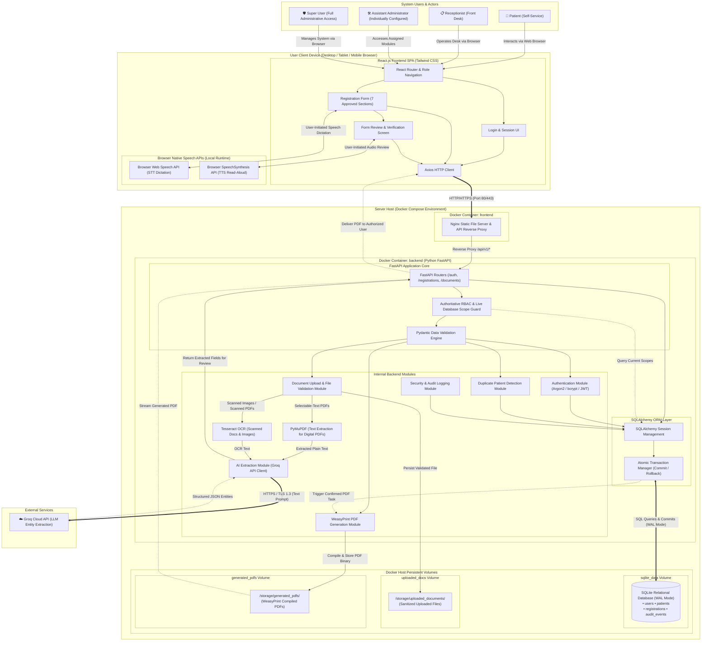
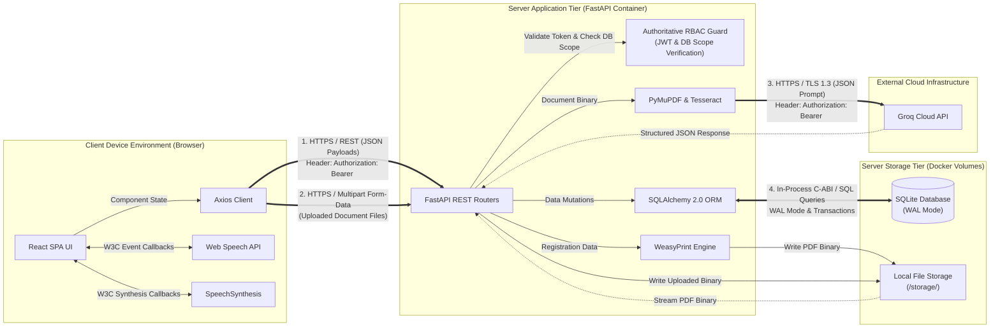
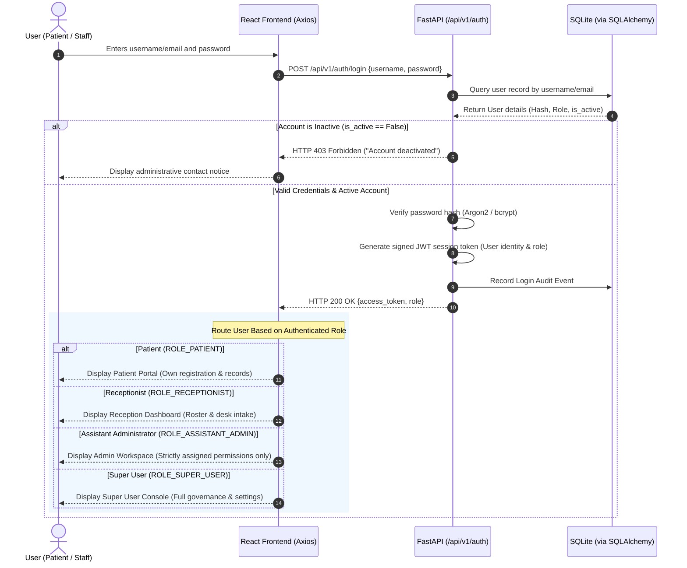
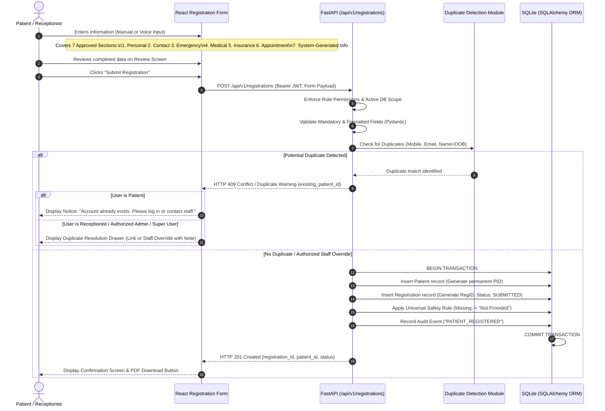
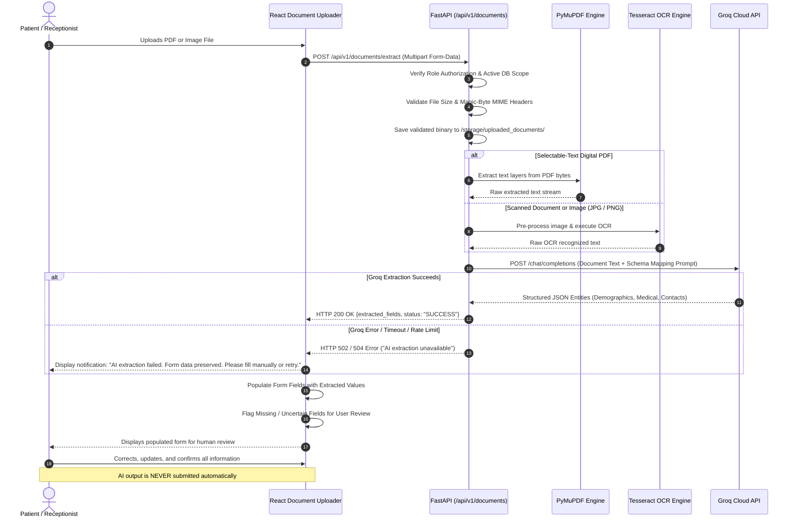
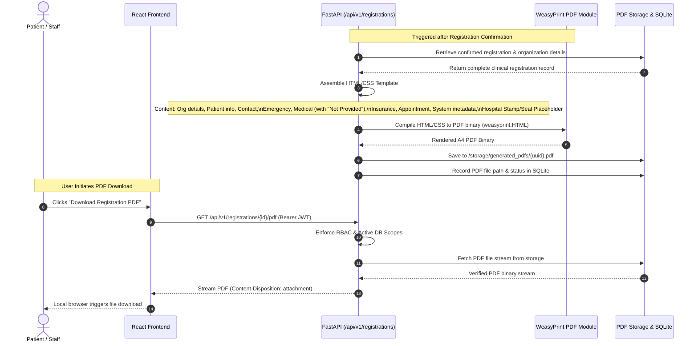
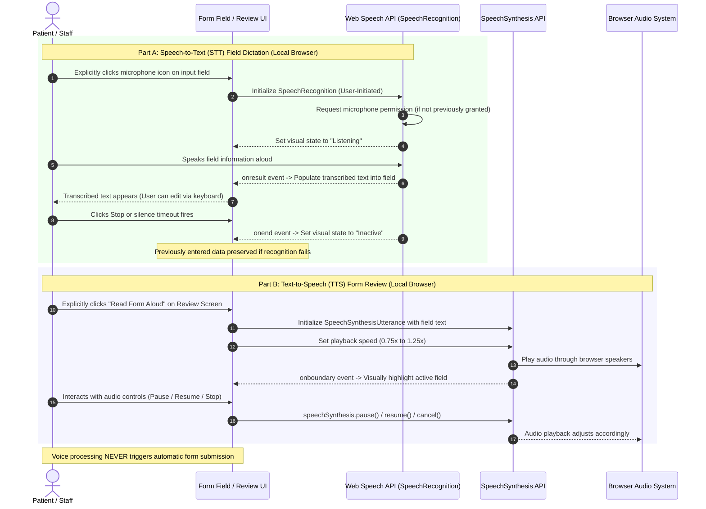
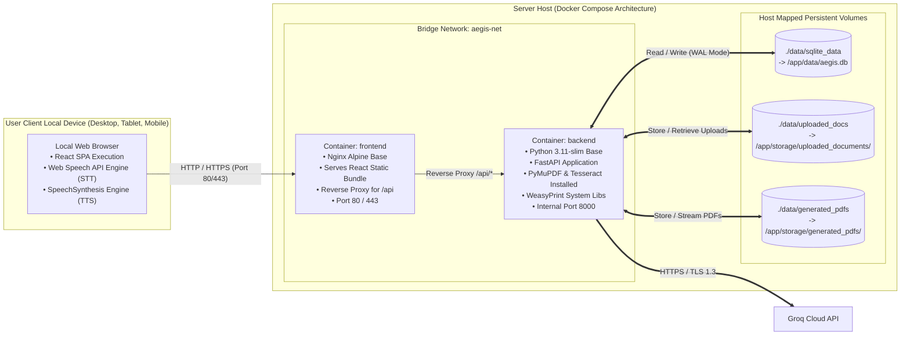

# High-Level Design (HLD) Specification
## AI-Powered Smart Patient Registration System

**Document Identifier:** HLD-AEGIS-2026-V1.4  
**Document Version:** 1.4.0 (Pending Final Review)  
**Publication Date:** October 28, 2026  
**Status:** Pending Final Review — Focused on 24-Hour MVP  
**Target Systems:** Web Application (Responsive Desktop, Tablet & Mobile)  
**Traceability:** Aligned strictly with the approved Software Requirements Specification ([AI_Powered_Smart_Patient_Registration_System_SRS.md](file:///c:/Surya/AI%20Form%20Application/AI_Powered_Smart_Patient_Registration_System_SRS.md))

---

## Change Summary: Corrections from Version 1.3 to Version 1.4

This document represents the updated High-Level Design (Version 1.4) for the **AI-Powered Smart Patient Registration System**. This update standardizes permission identifiers, hardens backend authorization against stale permissions, formalizes duplicate-resolution permissions, and corrects the client browser deployment boundary for speech APIs:

| Issue # | Correction Area | Description of Changes Implemented in Version 1.4 |
| :---: | :--- | :--- |
| **1** | **Standardize Assistant Administrator Scope Identifier** | • Standardized the scope identifier for receptionist management to **`accounts:receptionist_manage`** across the entire document.<br>• Replaced the truncated/misspelled identifier (`accounts:receptionist_mg`) in the RBAC matrix and text narratives. |
| **2** | **Prevent Stale JWT Permissions (Dynamic Revocation Strategy)** | • Updated the backend authorization model: JWT claims identify the user and validate authenticity, but **JWT permission claims are no longer treated as the sole authoritative source** for dynamic Assistant Administrator permissions.<br>• For Assistant Administrators, the FastAPI backend must verify current permissions against the **authoritative database** (or a reliable permission-version/timestamp mechanism) on protected requests.<br>• Revocations or modifications made by the Super User take effect immediately upon the next API request. A user never retains revoked privileges merely because an older JWT remains unexpired. |
| **3** | **Define Duplicate Resolution Authorization Model** | • Clarified the authorization model for duplicate patient warnings:<br>  - **Patient users:** Strictly prohibited from resolving or overriding duplicate warnings (`DENY`).<br>  - **Receptionists:** Authorized to resolve duplicates (Link or Override) as part of front-desk intake (`ALLOW`).<br>  - **Super Users:** Complete administrative authority to resolve duplicates (`ALLOW`).<br>  - **Assistant Administrators:** May resolve duplicates **only if explicitly granted** the new named scope: **`duplicates:resolve`** (`CONFIGURABLE`, denied by default).<br>• Enforced on the backend; decisions and overrides require staff clinical justification and are committed to `audit_events`. Records are **never automatically merged**. |
| **4** | **Correct Browser Speech API Deployment Boundary** | • Relocated the **Web Speech API (STT)** and **SpeechSynthesis API (TTS)** in Diagram 1 (Overall Architecture) and Diagram 8 (Deployment Topology) out of the frontend Docker container boundary.<br>• Accurately positioned browser speech capabilities within the **User's Local Client Device / Browser Environment**, communicating with the React SPA locally while the containerized frontend serves static assets. |
| **5** | **SRS-to-HLD Consistency Audit & Checklist** | • Verified all four roles, seven registration sections, 13 approved technologies, separate proposed dependencies, medical safety defaults (`"Not Provided"`), and human-in-the-loop AI extraction.<br>• Verified that precisely **eight (8) architectural diagrams** are present, numbered, and consistent.<br>• Document status designated as **Pending Final Review**. |

---

## Table of Contents

1. [Executive Summary & 24-Hour MVP Scope](#1-executive-summary--24-hour-mvp-scope)
2. [Approved Technology Stack & Proposed Supporting Dependencies](#2-approved-technology-stack--proposed-supporting-dependencies)
   - [2.1 The 13 Approved Core Technologies](#21-the-13-approved-core-technologies)
   - [2.2 Proposed Supporting Dependencies & Deployment Tools](#22-proposed-supporting-dependencies--deployment-tools)
3. [User Roles, Hierarchy & Permission Boundaries](#3-user-roles-hierarchy--permission-boundaries)
   - [3.1 Role Hierarchy & System Actor Definitions](#31-role-hierarchy--system-actor-definitions)
   - [3.2 Assistant Administrator Permission Governance & Named Scopes](#32-assistant-administrator-permission-governance--named-scopes)
   - [3.3 Comprehensive Role-Based Access Control (RBAC) Matrix](#33-comprehensive-role-based-access-control-rbac-matrix)
   - [3.4 Dynamic Authorization & Anti-Stale-Permission Enforcement](#34-dynamic-authorization--anti-stale-permission-enforcement)
4. [Seven (7) Approved Registration Form Sections](#4-seven-7-approved-registration-form-sections)
   - [4.1 Form Structure & Universal Clinical Safety Rule](#41-form-structure--universal-clinical-safety-rule)
   - [4.2 Detailed Field Specifications](#42-detailed-field-specifications)
5. [Main System Components](#5-main-system-components)
6. [Overall System Architecture Diagram (Diagram 1)](#6-overall-system-architecture-diagram-diagram-1)
7. [Component Communication & Protocol Flow Diagram (Diagram 2)](#7-component-communication--protocol-flow-diagram-diagram-2)
8. [Major End-to-End System Workflows](#8-major-end-to-end-system-workflows)
   - [8.1 Workflow 1: User Authentication & Role-Based Navigation (Diagram 3)](#81-workflow-1-user-authentication--role-based-navigation-diagram-3)
   - [8.2 Workflow 2: Patient Registration Intake & Persistence (Diagram 4)](#82-workflow-2-patient-registration-intake--persistence-diagram-4)
   - [8.3 Workflow 3: Document Processing & AI Clinical Extraction (Diagram 5)](#83-workflow-3-document-processing--ai-clinical-extraction-diagram-5)
   - [8.4 Workflow 4: Authoritative WeasyPrint PDF Generation & Download (Diagram 6)](#84-workflow-4-authoritative-weasyprint-pdf-generation--download-diagram-6)
   - [8.5 Workflow 5: User-Initiated Voice Interaction (STT & TTS) (Diagram 7)](#85-workflow-5-user-initiated-voice-interaction-stt--tts-diagram-7)
9. [Security Controls & Privacy Requirements](#9-security-controls--privacy-requirements)
10. [Docker Deployment Topology & Storage Architecture (Diagram 8)](#10-docker-deployment-topology--storage-architecture-diagram-8)
11. [SRS-to-HLD Traceability & Consistency Checklist](#11-srs-to-hld-traceability--consistency-checklist)
12. [Remaining Decisions Requiring User Approval During LLD](#12-remaining-decisions-requiring-user-approval-during-lld)
13. [Document Sign-Off & Next Phase Boundary](#13-document-sign-off--next-phase-boundary)

---

## 1. Executive Summary & 24-Hour MVP Scope

The **AI-Powered Smart Patient Registration System** streamlines healthcare admissions through multi-modal intake: manual keyboard entry, digital PDF text extraction, scanned document OCR, and browser-native voice assistance, backed by cloud AI entity extraction and authoritative backend PDF compilation.

### MVP Architectural Principles
1. **Scope Discipline:** Focus strictly on the requirements approved in the SRS for a 24-hour MVP working application. Extraneous features (such as digital signature pads, QR code generators, triage barcode systems, and unapproved local regex fallback engines) are omitted.
2. **Authoritative Server-Side Governance:** All business rules, role-based access control, input validation, and document processing are enforced strictly on the **FastAPI backend**. Client-side UI controls are usability aids only.
3. **Medical Information Safety:** Missing medical information must be explicitly stored and displayed as **"Not Provided"** or **"Unknown"**. The system **never assumes that an unentered field represents a negative clinical finding**.
4. **Human-in-the-Loop AI Boundary:** The Groq AI extraction engine serves solely as an administrative pre-filling aid. AI-extracted values are strictly provisional and must be verified and confirmed by an authorized user before database persistence. AI output is never submitted automatically.
5. **Deterministic PDF Dossiers:** Official registration dossiers are rendered authoritatively by the FastAPI backend using **WeasyPrint**, ensuring consistent layout, server-side data verification, and secure role-based delivery.

---

## 2. Approved Technology Stack & Proposed Supporting Dependencies

### 2.1 The 13 Approved Core Technologies
The architecture strictly employs only the previously approved technology stack:

```
┌────────────────────────────────────────────────────────────────────────┐
│                        APPROVED TECHNOLOGY STACK                       │
├─────────────────────┬──────────────────┬───────────────────────────────┤
│ System Role         │ Technology       │ Operational Responsibility    │
├─────────────────────┼──────────────────┼───────────────────────────────┤
│ Frontend Framework  │ React.js         │ Single Page Application (SPA) │
│ Frontend Styling    │ Tailwind CSS     │ Responsive layout & styles    │
│ API Client          │ Axios            │ HTTP client communication     │
│ Backend Service     │ Python FastAPI   │ REST API & business logic     │
│ Database Engine     │ SQLite           │ Relational persistence        │
│ ORM Mapping         │ SQLAlchemy       │ Relational data modeling      │
│ Cloud AI Inference  │ Groq API         │ Clinical entity extraction    │
│ PDF Text Extraction │ PyMuPDF          │ Backend digital PDF parsing   │
│ Optical OCR Engine  │ Tesseract OCR    │ Scanned document character OCR│
│ Speech-to-Text      │ Web Speech API   │ Browser-native speech input   │
│ Text-to-Speech      │ SpeechSynthesis  │ Browser-native audio readout  │
│ Document PDF Engine │ WeasyPrint       │ Backend PDF generation        │
│ Containerization    │ Docker & Compose │ Containerized deployment      │
└─────────────────────┴──────────────────┴───────────────────────────────┘
```

### 2.2 Proposed Supporting Dependencies & Deployment Tools
*(Requires User Approval / Confirmation in Low-Level Design)*

To implement the approved technology stack effectively without silently introducing mandatory technologies into the core architecture, the following deployment tools and Python libraries are identified as **proposed supporting dependencies**:

```
┌────────────────────────────────────────────────────────────────────────┐
│            PROPOSED SUPPORTING DEPENDENCIES & DEPLOYMENT TOOLS         │
├─────────────────────┬──────────────────┬───────────────────────────────┤
│ Proposed Dependency │ Category         │ Proposed Architectural Role   │
├─────────────────────┼──────────────────┼───────────────────────────────┤
│ Uvicorn             │ Deployment / ASGI│ Lightweight ASGI server to run│
│                     │                  │ FastAPI inside container      │
├─────────────────────┼──────────────────┼───────────────────────────────┤
│ Nginx               │ Deployment / Web │ Static file server & reverse  │
│                     │                  │ proxy for React bundle        │
├─────────────────────┼──────────────────┼───────────────────────────────┤
│ Pydantic (v2)       │ Backend Library  │ Request/response schema       │
│                     │                  │ validation for FastAPI        │
├─────────────────────┼──────────────────┼───────────────────────────────┤
│ Argon2-cffi         │ Backend Library  │ Proposed library for Argon2id │
│                     │                  │ secure password hashing       │
├─────────────────────┼──────────────────┼───────────────────────────────┤
│ Passlib / Bcrypt    │ Backend Library  │ Proposed alternative library  │
│                     │                  │ for bcrypt password hashing   │
├─────────────────────┼──────────────────┼───────────────────────────────┤
│ Python-Jose / PyJWT │ Backend Library  │ Signed JWT token encoding and │
│                     │                  │ validation                    │
├─────────────────────┼──────────────────┼───────────────────────────────┤
│ Python-Multipart    │ Backend Library  │ Streaming multipart file      │
│                     │                  │ upload parser for FastAPI     │
├─────────────────────┼──────────────────┼───────────────────────────────┤
│ Jinja2              │ Backend Library  │ HTML templating engine for    │
│                     │                  │ WeasyPrint PDF layout input   │
├─────────────────────┼──────────────────┼───────────────────────────────┤
│ Pillow (PIL)        │ Backend Library  │ Image file loading prior to   │
│                     │                  │ Tesseract OCR processing      │
└─────────────────────┴──────────────────┴───────────────────────────────┘
```

*Architectural Boundary:* None of the above proposed dependencies alter the core 13 technologies or introduce unapproved user-facing functionality. They are subject to formal confirmation during the LLD phase.

---

## 3. User Roles, Hierarchy & Permission Boundaries

### 3.1 Role Hierarchy & System Actor Definitions

The system enforces four distinct primary actor roles:

```
                            ┌────────────────────────┐
                            │       SUPER USER       │
                            │  Complete Admin Access │
                            └───────────┬────────────┘
                                        │
                 ┌──────────────────────┴──────────────────────┐
                 ▼ (Provisions & configures)                   ▼ (Provisions & manages)
      ┌─────────────────────────┐                   ┌─────────────────────────┐
      │ ASSISTANT ADMINISTRATOR │                   │       RECEPTIONIST      │
      │ Individually Configured │                   │ Desk Intake & Roster    │
      └─────────────────────────┘                   └─────────────────────────┘
                                                               │
                                                               ▼ (Registers on behalf)
                                                    ┌─────────────────────────┐
                                                    │         PATIENT         │
                                                    │ Self-Service Intake     │
                                                    └─────────────────────────┘
```

1. **PATIENT (`ROLE_PATIENT`)**:
   - External patient registering independently via self-service.
   - **Allowed Capabilities:** Self-register account, log in, upload own medical documents, create and submit own registration intake, view only own patient information, and download only own registration PDF.
   - **Strict Prohibitions:** Cannot view other patients' records; cannot search the patient database; cannot manage or create user accounts; cannot resolve or override duplicate warnings.

2. **RECEPTIONIST (`ROLE_RECEPTIONIST`)**:
   - Hospital front-desk admissions personnel.
   - **Allowed Capabilities:** View all patient details across the admissions roster, create new patient registrations on behalf of walk-in patients, upload and process patient documents, execute AI extraction (PyMuPDF and Tesseract), edit patient registration details, resolve duplicate patient warnings (Link or Staff Override with clinical note), and download registration PDFs for any patient.
   - **Strict Prohibitions:** Cannot create, update, or delete user accounts; cannot delete patient records.

3. **ASSISTANT ADMINISTRATOR (`ROLE_ASSISTANT_ADMIN`)**:
   - Delegated administrative officer created **strictly and exclusively by the Super User**.
   - **Allowed Capabilities:** Can **only perform explicitly assigned operations** configured by the Super User on an individual account basis.
   - **Strict Prohibitions:** Cannot create another Assistant Administrator or Super User account; cannot modify, extend, or elevate their own permissions; cannot delete patient records.

4. **SUPER USER (`ROLE_SUPER_USER`)**:
   - Executive clinical administrator with **complete administrative access**.
   - **Allowed Capabilities:** View, create, and edit all patient registrations; create and manage Patient, Receptionist, and Assistant Administrator accounts; assign and adjust Assistant Administrator permissions; deactivate user accounts; manage application and facility settings; resolve duplicate patient warnings; and view complete system audit logs.

### 3.2 Assistant Administrator Permission Governance & Named Scopes

To eliminate ambiguity regarding delegated administration, the system enforces the following architectural rules:
- **Denied by Default:** An Assistant Administrator possesses zero default operational permissions upon account creation. Every capability is denied unless explicitly assigned by the Super User.
- **Backend Enforcement:** The FastAPI backend verifies the presence of the specific permission scope in the caller's verified permissions (`Depends(get_current_active_user)` and `SecurityScopes`).
- **Strict Privilege Ceiling:** An Assistant Administrator can never be granted authority to create, edit, or deactivate another Assistant Administrator or Super User, nor can they alter their own permissions.

#### Complete Catalog of Configurable Permission Scopes

```
┌────────────────────────────────────────────────────────────────────────┐
│         ASSISTANT ADMINISTRATOR CONFIGURABLE PERMISSION SCOPES         │
├──────────────────────────┬──────────────────────────┬──────────────────┤
│ Named Scope Identifier   │ Operational Capability   │ Default & Rule   │
├──────────────────────────┼──────────────────────────┼──────────────────┤
│ records:view_own         │ View own patient profile │ DENIED by default│
├──────────────────────────┼──────────────────────────┼──────────────────┤
│ records:view_all         │ View full patient roster │ DENIED by default│
├──────────────────────────┼──────────────────────────┼──────────────────┤
│ records:edit             │ Edit registration details│ DENIED by default│
├──────────────────────────┼──────────────────────────┼──────────────────┤
│ documents:upload_own     │ Upload own documents     │ DENIED by default│
├──────────────────────────┼──────────────────────────┼──────────────────┤
│ documents:upload_all     │ Upload documents for any │ DENIED by default│
│                          │ patient                  │                  │
├──────────────────────────┼──────────────────────────┼──────────────────┤
│ ai:execute               │ Execute PyMuPDF & OCR    │ DENIED by default│
├──────────────────────────┼──────────────────────────┼──────────────────┤
│ voice:use                │ Use voice STT and TTS    │ DENIED by default│
├──────────────────────────┼──────────────────────────┼──────────────────┤
│ registrations:submit     │ Submit new registrations │ DENIED by default│
├──────────────────────────┼──────────────────────────┼──────────────────┤
│ duplicates:resolve       │ Resolve duplicate records│ DENIED by default│
│                          │ (Link / Staff Override)  │                  │
├──────────────────────────┼──────────────────────────┼──────────────────┤
│ pdf:download_own         │ Download own PDF dossier │ DENIED by default│
├──────────────────────────┼──────────────────────────┼──────────────────┤
│ pdf:download_all         │ Download any patient PDF │ DENIED by default│
├──────────────────────────┼──────────────────────────┼──────────────────┤
│ accounts:patient_manage  │ Create / manage patients │ DENIED by default│
├──────────────────────────┼──────────────────────────┼──────────────────┤
│ accounts:receptionist_manage│ Create / manage desk staff│ DENIED by default│
├──────────────────────────┼──────────────────────────┼──────────────────┤
│ accounts:deactivate      │ Deactivate user accounts │ DENIED by default│
├──────────────────────────┼──────────────────────────┼──────────────────┤
│ audit:view               │ View system audit logs   │ DENIED by default│
└──────────────────────────┴──────────────────────────┴──────────────────┘
```

### 3.3 Comprehensive Role-Based Access Control (RBAC) Matrix

| System Action / Resource | Patient | Receptionist | Assistant Administrator | Super User | Explicit Scope Identifier & Backend Enforcement Rule |
| :--- | :---: | :---: | :---: | :---: | :--- |
| **Self-Registration (Sign Up)** | **ALLOW** | DENY | DENY | DENY | Public endpoint; strictly assigns `ROLE_PATIENT` |
| **Login / Logout** | **ALLOW** | **ALLOW** | **ALLOW** | **ALLOW** | Authenticates active account (`is_active == 1`) |
| **Change Own Password** | **ALLOW** | **ALLOW** | **ALLOW** | **ALLOW** | Scoped to current authenticated session |
| **Upload Own Medical Documents** | **ALLOW** | **ALLOW** | **CONFIGURABLE** | **ALLOW** | Scope: `documents:upload_own` (DENIED by default for Admin) |
| **Upload Other Patients' Documents**| DENY | **ALLOW** | **CONFIGURABLE** | **ALLOW** | Scope: `documents:upload_all` (DENIED by default for Admin) |
| **Execute AI Extraction (PyMuPDF/OCR)**| **ALLOW** *(Own)*| **ALLOW** *(Any)*| **CONFIGURABLE** | **ALLOW** | Scope: `ai:execute` (DENIED by default for Admin) |
| **Voice Dictation (STT) & Audio (TTS)**| **ALLOW** | **ALLOW** | **CONFIGURABLE** | **ALLOW** | Scope: `voice:use` (DENIED by default for Admin) |
| **Submit Registration** | **ALLOW** *(Own)*| **ALLOW** *(Any)*| **CONFIGURABLE** | **ALLOW** | Scope: `registrations:submit` (DENIED by default for Admin) |
| **Edit Patient Registration Details**| DENY | **ALLOW** | **CONFIGURABLE** | **ALLOW** | Scope: `records:edit` (DENIED by default for Admin) |
| **Resolve Duplicate Patient Warnings**| **DENY** | **ALLOW** | **CONFIGURABLE** | **ALLOW** | Scope: `duplicates:resolve` (DENIED by default for Admin) |
| **View Own Patient Record** | **ALLOW** | **ALLOW** | **CONFIGURABLE** | **ALLOW** | Scope: `records:view_own` (DENIED by default for Admin) |
| **View All Patient Records & Roster** | DENY | **ALLOW** | **CONFIGURABLE** | **ALLOW** | Scope: `records:view_all` (DENIED by default for Admin) |
| **Download Own Registration PDF** | **ALLOW** | **ALLOW** | **CONFIGURABLE** | **ALLOW** | Scope: `pdf:download_own` (DENIED by default for Admin) |
| **Download Any Patient's PDF** | DENY | **ALLOW** | **CONFIGURABLE** | **ALLOW** | Scope: `pdf:download_all` (DENIED by default for Admin) |
| **Delete Patient Records** | **DENY** | **DENY** | **DENY (Strict)** | **DENY\*** | Hard deletion prohibited across all roles |
| **Create / Manage Patient Accounts** | DENY | DENY | **CONFIGURABLE** | **ALLOW** | Scope: `accounts:patient_manage` (DENIED by default for Admin) |
| **Create / Manage Receptionists** | DENY | DENY | **CONFIGURABLE** | **ALLOW** | Scope: `accounts:receptionist_manage` (DENIED by default for Admin) |
| **Create Assistant Administrators** | DENY | DENY | **DENY (Strict)** | **ALLOW** | **Super User exclusive authority** |
| **Modify Own Permissions** | DENY | DENY | **DENY (Strict)** | **ALLOW** | Self-escalation strictly blocked |
| **Deactivate User Accounts** | DENY | DENY | **CONFIGURABLE** | **ALLOW** | Scope: `accounts:deactivate` (DENIED by default for Admin) |
| **View System Audit Logs** | DENY | DENY | **CONFIGURABLE** | **ALLOW** | Scope: `audit:view` (DENIED by default for Admin) |
| **Manage Facility & App Settings** | DENY | DENY | DENY | **ALLOW** | Super User exclusive governance |

*\*Note on Record Deletion: Direct hard deletion is strictly prohibited across all roles to maintain patient medical history and audit trails. Account lifecycle management utilizes soft deactivation (`is_active = FALSE`).*

### 3.4 Dynamic Authorization & Anti-Stale-Permission Enforcement

To eliminate the security vulnerability where an Assistant Administrator retains revoked privileges via an unexpired JWT:
1. **JWT Authentication Boundary:** The JWT access token serves to authenticate user identity (`sub`), establish token validity, and certify user active status (`is_active`).
2. **Authoritative Backend Permission Verification:** For accounts with dynamic or configurable privileges (specifically Assistant Administrators), **JWT claims are not treated as the sole authoritative source of truth for revocable permissions**.
3. **Database-Backed Permission Check:** On every protected API request invoking a configurable scope, the FastAPI security dependency (`get_current_active_user` / permission guard) queries the authoritative SQLite database (or checks a permission-version/timestamp counter) to verify the account's live assigned scopes.
4. **Immediate Effect of Revocation:** If the Super User revokes a scope (e.g., `records:edit` or `accounts:patient_manage`), the change takes effect immediately on the Assistant Administrator's subsequent API request. The user cannot perform the revoked action, even if their current JWT remains unexpired.
5. **No Over-Engineering for MVP:** The solution leverages SQLite query lookups within the active database connection pool during request authorization, avoiding unnecessary external cache systems (e.g. Redis) while maintaining sub-millisecond local lookup speeds appropriate for the 24-hour MVP.

---

## 4. Seven (7) Approved Registration Form Sections

### 4.1 Form Structure & Universal Clinical Safety Rule

The patient registration data model is strictly organized into the **Seven (7) Approved Sections** defined in the SRS:

```
┌────────────────────────────────────────────────────────────────────────┐
│                   SEVEN (7) APPROVED FORM SECTIONS                     │
├────────────────────────────────────────────────────────────────────────┤
│ 1. Personal Information        │ Full Name, Date of Birth, Age (Auto), │
│                                │ Gender, Blood Group, Profile Photo    │
├────────────────────────────────┼───────────────────────────────────────┤
│ 2. Contact Information         │ Mobile Number (E.164), Email Address, │
│                                │ House # / Street, City, State, Country│
│                                │ PIN Code                              │
├────────────────────────────────┼───────────────────────────────────────┤
│ 3. Emergency Contact           │ Contact Person Name, Relationship,    │
│                                │ Emergency Contact Number              │
├────────────────────────────────┼───────────────────────────────────────┤
│ 4. Medical Information         │ Existing Medical Conditions, Previous │
│    (Universal Tri-State Rule)  │ Surgeries, Current Medications, Known │
│                                │ Allergies, Medical History, Disability│
├────────────────────────────────┼───────────────────────────────────────┤
│ 5. Insurance Information       │ Insurance Provider, Policy Number,    │
│                                │ Policy Holder Name, Policy Expiry Date│
├────────────────────────────────┼───────────────────────────────────────┤
│ 6. Appointment Information     │ Preferred Doctor, Department, Reason  │
│                                │ for Visit, Preferred Appointment Date │
├────────────────────────────────┼───────────────────────────────────────┤
│ 7. System-Generated Info       │ Patient ID (PID), Registration ID,    │
│                                │ Registration Timestamp, Status        │
└────────────────────────────────┴───────────────────────────────────────┘
```

> [!IMPORTANT]
> **Universal Medical Information Safety Mandate:**  
> Missing information must **never be interpreted as a confirmed negative medical finding**.  
> If medical data is omitted, unextracted, or unentered, it must explicitly default to **`"Not Provided"`** or **`"Unknown"`**.  
> The system shall **never assume that an empty field indicates the absence of allergies, previous surgeries, or medical conditions**.

### 4.2 Detailed Field Specifications

1. **Personal Information:**
   - **Full Name (Mandatory):** Alphabetic characters and standard punctuation.
   - **Date of Birth (Mandatory):** ISO-8601 Date (`YYYY-MM-DD`). Must represent a past date within biological validity.
   - **Age (Mandatory, Automatically Calculated):** Dynamically derived from Date of Birth. Non-editable by the user.
   - **Gender (Mandatory):** Selection: `Male`, `Female`, `Other`, `Prefer Not to Say`.
   - **Blood Group (Optional):** Selection: `A+`, `A-`, `B+`, `B-`, `AB+`, `AB-`, `O+`, `O-`, `Unknown`. Defaults to `Unknown`.
   - **Profile Photo (Optional):** Image file upload.

2. **Contact Information:**
   - **Mobile Number (Mandatory):** Validated against international telephone format (E.164 standard).
   - **Email Address (Optional):** Validated against standard email syntax (RFC 5322).
   - **House Number / Street (Optional):** Text string.
   - **City (Optional):** Text string.
   - **State (Optional):** Text string.
   - **Country (Optional):** Text string.
   - **PIN Code (Optional):** Alphanumeric string.

3. **Emergency Contact Information:**
   - **Contact Person Name (Optional):** Text string. Mandatory if patient is a minor ($\text{Age} < 18$).
   - **Relationship (Optional):** Text string or selection (`Parent`, `Spouse`, `Child`, `Sibling`, `Guardian`, `Other`).
   - **Emergency Contact Number (Conditional):** Mandatory if Contact Person Name is provided. Valid phone format; must not match patient's primary mobile number.

4. **Medical Information (Strict Tri-State Safety Rule):**
   - **Existing Medical Conditions:** Text description. Defaults to **`"Not Provided"`**.
   - **Previous Surgeries:** Text description. Defaults to **`"Not Provided"`**.
   - **Current Medications:** Text description. Defaults to **`"Not Provided"`**.
   - **Known Allergies (High Clinical Risk):** Food, drug, or environmental allergies. Provides explicit tri-state handling:
     1. *Specific Allergies Listed:* Populated with verified allergens.
     2. *No Known Allergies (NKDA):* Explicitly confirmed negative finding.
     3. *Not Provided / Unknown:* Unconfirmed status, displayed with a clear alert notice. Defaults to **`"Not Provided / Unknown"`**.
   - **Previous Medical History:** Historical medical details. Defaults to **`"Not Provided"`**.
   - **Disability Information (Optional):** Accessibility accommodations required during visit. Defaults to **`"Not Provided"`**.

5. **Insurance Information (Optional):**
   - **Insurance Provider:** Text string.
   - **Policy Number:** Alphanumeric string.
   - **Policy Holder Name:** Text string.
   - **Policy Expiry Date:** ISO-8601 Date (`YYYY-MM-DD`). Must not be in the past if provided.

6. **Appointment Information (Optional):**
   - **Preferred Doctor:** Doctor name or ID.
   - **Department:** Clinical department name.
   - **Reason for Visit:** Text string describing symptoms or consultation purpose.
   - **Preferred Appointment Date:** ISO-8601 Date (`YYYY-MM-DD`). Must not be in the past ($\ge \text{Current Date}$).

7. **System-Generated Information:**
   - **Patient ID (`PID`):** Unique permanent patient identifier.
   - **Registration ID (`RegID`):** Unique encounter identifier.
   - **Registration Date and Time:** ISO-8601 UTC timestamp.
   - **Registration Status:** State machine attribute: `DRAFT`, `PENDING_REVIEW`, `SUBMITTED`, `REJECTED`.

*UI Wizard Note:* While the presentation layer may organize intake into multi-step wizard views for user convenience, the underlying data model strictly preserves all seven approved sections.

---

## 5. Main System Components

The system architecture is organized into twelve core functional components:

1. **React.js + Tailwind CSS Frontend:** Single Page Application (SPA) providing responsive registration forms across all seven sections, dashboard navigation, and client-side form validation.
2. **FastAPI Asynchronous Backend:** Asynchronous Python REST service exposing API endpoints, orchestrating document processing, enforcing RBAC, and managing database transactions.
3. **Authentication & RBAC Module:** Secures user access using Argon2/bcrypt password hashing, issues signed JWT session tokens, and enforces server-side route guards and live database scope verification via FastAPI dependencies.
4. **Patient Registration Module:** Manages the lifecycle of the seven approved form sections, auto-calculates age, and applies the clinical tri-state rule for medical data.
5. **Document Upload Module:** Ingests PDF, JPG, and PNG files, validates magic-byte headers, and assigns sanitized filenames in isolated backend storage.
6. **Document Processing Module:** Dual extraction engine:
   - **PyMuPDF:** Parses selectable-text digital PDFs.
   - **Tesseract OCR:** Performs optical character recognition on scanned documents and image files.
7. **AI Extraction Module (Groq API):** Transmits extracted text to Groq Cloud API for structured JSON entity mapping. Flagged uncertain fields are returned to the frontend for human review. If Groq is unavailable, the system reports a clear error, preserves user data, and supports manual entry.
8. **Form Validation and Review Module:** Validates all mandatory and formatted fields (E.164 phones, RFC 5322 emails, non-negative dates), detects potential duplicate records (Phone, Email, Composite Name+DOB), and presents a dedicated review screen before submission.
9. **Voice Interaction Subsystem:**
   - **Browser Web Speech API (STT):** Provides user-initiated voice dictation for form fields running in the local client browser.
   - **Browser SpeechSynthesis API (TTS):** Provides user-initiated audio read-aloud of entered field values and completed registration summaries running in the local client browser.
10. **PDF Generation Module (WeasyPrint):** Backend Python service that compiles confirmed registration data into a structured ISO A4 PDF document containing hospital branding, patient details, and a placeholder for hospital stamp/seal.
11. **SQLite Database through SQLAlchemy:** Relational persistence engine operating in Write-Ahead Logging (WAL) mode with busy timeout handling, executing atomic commits and rollbacks.
12. **Docker and Docker Compose Deployment:** Multi-container packaging providing isolated services for the frontend, backend, and persistent host storage volumes.

---

## 6. Overall System Architecture Diagram (Diagram 1)



---

## 7. Component Communication & Protocol Flow Diagram (Diagram 2)



---

## 8. Major End-to-End System Workflows

### 8.1 Workflow 1: User Authentication & Role-Based Navigation (Diagram 3)



**Workflow Narrative:**
1. The user inputs their credentials into the React authentication form.
2. Axios dispatches a `POST /api/v1/auth/login` request.
3. FastAPI queries SQLite. If the account is deactivated (`is_active == 0`), access is immediately denied with HTTP 403 Forbidden.
4. FastAPI validates the password hash (Argon2 or bcrypt).
5. FastAPI generates a signed JWT session token encoding the user's verified identity and base role, records the login audit event, and returns HTTP 200 OK.
6. React inspects the role claim and directs the user to their permitted dashboard:
   - Patient $\rightarrow$ `/patient/portal` (access strictly quarantined to own records).
   - Receptionist $\rightarrow$ `/reception/desk` (admissions roster and desk intake).
   - Assistant Administrator $\rightarrow$ `/admin/workspace` (strictly permitted modules).
   - Super User $\rightarrow$ `/super-user/dashboard` (complete system governance).

---

### 8.2 Workflow 2: Patient Registration Intake & Persistence (Diagram 4)



**Workflow Narrative:**
1. The patient or front-desk receptionist enters patient details across all **seven approved sections** using typing or voice dictation.
2. The user navigates to the dedicated Form Review screen to verify all fields.
3. The user initiates submission; Axios dispatches `POST /api/v1/registrations`.
4. FastAPI checks authorization (Patients submit only own data; Receptionists, authorized Assistant Admins with `registrations:submit`, and Super Users submit on behalf of patients).
5. FastAPI validates mandatory fields and formats (E.164 phones, RFC 5322 emails, non-negative dates).
6. The Duplicate Detection Module queries SQLite. If a match is found:
   - Self-registering Patients are notified to log in; they cannot override duplicates.
   - Authorized staff (Receptionist, Super User, or Assistant Admin with `duplicates:resolve`) are surfaced the Duplicate Resolution Drawer to Link or Override with documented justification.
7. Once cleared, an atomic SQLite transaction begins:
   - Patient and Registration records are created with system-generated IDs.
   - Missing medical fields are normalized to `"Not Provided"` or `"Unknown"`.
   - The transaction commits atomically. Records are **never automatically merged**.
8. FastAPI returns HTTP 201 Created, and the frontend transitions to the confirmation screen.

---

### 8.3 Workflow 3: Document Processing & AI Clinical Extraction (Diagram 5)



**Workflow Narrative:**
1. The user uploads a medical document or identity card (PDF, JPG, PNG).
2. FastAPI verifies caller authorization (Patients upload only for their own intake; Receptionists, authorized Assistant Admins with `documents:upload_all` and `ai:execute`, and Super Users upload for any patient).
3. FastAPI validates magic-byte headers and file size, persisting the file to `/storage/uploaded_documents/`.
4. Text is extracted according to file characteristics:
   - Digital selectable PDFs are parsed via **PyMuPDF**.
   - Scanned documents or images are processed via **Tesseract OCR**.
5. Extracted text is transmitted to the **Groq API** with prompt instructions to map clinical entities into a structured JSON schema.
6. If Groq succeeds, structured fields are returned to React and populated into the registration form.
7. If Groq fails, times out, or returns an error, the backend notifies the frontend; existing user-entered data is preserved, and the user is prompted to retry or enter information manually.
8. The user reviews, edits, and confirms all extracted fields. **AI output is never submitted automatically.**

---

### 8.4 Workflow 4: Authoritative WeasyPrint PDF Generation & Download (Diagram 6)



**Workflow Narrative:**
1. After a registration is confirmed and committed to SQLite, the FastAPI backend retrieves the record.
2. The data is merged into an HTML5 template containing organization details, patient demographic info, contact info, emergency contacts, medical summary (with `"Not Provided"` defaults), insurance, appointment details, system-generated IDs, and a placeholder for hospital stamp/seal.
3. **WeasyPrint** compiles the HTML and CSS into a structured ISO A4 PDF document.
4. The generated PDF binary is saved to `/storage/generated_pdfs/{uuid}.pdf`, and its location is linked in SQLite.
5. An authorized user requests `GET /api/v1/registrations/{id}/pdf`.
6. FastAPI enforces role permissions:
   - Patients can download **only their own** registration PDF.
   - Receptionists, authorized Assistant Admins (with active `pdf:download_all` scope in database), and Super Users can download any patient's registration PDF.
7. The verified PDF is streamed as a downloadable attachment.

---

### 8.5 Workflow 5: User-Initiated Voice Interaction (STT & TTS) (Diagram 7)



**Workflow Narrative:**
1. **Speech-to-Text (STT):**
   - The user clicks the microphone button next to an active input field.
   - The browser's native Web Speech API (`SpeechRecognition`) initializes locally upon this explicit user gesture.
   - Spoken words are converted to text and inserted into the active field in real time.
   - The user can edit, correct, or append to the transcribed text using the keyboard.
   - If speech recognition fails or encounters silence, pre-existing field data is completely preserved.
2. **Text-to-Speech (TTS):**
   - On the Form Review screen, the user clicks "Read Form Aloud".
   - The browser's native `SpeechSynthesis` API reads form fields sequentially through local speakers.
   - As each field is read aloud, the active field is visually highlighted in the UI.
   - Playback controls allow the user to pause, resume, stop, or adjust speech rate ($0.75\times$ to $1.25\times$).
3. **Safety Policy:** All voice interactions are strictly user-initiated; voice input never triggers automatic form submission.

---

## 9. Security Controls & Privacy Requirements

Rather than asserting unverified compliance certifications, the system implements the specific security controls and privacy requirements defined in the SRS:

### 9.1 Authentication & Credential Security
- **Password Hashing:** Passwords must be hashed using **Argon2** or **bcrypt** with secure salt generation. Plain-text passwords are never stored, cached, or logged.
- **Session Management:** Secure token-based session management using signed JWT access tokens with short lifetimes.
- **Session Expiration:** Expired authentication tokens are rejected by backend route guards, prompting re-authentication.

### 9.2 Role-Based Access Control (RBAC) & Dynamic Scope Enforcement
- All authorization checks are enforced authoritatively on the **FastAPI backend** using dependency injection (`Depends(get_current_active_user)` and `SecurityScopes`).
- For Assistant Administrators, active permissions are validated against the authoritative database on protected requests to prevent stale token reuse.
- Client-side route guards and interface elements are visual conveniences only and are never treated as security boundaries.

### 9.3 Patient Data Protection & Storage Hygiene
- **Data in Transit:** All client-server communication enforces encryption over HTTPS using modern TLS.
- **Data at Rest:** SQLite database files and document storage directories reside on secured server filesystem volumes.
- **Client Storage Hygiene:** Sensitive Protected Health Information (PHI) must **never reside permanently in browser `localStorage` or `sessionStorage`**. Client state is maintained in-memory within React components during active sessions.

### 9.4 Uploaded File Security
- **Magic-Byte Header Inspection:** Uploaded files must match their declared MIME types (`%PDF`, `\xFF\xD8\xFF`, `\x89PNG`). Files with spoofed extensions are rejected immediately.
- **UUID Filename Sanitization:** Original user filenames are stripped upon upload; files are renamed to UUID strings to eliminate directory traversal risks (`../../`).
- **Access Restrictions:** Uploaded files and generated PDFs reside in non-public directories (`/storage/`) and are accessible only through authenticated, role-verified FastAPI streaming endpoints.

### 9.5 Audit Logging
- Security-relevant events (user logins, logouts, registration submissions, duplicate overrides, record edits, and PDF downloads) are committed to an SQLite `audit_events` table.
- Passwords, secret keys, and sensitive medical narratives are redacted from log entries (`"password": "[REDACTED]"`).

### 9.6 Soft Deactivation vs. Permanent Deletion
- Direct permanent deletion of patient accounts or clinical records is prohibited to preserve patient history and audit trails.
- Deactivating an account sets `is_active = FALSE`, immediately revoking login privileges while retaining clinical records for administrative and legal requirements.

### 9.7 Healthcare Privacy & Informed Consent
- The system presents an informed consent declaration before registration submission, requiring patient or guardian confirmation.
- Prominent disclaimers clarify that AI-assisted data extraction is an administrative pre-filling aid and does not constitute medical diagnosis or clinical judgment.

---

## 10. Docker Deployment Topology & Storage Architecture (Diagram 8)



### Storage Directory Layout
- `/app/data/aegis.db`: SQLite database file operating under Write-Ahead Logging (`aegis.db-wal` and `aegis.db-shm`).
- `/app/storage/uploaded_documents/`: Storage for incoming clinical PDFs and images, accessible only to backend services.
- `/app/storage/generated_pdfs/`: Storage for WeasyPrint-generated registration PDFs, delivered strictly through authenticated endpoints.

---

## 11. SRS-to-HLD Traceability & Consistency Checklist

This checklist confirms strict alignment between the approved Software Requirements Specification (SRS) and this High-Level Design (HLD Version 1.4):

| # | Consistency Audit Area | Verification Status | Architectural Alignment in HLD V1.4 |
| :---: | :--- | :---: | :--- |
| **1** | **User Roles & Hierarchy** | **VERIFIED** | Enforces four distinct roles: Patient, Receptionist, Assistant Administrator, Super User. |
| **2** | **Assistant Administrator Governance** | **VERIFIED** | Every capability is configurable and denied by default. No self-modification or admin creation permitted. Standardized scope identifier `accounts:receptionist_manage` applied. |
| **3** | **Anti-Stale-Permission Enforcement** | **VERIFIED** | Backend queries authoritative database to prevent stale JWT claims from bypassing permission revocations. |
| **4** | **Duplicate Resolution Model** | **VERIFIED** | Patients cannot resolve duplicates; Receptionists and Super Users can; Assistant Administrators require explicit `duplicates:resolve` scope. Automated record merging is strictly prohibited. |
| **5** | **Super User Authority** | **VERIFIED** | Super User retains complete administrative access across registrations, accounts, settings, and audits. |
| **6** | **Seven Registration Sections** | **VERIFIED** | Preserves all seven approved sections: Personal, Contact, Emergency Contact, Medical, Insurance, Appointment, System-Generated. |
| **7** | **The 13 Approved Core Technologies** | **VERIFIED** | React.js, Tailwind CSS, FastAPI, SQLite, SQLAlchemy, Groq API, PyMuPDF, Tesseract OCR, Web Speech API, SpeechSynthesis API, Axios, WeasyPrint, Docker & Compose. |
| **8** | **Proposed Dependencies Segregation** | **VERIFIED** | Uvicorn, Nginx, Pydantic, Argon2-cffi/Passlib/Bcrypt, Python-jose/PyJWT, Python-multipart, Jinja2, Pillow isolated in Section 2.2. |
| **9** | **Medical Safety Defaults** | **VERIFIED** | Universal clinical safety rule: missing medical information defaults to `"Not Provided"` or `"Unknown"` and is never treated as a confirmed negative. |
| **10**| **Human-in-the-Loop AI Workflow** | **VERIFIED** | Linear 7-stage extraction requires human review and confirmation. AI never invents data or auto-submits. |
| **11**| **Speech API Deployment Boundary** | **VERIFIED** | Web Speech API and SpeechSynthesis API correctly modeled in client browser environment outside Docker. |
| **12**| **Architectural Diagrams Integrity** | **VERIFIED** | Precisely eight (8) architectural diagrams verified, numbered, and cross-referenced. |
| **13**| **24-Hour MVP Scope Focus** | **VERIFIED** | All unapproved features (canvas signatures, QR codes, triage scanning, local regex AI fallback) omitted. |

---

## 12. Remaining Decisions Requiring User Approval During LLD

The following technical implementation decisions are explicitly reserved for user review and approval during the Low-Level Design (LLD) phase:

```
┌────────────────────────────────────────────────────────────────────────┐
│            REMAINING DECISIONS REQUIRING APPROVAL DURING LLD           │
├─────────────────────┬──────────────────────────┬───────────────────────┤
│ Decision Area       │ Proposed Implementation  │ LLD Decision Scope    │
├─────────────────────┼──────────────────────────┼───────────────────────┤
│ 1. Password Hashing │ `argon2-cffi` vs         │ Select between Argon2 │
│    Library & Config │ `passlib[bcrypt]`        │ vs bcrypt and confirm │
│                     │                          │ salt cost/parameters  │
├─────────────────────┼──────────────────────────┼───────────────────────┤
│ 2. Dynamic Scope    │ Direct DB lookup in      │ Select between direct │
│    Verification     │ `get_current_active_user`│ DB query vs token     │
│    Strategy         │ vs permission-version    │ permission-version    │
│                     │ claim counter check      │ counter validation    │
├─────────────────────┼──────────────────────────┼───────────────────────┤
│ 3. Web & ASGI       │ Nginx (Frontend container│ Confirm reverse proxy │
│    Deployment Server│ Uvicorn (Backend ASGI)   │ and ASGI container    │
│                     │                          │ configurations        │
├─────────────────────┼──────────────────────────┼───────────────────────┤
│ 4. Session & Token  │ 15-minute access token;  │ Confirm session       │
│    Lifespans        │ 7-day refresh token      │ expiration windows    │
├─────────────────────┼──────────────────────────┼───────────────────────┤
│ 5. Document Upload  │ 10 MB maximum file size  │ Confirm per-document  │
│    Threshold        │                          │ size ceiling          │
├─────────────────────┼──────────────────────────┼───────────────────────┤
│ 6. SQLite PRAGMA    │ journal_mode=WAL;        │ Confirm SQLite I/O &  │
│    Tuning Parameters│ busy_timeout=5000;       │ concurrency pragmas   │
├─────────────────────┼──────────────────────────┼───────────────────────┤
│ 7. System Identifier│ Patient: PID-YYYY-XXXXX  │ Confirm ID string     │
│    String Formats   │ Reg: AEGIS-YYYY-XXXXX    │ generation format     │
├─────────────────────┼──────────────────────────┼───────────────────────┤
│ 8. Supporting Python│ Pydantic, python-jose,   │ Formally confirm the  │
│    Helper Libraries │ python-multipart, jinja2,│ supporting Python     │
│                     │ Pillow (PIL)             │ packages for backend  │
└─────────────────────┴──────────────────────────┴───────────────────────┘
```

---

## 13. Document Sign-Off & Next Phase Boundary

### Document Status & Completeness
This **High-Level Design (HLD Version 1.4)** document is complete, corrected, and submitted for review:
- It adheres strictly to the approved SRS requirements.
- It preserves the 13 approved technologies and isolates proposed dependencies.
- It standardizes the scope identifier `accounts:receptionist_manage` everywhere.
- It hardens backend authorization against stale JWT permissions via live database verification.
- It defines the duplicate-resolution authorization model with the `duplicates:resolve` scope.
- It accurately represents the browser speech deployment boundary outside Docker.
- It maintains the universal clinical safety rule (`"Not Provided"`/`"Unknown"`) across all medical fields.
- It preserves all seven registration sections and the 7-stage human-in-the-loop AI workflow.
- It provides precisely eight (8) verified architectural diagrams.
- It isolates implementation-specific choices into a dedicated proposed technical decisions section.

### Boundary to Next Phase
- **Document State:** **Pending Final Review** (This document is not frozen or approved until explicitly confirmed by the user).
- **Implementation Freeze:** In strict adherence to project instructions, **no application code, database schemas, API specifications, or Low-Level Design documents will be generated until explicitly reviewed and approved by the user.**

