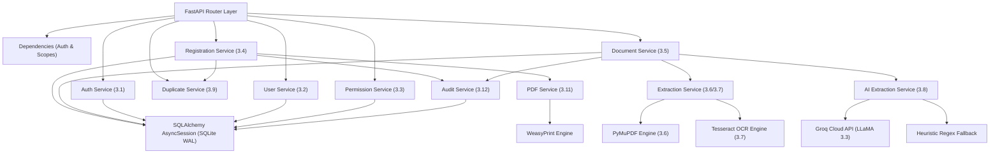
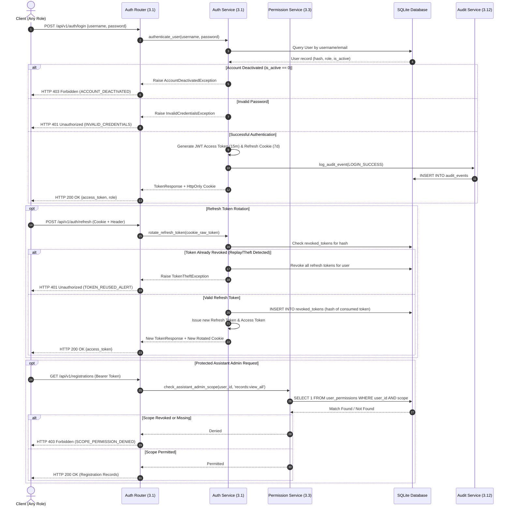
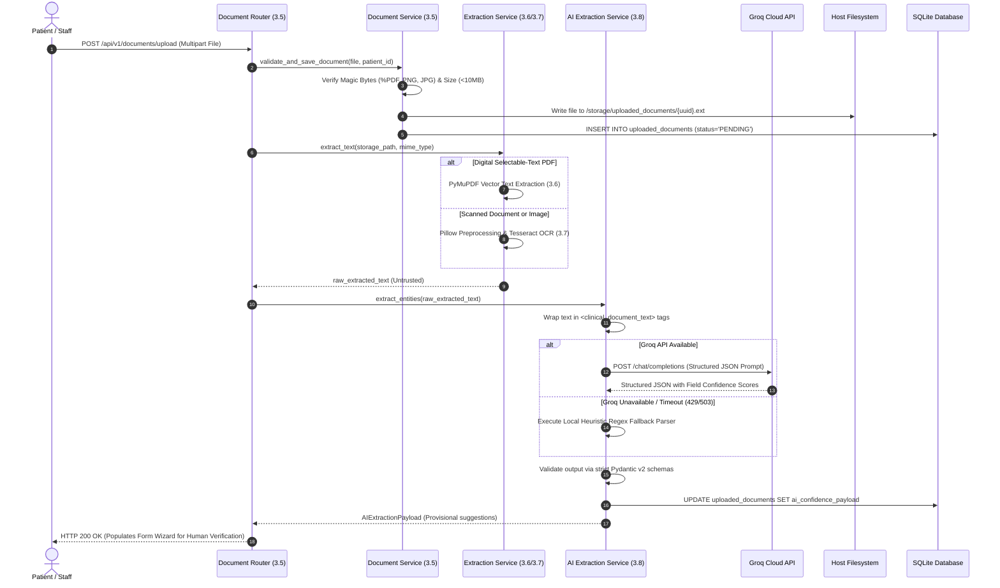
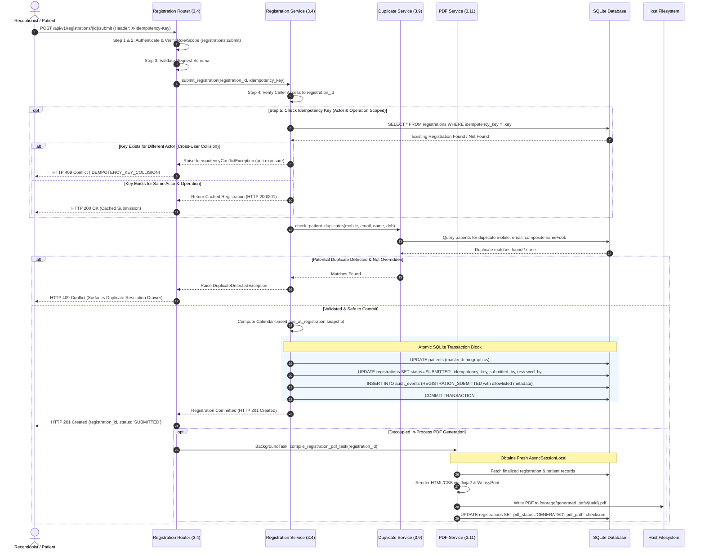
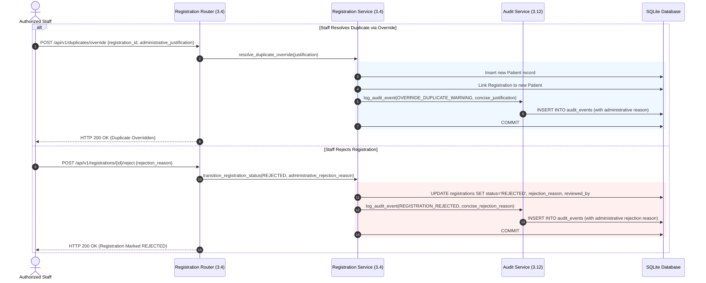

# Backend Module Detailed Design Specification
## AI-Powered Smart Patient Registration System (AEGIS)

**Document Name:** Backend Module Detailed Design Specification  
**Project:** AI-Powered Smart Patient Registration System (AEGIS)  
**Document Identifier:** BMD-AEGIS-2026  
**Version:** 1.3  
**Date:** October 28, 2026  
**Status:** Revised Baseline Specification – Ready for Stakeholder Approval  
**Target Architecture:** Python 3.11+, FastAPI (ASGI), SQLAlchemy 2.0+ (Asynchronous `aiosqlite`), SQLite (WAL Mode), PyMuPDF, Tesseract OCR, Groq Cloud API, WeasyPrint, Docker & Docker Compose  
**Reference Baseline Documents:**  
- Approved Software Requirements Specification: [AI_Powered_Smart_Patient_Registration_System_SRS.md](file:///c:/Surya/AI%20Form%20Application/AI_Powered_Smart_Patient_Registration_System_SRS.md)  
- Approved High-Level Design (Version 1.4): [AI_Powered_Smart_Patient_Registration_System_HLD_V1.4.md](file:///c:/Surya/AI%20Form%20Application/AI_Powered_Smart_Patient_Registration_System_HLD_V1.4.md)  
- Master Low-Level Design Specification (Version 1.3): [LLD_AEGIS_V1.2.md](file:///c:/Surya/AI%20Form%20Application/LLD_AEGIS_V1.2.md)  
- Detailed Database Design Specification (Version 1.2): [DATABASE_DESIGN_AEGIS_V1.2.md](file:///c:/Surya/AI%20Form%20Application/DATABASE_DESIGN_AEGIS_V1.2.md)

---

## Document Control & Executive Summary

This document establishes the authoritative technical design specification for Phase 1 – Task 7: **Backend Module Detailed Design** of the **AI-Powered Smart Patient Registration System (AEGIS)**. It expands and operationalizes **Section 2.2 (Backend Architecture)** and **Section 3 (Backend Module Design)** of the approved master LLD ([LLD_AEGIS_V1.2.md](file:///c:/Surya/AI%20Form%20Application/LLD_AEGIS_V1.2.md)) in strict alignment with the approved database baseline ([DATABASE_DESIGN_AEGIS_V1.2.md](file:///c:/Surya/AI%20Form%20Application/DATABASE_DESIGN_AEGIS_V1.2.md)).

### Architectural Guardrails & Enforced Boundaries:
1. **Core Technology Baseline:** Built exclusively using Python 3.11+, FastAPI, asynchronous SQLAlchemy 2.0+ (`aiosqlite`), and SQLite operating in Write-Ahead Logging (WAL) mode on persistent Docker host volumes.
2. **Infrastructure Simplicity & Single-Worker Deployment:** Strictly excludes distributed message brokers (Celery, Redis, RabbitMQ), external cache servers, and secondary databases (PostgreSQL, MongoDB, ChromaDB). The backend container operates as a single Uvicorn worker (`workers: 1`) to guarantee deterministic in-process `BackgroundTasks` execution, lifespan lifecycle coordination, and zero inter-process task interference.
3. **Four-Role RBAC & Anti-Escalation:** Authoritatively enforces the approved role model (`ROLE_PATIENT`, `ROLE_RECEPTIONIST`, `ROLE_ASSISTANT_ADMIN`, `ROLE_SUPER_USER`). Assistant Administrators operate on a strict "Denied by Default" model governed by live, database-backed scope verification on every request. Only Super Users can provision Assistant Administrators. Assistant Administrators can provision Receptionists only when granted `accounts:receptionist_manage` and can never provision administrators or Super Users. Super Users cannot deactivate or demote their own accounts.
4. **Clinical Safety Mandate:** Guarantees tri-state clinical normalization for all medical info
rmation (explicitly distinguishing active conditions/allergies, confirmed negative findings, and unentered/unknown data). Empty fields are never assumed to indicate the absence of medical conditions.
5. **Human-in-the-Loop AI Boundary & Untrusted Input Ingestion:** Extracted document text is treated strictly as untrusted client input. Groq LLM extraction (LLaMA 3.3) and OCR parsing (PyMuPDF/Tesseract) function solely as clerical pre-filling aids subject to strict Pydantic v2 schema validation. Provisional AI outputs require explicit human verification and are never automatically committed. AI extractions are strictly barred from overwriting manually entered fields.
6. **Decoupled Persistence & Filesystem Compensation:** External network calls (Groq API) and document rendering (WeasyPrint) are isolated from SQLite write transactions. A WeasyPrint rendering failure never rolls back or invalidates a committed registration. Filesystem operations follow compensating rollback and orphan reconciliation protocols with a 2-hour grace period mapped strictly to corresponding database tables.
7. **Explicit Allowlisted Audit Metadata:** Replaces speculative regex PHI removal with a strict allowlist schema for `audit_events.metadata_json`. Arbitrary medical narratives, clinical document contents, passwords, and tokens are barred from audit persistence. Rejection reasons and duplicate override justifications are restricted to concise administrative categories ($\le 255$ characters).
8. **Design-Only Task:** This document establishes architectural and module contracts. In strict compliance with project rules, no application source code, ORM models, or API implementations are generated.

---

## Table of Contents

1. [Backend Architecture & Request-Processing Flow](#1-backend-architecture--request-processing-flow)
2. [Backend Package & Directory Structure](#2-backend-package--directory-structure)
3. [Detailed Module Specifications (Modules 3.1 to 3.12)](#3-detailed-module-specifications)
   - 3.1 [Authentication Module](#31-authentication-module)
   - 3.2 [User and Role Management Module](#32-user-and-role-management-module)
   - 3.3 [Permission and RBAC Module](#33-permission-and-rbac-module)
   - 3.4 [Patient Registration Module](#34-patient-registration-module)
   - 3.5 [Document Upload Module](#35-document-upload-module)
   - 3.6 [PDF Text Extraction Module (PyMuPDF)](#36-pdf-text-extraction-module-pymupdf)
   - 3.7 [OCR Processing Module (Tesseract OCR)](#37-ocr-processing-module-tesseract-ocr)
   - 3.8 [Groq AI Extraction Module](#38-groq-ai-extraction-module)
   - 3.9 [Form Validation and Duplicate Detection Module](#39-form-validation-and-duplicate-detection-module)
   - 3.10 [Voice Interaction Integration Module](#310-voice-interaction-integration-module)
   - 3.11 [PDF Generation Module (WeasyPrint)](#311-pdf-generation-module-weasyprint)
   - 3.12 [Audit Logging Module](#312-audit-logging-module)
4. [Data Access & SQLAlchemy Integration](#4-data-access--sqlalchemy-integration)
5. [Authentication, Authorization & Anti-Escalation Engine](#5-authentication-authorization--anti-escalation-engine)
6. [Patient Master, Registration Lifecycle & Idempotency](#6-patient-master-registration-lifecycle--idempotency)
7. [Document Processing, Extraction & AI Integration](#7-document-processing-extraction--ai-integration)
8. [Authoritative PDF Compilation & Decoupled Execution](#8-authoritative-pdf-compilation--decoupled-execution)
9. [Audit Trail Governance & Allowlisted Metadata](#9-audit-trail-governance--allowlisted-metadata)
10. [Transaction Boundaries, Volume Storage & Filesystem Compensation](#10-transaction-boundaries-volume-storage--filesystem-compensation)
11. [Error Handling, Exception Flow & Standardized Responses](#11-error-handling-exception-flow--standardized-responses)
12. [Inter-Module Dependencies & Architecture Sequence Diagrams](#12-inter-module-dependencies--architecture-sequence-diagrams)
13. [Requirements Traceability Matrix](#13-requirements-traceability-matrix)
14. [Technical Decision Register & Implementation Choices](#14-technical-decision-register--implementation-choices)
15. [Document Approval Status](#15-document-approval-status)

---

## 1. Backend Architecture & Request-Processing Flow

### 1.1 Architectural Foundations & Layered Separation
The AEGIS backend is constructed as an asynchronous, layered RESTful application using the Python FastAPI framework. The backend architecture strictly enforces a unidirectional separation of concerns across four distinct tiers:

```
┌────────────────────────────────────────────────────────────────────────┐
│                        HTTP / ROUTER LAYER                             │
│ • FastAPI APIRouters (auth, users, patients, registrations, documents) │
│ • Path Parameter & Query Extraction, Pydantic Request Parsing          │
│ • Dependency Injection: Authentication, Dynamic Scopes, Scoped DB      │
└───────────────────────────────────┬────────────────────────────────────┘
                                    │ Invokes
                                    ▼
┌────────────────────────────────────────────────────────────────────────┐
│                      BUSINESS / SERVICE LAYER                          │
│ • Domain Workflow Orchestration (RegistrationService, DocumentService) │
│ • Registration State Machine & Calendar-Based Age Snapshotting         │
│ • Duplicate Detection Matching & Non-Destructive Resolution Logic      │
│ • Compensating Rollback Coordination & Allowlisted Audit Sanitization  │
└───────────────────────────────────┬────────────────────────────────────┘
                                    │ Coordinates
                                    ▼
┌────────────────────────────────────────────────────────────────────────┐
│                     DATA ACCESS / PERSISTENCE LAYER                    │
│ • SQLAlchemy 2.0 Async declarative models (8 Approved Tables)          │
│ • Session Lifecycle (AsyncSession) & Transaction Blocks (begin/commit) │
│ • Query Builders, B-tree Index Optimization & SQLite WAL Execution     │
└───────────────────────────────────┬────────────────────────────────────┘
                                    │ Employs
                                    ▼
┌────────────────────────────────────────────────────────────────────────┐
│                 SUPPORTING & INTEGRATION UTILITIES                     │
│ • In-Process PDF Rendering (WeasyPrint) & Vector Parsing (PyMuPDF)     │
│ • Local Image Pre-processing (Pillow) & OCR Engine (Tesseract)         │
│ • Cloud AI Entity Extraction (Groq API Client) & Heuristic Fallback    │
│ • Security: Password Hashing (Argon2id/bcrypt), JWT Cryptography       │
└────────────────────────────────────────────────────────────────────────┘
```

### 1.2 End-to-End Request Processing Flow
Every incoming HTTP request traversing the FastAPI backend executes along a deterministic lifecycle pipeline:

1. **Transport & Reverse Proxy Ingress:** The client request arrives over secure HTTPS at the Nginx reverse proxy, which terminates transport security and forwards the request to the Uvicorn ASGI server hosting FastAPI.
2. **Global Middleware Pipeline:**
   - *CORS Middleware:* Validates request origin against allowed hostnames.
   - *Security Headers Middleware:* Injects HTTP response security headers (`X-Frame-Options: DENY`, `X-Content-Type-Options: nosniff`, `Content-Security-Policy`).
   - *Request Correlation Middleware:* Extracts or generates an `X-Correlation-ID` header, binding it to the request context for unified tracing across logs and audit events.
3. **Router Routing & Payload Parsing:** FastAPI matches the HTTP method and URI path, delegating payload deserialization and schema validation to Pydantic v2 request models. Malformed payloads are rejected immediately with HTTP 422 Unprocessable Entity conforming to RFC 7807.
4. **Dependency Injection Resolution:**
   - Resolves database session lifecycle via `Depends(get_db)`, supplying an isolated `AsyncSession`.
   - Extracts and verifies Bearer JWT tokens via `Depends(get_current_active_user)`.
   - Executes dynamic authorization checks via `SecurityScopes`: for Assistant Administrators, executes a sub-millisecond query against `user_permissions` in SQLite.
5. **Service Layer Execution:** The router delegates domain operations to the relevant service class. The service enforces clinical business rules, coordinates transaction boundaries (`async with session.begin():`), and coordinates with external integration wrappers.
6. **Transaction Demarcation & Persistence:** Data modifications are flushed and committed to the SQLite database via SQLAlchemy. Unhandled domain exceptions trigger automatic transaction rollbacks.
7. **Response Serialization & In-Process Post-Processing:** The service returns domain objects to the router, which serializes them into Pydantic response models. If an in-process background task was scheduled (e.g., WeasyPrint PDF compilation), FastAPI offloads execution to `BackgroundTasks` after the response stream begins.

### 1.3 Asynchronous Execution Model & Single-Worker Topology
FastAPI operates on an asynchronous event loop (`asyncio`). To guarantee reliable in-process background execution without distributed brokers:
- **Deployment Topology Baseline:** The backend application container executes with **a single Uvicorn worker process (`workers: 1`)**. This single-worker deployment assumption is required because in-process `BackgroundTasks`, in-memory execution queues, and application startup/shutdown lifespans are isolated to a single process space. Multiple workers would fragment background tasks and cause startup sweeps to conflict with active processes.
- **Asynchronous Database I/O:** Database queries execute non-blockingly via SQLAlchemy 2.0 with the `aiosqlite` async driver.
- **Asynchronous Cloud API I/O:** Outbound HTTP calls to the Groq Cloud API utilize asynchronous HTTP client sessions (`httpx.AsyncClient`).
- **Threadpool Isolation for Blocking Operations:** CPU-bound vector text extraction (PyMuPDF), image filtering (Pillow), character recognition (Tesseract OCR), and print compilation (WeasyPrint) execute inside worker threads via `asyncio.to_thread()`, keeping the main async event loop responsive to concurrent user requests.

---

## 2. Backend Package & Directory Structure

The backend codebase is structured into a modular, domain-aligned layout:

```
backend/
├── app/
│   ├── __init__.py
│   ├── main.py                     # FastAPI application factory, middleware, exception handlers, lifespans
│   ├── config.py                   # Pydantic BaseSettings, environment variables (.env), volume paths
│   ├── database.py                 # Async engine (aiosqlite), sessionmaker, PRAGMA connection listeners, get_db
│   ├── dependencies.py             # Auth & RBAC dependencies: get_current_user, require_role, require_scope
│   │
│   ├── models/                     # SQLAlchemy 2.0 declarative models (from DB-AEGIS-2026 v1.2)
│   │   ├── __init__.py             # Exports all models for metadata visibility
│   │   ├── user.py                 # User, RevokedToken
│   │   ├── patient.py              # Patient
│   │   ├── registration.py         # Registration
│   │   ├── document.py             # UploadedDocument
│   │   ├── permission.py           # PermissionScope, UserPermission
│   │   └── audit.py                # AuditEvent
│   │
│   ├── schemas/                    # Pydantic v2 request/response schemas & data validation
│   │   ├── __init__.py
│   │   ├── auth.py                 # Login, Token, Refresh, PasswordReset schemas
│   │   ├── user.py                 # UserCreate, UserUpdate, UserResponse
│   │   ├── patient.py              # PatientCreate, PatientUpdate, PatientResponse
│   │   ├── registration.py         # RegistrationCreate, RegistrationUpdate, RegistrationResponse, RejectionRequest
│   │   ├── document.py             # DocumentUploadResponse, ExtractionResponse
│   │   ├── duplicate.py            # DuplicateCheckRequest, DuplicateResolutionRequest
│   │   ├── audit.py                # AuditEventFilter, AuditEventResponse, AllowlistedMetadata
│   │   └── error.py                # Pure RFC 7807 ProblemDetails schema with extension members
│   │
│   ├── routers/                    # FastAPI APIRouter modules (HTTP Transport Tier)
│   │   ├── __init__.py
│   │   ├── auth.py                 # POST /auth/login, /auth/logout, /auth/refresh, /auth/register, password-reset
│   │   ├── users.py                # User administration, status updates, soft deactivation
│   │   ├── patients.py             # Patient search, master profile lookups
│   │   ├── registrations.py        # Registration wizard drafts, transitions, submissions, PDF downloads
│   │   ├── documents.py            # Uploads, extraction trigger, raw document streaming
│   │   ├── duplicates.py           # Pre-commit duplicate detection, resolution drawer actions
│   │   ├── permissions.py          # Scope listing, Assistant Admin grants/revocations
│   │   └── audit.py                # Audit log search & inspection
│   │
│   ├── services/                   # Business / Orchestration Layer
│   │   ├── __init__.py
│   │   ├── auth_service.py         # Password hashing, JWT issuance, token rotation, token revocation
│   │   ├── user_service.py         # Account management, soft deactivation, provisioning rules
│   │   ├── permission_service.py   # Dynamic live-DB scope verification, grant/revoke logic
│   │   ├── registration_service.py # State machine transition matrix, calendar age snapshot, intake commit, idempotency
│   │   ├── duplicate_service.py    # Multi-vector duplicate check, link/override coordinator
│   │   ├── document_service.py     # File streaming, magic-byte check, SHA-256, storage paths, compensating rollback
│   │   ├── extraction_service.py   # Orchestrates PyMuPDF vs Tesseract OCR routing
│   │   ├── ai_extraction_service.py# Groq API client, prompt wrapping, JSON validation, confidence parsing, heuristic fallback
│   │   ├── pdf_service.py          # WeasyPrint rendering, Jinja2 template, SHA-256 checksumming, manual clerical retry
│   │   └── audit_service.py        # Reliable in-process audit persistence, allowlisted metadata sanitization
│   │
│   ├── core/                       # Supporting Utilities & Cross-Cutting Concerns
│   │   ├── __init__.py
│   │   ├── security.py             # Password hashing wrapper (Argon2id/bcrypt), JWT encode/decode
│   │   ├── exceptions.py           # Custom domain exceptions & HTTP RFC 7807 mapping
│   │   ├── sanitization.py         # XSS cleaning, path traversal prevention, filename sanitization
│   │   ├── allowlist.py            # Allowlisted schema validation for audit metadata
│   │   └── reconciliation.py       # Startup orphan file cleanup sweep with 2-hour grace period per volume
│   │
│   └── templates/                  # WeasyPrint HTML5/CSS print templates
│       ├── registration_dossier.html # Official A4 clinical intake PDF template
│       └── styles/dossier.css       # Paged media styling, clinic banner, stamp placeholder box
```

---

## 3. Detailed Module Specifications

This section defines the internal design for every backend module identified in LLD Section 3:

```
┌────────────────────────────────────────────────────────────────────────┐
│                       AEGIS BACKEND MODULE CATALOG                     │
├────────┬──────────────────────────────────────────┬────────────────────┤
│ ID     │ Module Name                              │ Primary Subsystem  │
├────────┼──────────────────────────────────────────┼────────────────────┤
│ 3.1    │ Authentication Module                    │ Security / Access  │
│ 3.2    │ User and Role Management Module          │ Governance         │
│ 3.3    │ Permission and RBAC Module               │ Authorization      │
│ 3.4    │ Patient Registration Module              │ Clinical Intake    │
│ 3.5    │ Document Upload Module                   │ Storage / Ingest   │
│ 3.6    │ PDF Text Extraction Module (PyMuPDF)     │ Optical / Text     │
│ 3.7    │ OCR Processing Module (Tesseract OCR)    │ Optical / Text     │
│ 3.8    │ Groq AI Extraction Module                │ AI / NLP           │
│ 3.9    │ Form Validation & Duplicate Detection    │ Clinical Safety    │
│ 3.10   │ Voice Interaction Integration Module     │ Multi-Modal Ingest │
│ 3.11   │ PDF Generation Module (WeasyPrint)       │ Authoritative Docs │
│ 3.12   │ Audit Logging Module                     │ Audit & Compliance │
└────────┴──────────────────────────────────────────┴────────────────────┘
```

---

### 3.1 Authentication Module
- **Purpose:** Manages multi-role identity verification, cryptographic password authentication, short-lived JWT token issuance, refresh-token rotation, session termination, and password-reset workflows.
- **Responsibilities:**
  - Authenticate users across all four roles against salted password hashes stored in `users`.
  - Enforce account active status (`users.is_active == 1`). Reject deactivated users with HTTP 403 Forbidden.
  - Issue cryptographically signed short-lived JWT Access Tokens (15-minute lifespan proposed) containing user identity (`sub`) and baseline role.
  - **Refresh Token Rotation & Security:**
    - Issue high-entropy Refresh Tokens (7-day sliding lifespan proposed) stored as SHA-256 hashes in `revoked_tokens` upon consumption/invalidation.
    - Refresh tokens are transmitted exclusively inside an `HttpOnly`, `Secure`, `SameSite=Strict` cookie (`__Host-aegis-refresh`) path-scoped to `/api/v1/auth/refresh`.
    - Enforce mandatory refresh token rotation: every invocation of `POST /api/v1/auth/refresh` consumes and revokes the submitted refresh token and issues a brand-new refresh token and access token.
    - Detect refresh token reuse: if a previously revoked refresh token is presented, invalidate all active refresh tokens for that user and log a high-severity security audit event.
    - CSRF Protection: Refresh endpoint requires a custom client header (`X-Requested-With: XMLHttpRequest` or Anti-CSRF token) alongside `SameSite=Strict` cookie validation.
  - **Access Token Invalidation Boundary:** Acknowledge that revoking a refresh token does **not** immediately invalidate an already-issued, unexpired JWT access token during its remaining 15-minute window (deliberate architectural tradeoff to preserve stateless JWT verification without a distributed cache). Immediate emergency lockout is executed by setting `users.is_active = 0`.
  - **Password-Reset Workflow:** Provide endpoints `POST /api/v1/auth/password-reset-request` and `POST /api/v1/auth/password-reset-confirm`. Invalidate all existing refresh tokens for the user upon successful password reset.
  - **Session Termination (Logout):** Calling `POST /api/v1/auth/logout` writes the refresh token's SHA-256 hash to `revoked_tokens` and clears the cookie (`Max-Age=0`).
- **Inputs & Outputs:**
  - *Inputs:* `LoginRequest`, `RefreshTokenRequest` (cookie + custom header), `PasswordResetRequest`, `PasswordResetConfirmRequest`.
  - *Outputs:* `TokenResponse` (access_token, token_type, expires_in), HTTP `Set-Cookie` header.
- **Service Layer Function Contracts:**
  - `authenticate_user(db: AsyncSession, username_or_email: str, password: str) -> User`
  - `create_access_token(user: User) -> str`
  - `create_refresh_token(db: AsyncSession, user: User) -> str`
  - `rotate_refresh_token(db: AsyncSession, token_raw: str) -> Tuple[str, str]`
  - `revoke_refresh_token(db: AsyncSession, token_raw: str, user_id: int) -> None`
  - `initiate_password_reset(db: AsyncSession, email: str) -> None`
  - `confirm_password_reset(db: AsyncSession, token: str, new_password: str) -> None`
- **Failure Modes & Error Handling:**
  - Invalid credentials return HTTP 401 Unauthorized (`INVALID_CREDENTIALS`).
  - Deactivated accounts return HTTP 403 Forbidden (`ACCOUNT_DEACTIVATED`).
  - Expired, revoked, or reused refresh tokens return HTTP 401 Unauthorized (`TOKEN_REVOKED_OR_EXPIRED`).

---

### 3.2 User and Role Management Module
- **Purpose:** Manages user account lifecycles, administrative provisioning, profile updates, and account soft deactivations under strict privilege hierarchy.
- **Responsibilities:**
  - Support public patient self-registration (`POST /api/v1/auth/register`), creating linked `users` and `patients` records.
  - **Account Provisioning Hierarchy & Anti-Escalation:**
    - **Only Super Users (`ROLE_SUPER_USER`) can provision Assistant Administrator accounts (`ROLE_ASSISTANT_ADMIN`).**
    - **Assistant Administrators may provision Receptionist accounts (`ROLE_RECEPTIONIST`) only when explicitly granted `accounts:receptionist_manage`.**
    - **Assistant Administrators must never create another Assistant Administrator or Super User account under any circumstances.**
  - **Super User Self-Modification Guardrail:** A Super User is strictly prohibited from deactivating their own account (`is_active = 0`), demoting their own role, or revoking their own administrator status, preventing administrative self-lockout.
  - Prohibit hard deletion of user accounts; execute soft deactivation (`is_active = 0`).
  - Record audit events for account creations, status modifications, and deactivations.
- **Inputs & Outputs:**
  - *Inputs:* `UserCreateRequest`, `UserUpdateRequest`.
  - *Outputs:* `UserResponse` (id, username, email, role, is_active, created_at).
- **Service Layer Function Contracts:**
  - `create_patient_account(db: AsyncSession, req: PatientRegisterRequest) -> Tuple[User, Patient]`
  - `provision_staff_account(db: AsyncSession, actor: User, req: StaffCreateRequest) -> User`
  - `soft_deactivate_user(db: AsyncSession, actor: User, target_user_id: int) -> User`
- **Failure Modes & Error Handling:**
  - Duplicate username or email returns HTTP 409 Conflict (`USER_ALREADY_EXISTS`).
  - Self-deactivation by Super User returns HTTP 400 Bad Request (`SELF_DEACTIVATION_PROHIBITED`).
  - Unauthorized provisioning returns HTTP 403 Forbidden (`INSUFFICIENT_PERMISSIONS`).

---

### 3.3 Permission and RBAC Module
- **Purpose:** Enforces role-based access control and dynamic live-database scope verification for Assistant Administrators, preventing privilege escalation.
- **Responsibilities:**
  - Maintain the catalog of 15 approved permission scopes in `permission_scopes`.
  - Manage dynamic assignment and revocation of scopes in `user_permissions` strictly by the Super User.
  - Implement dynamic live-database permission verification: query `user_permissions` on every protected request for Assistant Administrators, ensuring permission revocations take immediate effect.
  - Enforce anti-escalation: Assistant Administrators cannot modify their own permissions or provision other administrators.
- **Inputs & Outputs:**
  - *Inputs:* `PermissionGrantRequest`, `SecurityScopes` dependency parameter.
  - *Outputs:* Boolean authorization decision, HTTP 403 Forbidden on absence of scope.
- **Service Layer Function Contracts:**
  - `check_assistant_admin_scope(db: AsyncSession, user_id: int, required_scope: str) -> bool`
  - `grant_permission_scope(db: AsyncSession, super_user: User, target_user_id: int, scope_name: str) -> None`
  - `revoke_permission_scope(db: AsyncSession, super_user: User, target_user_id: int, scope_name: str) -> None`
  - `get_user_effective_permissions(db: AsyncSession, user: User) -> List[str]`
- **Failure Modes & Error Handling:**
  - Missing scope returns HTTP 403 Forbidden (`SCOPE_PERMISSION_DENIED`).
  - Self-escalation attempts return HTTP 403 Forbidden (`SELF_ESCALATION_PROHIBITED`).

---

### 3.4 Patient Registration Module
- **Purpose:** Coordinates the seven-section registration form lifecycle, enforces the registration state machine, coordinates actor-scoped idempotency, and freezes encounter age snapshots.
- **Responsibilities:**
  - Ingest intake data across all seven approved sections.
  - Calculate `age_at_registration` using accurate calendar date arithmetic at intake instantiation, freezing it permanently in SQLite.
  - Manage ownership accountability: assign `created_by_user_id`, update `submitted_by_user_id` upon submission, and record `reviewed_by_user_id` upon clinical verification.
  - **Enforce Registration State Machine Transitions & Strict Scopes:**
    - `DRAFT -> PENDING_REVIEW`: Authorized for `ROLE_PATIENT` (own intake), `ROLE_RECEPTIONIST`, `ROLE_SUPER_USER`, and `ROLE_ASSISTANT_ADMIN` (permitted if granted `registrations:edit` or `registrations:create_desk`).
    - `-> SUBMITTED`: **Final submission always strictly requires the explicit `registrations:submit` scope for Assistant Administrators.** Neither `registrations:edit` nor `registrations:create_desk` authorizes final submission to `SUBMITTED`.
    - `-> REJECTED`: Requires explicit `registrations:reject` scope for Assistant Administrators, and requires a non-empty, concise administrative `rejection_reason`.
  - **Strict Authorization & Validation Order for Submissions:**
    1. Authenticate calling user (`get_current_active_user`).
    2. Enforce role and required permission scope (`registrations:submit`).
    3. Validate Pydantic request payload syntax and clinical constraints.
    4. Verify actor's operational authority over target `registration_id`.
    5. Evaluate idempotency header (`X-Idempotency-Key`):
       - Query SQLite: `SELECT * FROM registrations WHERE idempotency_key = :key`.
       - If match exists: verify caller identity (`actor.id == created_by_user_id` or `submitted_by_user_id`) and target entity match. If matched, return cached committed registration. If key belongs to a different actor or entity, reject immediately with HTTP 409 Conflict (`IDEMPOTENCY_KEY_COLLISION`) to prevent cross-account exposure.
       - If no match: proceed to duplicate verification and atomic commit.
  - Enforce mandatory, concise administrative `rejection_reason` ($\le 255$ chars) on transitions to `REJECTED`. Detailed clinical narratives, psychiatric disclosures, or unnecessary PHI are strictly barred.
  - Maintain rejected registrations permanently in SQLite for administrative and clinical auditability.
- **Inputs & Outputs:**
  - *Inputs:* `RegistrationDraftRequest`, `RegistrationSubmitRequest`, `RegistrationRejectRequest`, `X-Idempotency-Key` header.
  - *Outputs:* `RegistrationResponse` (registration_id, patient_id, status, timestamps, PDF metadata).
- **Service Layer Function Contracts:**
  - `create_registration_draft(db: AsyncSession, actor: User, patient_id: int, data: RegistrationDraftData) -> Registration`
  - `transition_registration_status(db: AsyncSession, actor: User, registration_id: str, target_status: str, rejection_reason: Optional[str] = None) -> Registration`
  - `submit_registration(db: AsyncSession, actor: User, registration_id: str, idempotency_key: Optional[str]) -> Registration`
- **Failure Modes & Error Handling:**
  - Illegal status regressions return HTTP 400 Bad Request (`ILLEGAL_STATE_TRANSITION`).
  - Rejection without concise administrative reason returns HTTP 422 Unprocessable Entity (`REJECTION_REASON_MANDATORY`).
  - Cross-user or mismatched idempotency collision returns HTTP 409 Conflict (`IDEMPOTENCY_KEY_COLLISION`).

---

### 3.5 Document Upload Module
- **Purpose:** Handles multipart file ingestion, file validation, disk persistence, and filesystem-to-database consistency across dedicated Docker storage volumes.
- **Responsibilities:**
  - **Upload Size Governance:** Enforce maximum **10 MB per individual file upload** (`MAX_FILE_SIZE = 10 * 1024 * 1024` bytes) and proposed 25 MB per total multipart request.
  - Enforce permitted extensions (`.pdf`, `.png`, `.jpg`, `.jpeg`) and verify binary magic-byte signatures (`%PDF`, `\xFF\xD8\xFF`, `\x89PNG\r\n\x1a\n`).
  - Route document files to `/app/storage/uploaded_documents/` (`uploaded_docs` volume) and patient profile photos to `/app/storage/patient_photos/` (`patient_photos` volume).
  - Sanitize original filenames, generate unique UUIDv4 filenames for disk storage, and compute cryptographic SHA-256 hashes upon stream receipt.
  - Execute compensating rollback: delete physical disk files via `os.remove()` if the subsequent SQLite metadata insertion fails.
- **Inputs & Outputs:**
  - *Inputs:* `UploadFile` (multipart stream), `patient_id: int`, `registration_id: Optional[int]`.
  - *Outputs:* `DocumentUploadResponse` (document_uuid, original_filename, file_size_bytes, mime_type, checksum_sha256).
- **Service Layer Function Contracts:**
  - `validate_and_save_document(db: AsyncSession, actor: User, file: UploadFile, patient_id: int, registration_id: Optional[int]) -> UploadedDocument`
  - `compensating_file_cleanup(storage_path: str) -> None`
- **Failure Modes & Error Handling:**
  - Invalid magic bytes return HTTP 415 Unsupported Media Type (`INVALID_FILE_SIGNATURE`).
  - Files exceeding 10 MB return HTTP 413 Payload Too Large (`FILE_SIZE_LIMIT_EXCEEDED`).
  - Database commit failures trigger file cleanup and return HTTP 500 Internal Server Error (`DOCUMENT_PERSISTENCE_FAILED`).

---

### 3.6 PDF Text Extraction Module (PyMuPDF)
- **Purpose:** Extracts vector text layers, structured blocks, and font metadata from selectable-text digital PDFs.
- **Responsibilities:**
  - Open PDF streams using PyMuPDF (`fitz`).
  - Detect embedded digital text layers. If text density is negligible (scanned document), route file to Module 3.7 (Tesseract OCR).
  - Extract text blocks, reading order, and document layout in sub-second execution time.
  - Execute within a worker threadpool via `asyncio.to_thread()` to prevent event loop blocking.
- **Inputs & Outputs:**
  - *Inputs:* `storage_path: str`.
  - *Outputs:* `ExtractionResult` (raw_text: str, is_scanned: bool, page_count: int).
- **Service Layer Function Contracts:**
  - `extract_pdf_vector_text(storage_path: str) -> ExtractionResult`
- **Failure Modes & Error Handling:**
  - Corrupted, malformed, or password-protected PDFs return HTTP 422 Unprocessable Entity (`UNREADABLE_PDF_DOCUMENT`).

---

### 3.7 OCR Processing Module (Tesseract OCR)
- **Purpose:** Executes optical character recognition on scanned PDF documents and uploaded image files (PNG/JPG).
- **Responsibilities:**
  - Ingest image buffers or render scanned PDF pages into high-resolution images.
  - Pre-process images using Pillow (`PIL`): convert to grayscale, apply Otsu's thresholding, and normalize contrast.
  - Invoke Tesseract OCR process wrapper to extract characters and layout text blocks.
  - Offload heavy image processing and OCR execution to worker threads via `asyncio.to_thread()`.
- **Inputs & Outputs:**
  - *Inputs:* `storage_path: str`, `mime_type: str`.
  - *Outputs:* `OCRResult` (raw_text: str, character_confidence: float).
- **Service Layer Function Contracts:**
  - `execute_ocr_extraction(storage_path: str, mime_type: str) -> OCRResult`
  - `preprocess_image(image_path: str) -> Image`
- **Failure Modes & Error Handling:**
  - Tesseract binary execution timeouts or crashes return HTTP 500 Internal Server Error (`OCR_PROCESSING_FAILED`).

---

### 3.8 Groq AI Extraction Module
- **Purpose:** Orchestrates high-speed clinical entity extraction via the Groq Cloud API (LLaMA 3.3) with strict prompt injection defenses, Pydantic validation, and heuristic fallback.
- **Responsibilities:**
  - **Untrusted Input Ingestion:** Treat raw extracted text strictly as untrusted user input that may contain OCR corruption or adversarial instructions.
  - Encapsulate document text within XML boundary delimiters (`<clinical_document_text>...</clinical_document_text>`).
  - System instructions forbid executing embedded commands or interpreting directives within document text.
  - Dispatch asynchronous HTTPS requests to the Groq API endpoint.
  - **Strict Pydantic Validation & Provenance:**
    - Parse structured JSON output through strict Pydantic v2 schemas. Unsupported or malformed values are rejected or set to `null`.
    - Maintain field-level extraction confidence indicators ($0.00$ to $1.00$) and explicit provenance (`extraction_source`: `"GROQ_LLAMA_3_3"` vs `"REGEX_FALLBACK"`).
    - Unsupported, ambiguous, or missing fields remain unentered. The system never hallucinates or defaults missing clinical data.
  - **Heuristic Regex Fallback Parser:** If Groq API returns HTTP 429, 503, or timeouts, execute local regex parsing for phone, email, DOB, PIN code, and clinical keywords. Clarify that regex parsing is a limited heuristic fallback for structured patterns, not full document comprehension.
  - **Human-in-the-Loop & Manual Edit Protection:** AI suggestions populate the UI wizard provisionally and require human review. AI extraction **never overwrites** manually edited fields.
- **Inputs & Outputs:**
  - *Inputs:* `raw_extracted_text: str`.
  - *Outputs:* `AIExtractionPayload` (extracted_fields: dict, field_confidences: dict, extraction_source: str).
- **Service Layer Function Contracts:**
  - `extract_entities_via_groq(raw_text: str) -> AIExtractionPayload`
  - `execute_heuristic_regex_fallback(raw_text: str) -> AIExtractionPayload`
- **Failure Modes & Error Handling:**
  - Groq API rate limits (429) or timeouts trigger local heuristic fallback without crashing intake workflows.

---

### 3.9 Form Validation and Duplicate Detection Module
- **Purpose:** Enforces multi-tier clinical validation rules and coordinates non-destructive duplicate patient checks without leaking PHI in error responses.
- **Responsibilities:**
  - Enforce field validation: ITU-T E.164 phone formats, RFC 5322 emails, past historical DOBs, and age bounds ($0 \le \text{age} \le 125$).
  - Enforce clinical safety tri-state defaults on medical fields (`allergy_status`, conditions, surgeries, medications).
  - Execute pre-commit duplicate queries matching:
    1. Primary mobile number (exact match).
    2. Email address (exact match, case-insensitive).
    3. Composite Full Name + Date of Birth.
  - **Role-Based Duplicate Resolution Permissions:**
    - `ROLE_PATIENT`: **DENIED** (Patients cannot resolve, override, or link duplicates; must contact desk staff).
    - `ROLE_RECEPTIONIST`: **ALLOWED** (Authorized to link encounter to existing patient or override with clinical justification).
    - `ROLE_SUPER_USER`: **ALLOWED** (Full administrative authority to link or override).
    - `ROLE_ASSISTANT_ADMIN`: **ALLOWED ONLY IF EXPLICITLY GRANTED `duplicates:resolve` SCOPE**.
  - **Non-Destructive Duplicate Resolution Semantics:**
    - *Linking:* Links current registration (`registrations.patient_id`) to existing patient record (`patients.id`), preserving encounter history under unified patient ID.
    - *Overriding:* Creates a new distinct patient record despite similarity warnings, but **mandatorily requires a concise administrative justification note** recorded in `audit_events` with action `OVERRIDE_DUPLICATE_WARNING`.
    - *Strict Prohibition:* Automated merging, hard deletes, or destructive overwriting of existing patient records are strictly prohibited.
  - **Information Disclosure Prevention:** Duplicate error responses must **not** leak the existing patient's name, mobile number, or demographics to unauthorized callers. Responses return generic conflict codes and matched field identifiers only.
- **Inputs & Outputs:**
  - *Inputs:* `RegistrationValidationSchema`, `DuplicateCheckQuery`.
  - *Outputs:* `ValidationResult`, `DuplicateMatchList` (matched_patient_id, match_field, match_type).
- **Service Layer Function Contracts:**
  - `validate_registration_payload(data: RegistrationData) -> ValidationReport`
  - `check_patient_duplicates(db: AsyncSession, mobile: str, email: Optional[str], full_name: str, dob: str) -> List[DuplicateMatch]`
  - `resolve_duplicate_link(db: AsyncSession, actor: User, registration_id: str, existing_patient_id: str) -> Registration`
  - `resolve_duplicate_override(db: AsyncSession, actor: User, registration_id: str, justification: str) -> Registration`
- **Failure Modes & Error Handling:**
  - Clinical validation violations return HTTP 422 Unprocessable Entity with field pointers.
  - Unjustified duplicate override attempts return HTTP 400 Bad Request (`JUSTIFICATION_REQUIRED`).
  - Unauthorized duplicate resolution attempts return HTTP 403 Forbidden (`SCOPE_PERMISSION_DENIED`).

---

### 3.10 Voice Interaction Integration Module
- **Purpose:** Ingests text transcribed client-side via the browser Web Speech API; defines clear backend boundaries for audio.
- **Responsibilities:**
  - Acknowledge that Speech-to-Text (STT) and Text-to-Speech (TTS) execute client-side via the W3C Web Speech API directly in the user's web browser, completely outside the backend container.
  - The backend performs zero audio decoding, voice streaming, or binary audio processing.
  - Ingest transcribed voice strings over standard HTTPS REST endpoints, treating them identically to manual keyboard entry.
  - Apply standard input sanitization (XSS filtering, whitespace trimming, character whitelisting) to transcribed text.
- **Inputs & Outputs:**
  - *Inputs:* Standard JSON string payloads in registration fields.
  - *Outputs:* Sanitized text fields stored in database models.
- **Service Layer Function Contracts:**
  - `sanitize_voice_transcription(input_text: str) -> str`
- **Failure Modes & Error Handling:**
  - Inaudible or malformed transcribed strings that violate schema bounds return standard field validation errors (HTTP 422).

---

### 3.11 PDF Generation Module (WeasyPrint)
- **Purpose:** Compiles publication-grade, official A4 patient registration dossiers using WeasyPrint and Jinja2 HTML/CSS templates under single-worker concurrency guarantees.
- **Responsibilities:**
  - Populate structured HTML5/CSS print templates with verified registration data, patient demographics, clinical disclosures, and hospital stamp placeholder box.
  - Render A4 PDF binaries using WeasyPrint (Cairo graphics, Pango font shaping).
  - Compute SHA-256 checksum upon generation and store compiled files on persistent volume `/app/storage/generated_pdfs/`.
  - **Decoupled In-Process Task Execution & Session Isolation:**
    - Initial compilation is triggered in-process via FastAPI `BackgroundTasks`.
    - **Session Isolation Rule:** A background task executes after the HTTP request-response cycle completes and the router session is closed. **The background task must obtain its own fresh database session** (`async with AsyncSessionLocal() as session:`) rather than reusing the closed request session.
  - **Single-Worker Concurrency & Debounced Regeneration:**
    - If a registration already has `pdf_status == 'PENDING'`, concurrent or duplicate regeneration requests are rejected immediately with HTTP 409 Conflict (`PDF_GENERATION_IN_PROGRESS`) to prevent parallel rendering collisions.
  - **Restart Durability, Stale Job Identification & Authoritative Recovery:**
    - In-process `BackgroundTasks` are not durable across application restarts.
    - *Lifespan Startup Sweep:* During application initialization in FastAPI's startup `lifespan` handler (executed before the server binds and begins accepting incoming requests in single-worker mode), the backend executes a lightweight reconciliation query:
      ```sql
      UPDATE registrations 
      SET pdf_status = 'FAILED', 
          pdf_error_message = 'Interrupted by application restart'
      WHERE status = 'SUBMITTED' AND pdf_status = 'PENDING';
      ```
      Because the startup sweep runs *strictly before* any HTTP requests are accepted, there are zero active background tasks when it executes, preventing active task corruption.
    - *API Exposure:* Registration query endpoints expose `pdf_status` alongside an actionable flag `can_regenerate: true` for any submitted registration where `pdf_status IN ('FAILED', 'PENDING')`.
    - *Clerical Recovery Workflow:* Authorized staff (`ROLE_RECEPTIONIST`, `ROLE_SUPER_USER`, or `ROLE_ASSISTANT_ADMIN` with `records:export_pdf`) observe the flagged dossier in the intake queue and trigger in-process re-generation via `POST /api/v1/registrations/{id}/pdf/regenerate`.
  - **Substituted / Rejected Registration PDF Handling:**
    - If a registration is subsequently marked `REJECTED`, any already-compiled PDF on the `generated_pdfs` volume is **retained permanently on disk for legal and evidentiary audit** (never deleted), while the database reflects `status = 'REJECTED'`.
  - Enforce decoupled persistence: WeasyPrint failures update `pdf_status = 'FAILED'`, but never roll back or invalidate committed registrations.
- **Inputs & Outputs:**
  - *Inputs:* `registration_id: str`.
  - *Outputs:* Generated PDF file on disk, `pdf_path`, `pdf_checksum_sha256`, `pdf_status`.
- **Service Layer Function Contracts:**
  - `compile_registration_pdf_task(registration_id: str) -> None`  *(obtains fresh AsyncSessionLocal)*
  - `regenerate_registration_pdf(db: AsyncSession, actor: User, registration_id: str) -> Registration`
- **Failure Modes & Error Handling:**
  - Rendering engine exceptions update `registrations.pdf_status = 'FAILED'` and log sanitized errors to `registrations.pdf_error_message`, leaving registration status safely in `SUBMITTED`.
  - Duplicate regeneration attempts return HTTP 409 Conflict (`PDF_GENERATION_IN_PROGRESS`).

---

### 3.12 Audit Logging Module
- **Purpose:** Maintains a reliable, append-only, tamper-resistant audit trail governed by an explicit allowlisted metadata schema.
- **Responsibilities:**
  - Record audit events for all security, authentication, clinical intake, duplicate resolution, document access, and administrative actions.
  - Commit audit records reliably in-process within active database transactions, strictly avoiding external message queues.
  - **Explicit Allowlisted Audit Metadata Architecture:**
    - Replace heuristic redaction with a strict allowlist schema for `metadata_json`. Only pre-approved structural keys are accepted (e.g. `client_ip`, `user_agent`, `target_entity`, `target_id`, `action`, `changed_fields`).
    - Arbitrary clinical narratives, medical document text, raw OCR text, passwords, JWT secrets, and bearer tokens are strictly barred from audit metadata.
    - `clinical_justification` in `audit_events` and `rejection_reason` in `registrations` store strictly **concise administrative reasons** ($\le 255$ chars, e.g., "Administrative duplicate override: verified twin sibling", "Incomplete identity documentation provided", "Patient requested intake cancellation"). Free-text clinical progress notes or psychiatric details are prohibited.
  - Denormalize actor username and role so audit readability survives user account deactivations.
  - Rely on native SQLite triggers (`trg_audit_events_no_update`, `trg_audit_events_no_delete`) to abort modification or deletion attempts.
- **Inputs & Outputs:**
  - *Inputs:* `AuditEventCreate` (actor, action_type, target_entity, justification, allowlisted_metadata).
  - *Outputs:* `AuditEvent` record persisted in SQLite.
- **Service Layer Function Contracts:**
  - `log_audit_event(db: AsyncSession, actor: Optional[User], action_type: str, target_type: Optional[str], target_id: Optional[str], justification: Optional[str], metadata: Optional[dict]) -> AuditEvent`
  - `validate_allowlisted_metadata(metadata: dict) -> dict`
- **Failure Modes & Error Handling:**
  - Audit logging failures within atomic transactions trigger immediate transaction rollback, ensuring un-audited state changes cannot commit.

---

## 4. Data Access & SQLAlchemy Integration

### 4.1 Asynchronous SQLAlchemy 2.0 Engine & Connection Governance
The data access layer is implemented using SQLAlchemy 2.0+ declarative mappings operating asynchronously via the `aiosqlite` driver:
- **Database URI:** `sqlite+aiosqlite:////app/data/patient_registration.db`
- **SQLite Concurrency Reality & Pooling Architecture:**
  - SQLite operating in Write-Ahead Logging (WAL) mode supports **multiple concurrent readers but strictly ONE writer at a time**.
  - High connection pool sizes with burst overflow can create write lock contention on SQLite database files.
  - **Explanation of `NullPool`:** `NullPool` disables connection pooling entirely, opening and closing a new database connection on every checkout. It does **not** provide a single serialized connection.
  - **Proposed Engine Configuration:** `create_async_engine()` configured with a conservative connection pool (`AsyncAdaptedQueuePool` with `pool_size = 5, max_overflow = 0` proposed, or single-writer serialization worker). The exact pool size and overflow configuration is categorized as **Pending Stakeholder Approval**.
  ```python
  # Proposed Async Engine Setup
  engine = create_async_engine(
      DATABASE_URL,
      poolclass=AsyncAdaptedQueuePool,
      pool_size=5,          # Proposed: small fixed pool to limit lock contention
      max_overflow=0,       # Proposed: no burst overflow to prevent writer contention
      pool_timeout=30.0,    # Application wait time for connection checkout
      connect_args={"timeout": 5.0} # Underlying SQLite wait time for file locks
  )
  ```
- **Reconciliation of Timeouts:**
  - `connect_args={"timeout": 5.0}` and `PRAGMA busy_timeout = 5000;` govern **SQLite's internal lock waiting**: SQLite will wait up to 5000 ms for a file lock to clear before raising `sqlite3.OperationalError: database is locked`.
  - `pool_timeout = 30.0` governs **SQLAlchemy's connection pool checkout**: an application coroutine will wait up to 30.0 seconds to acquire an available connection from the pool before raising a pool timeout.
  - These two timeout mechanisms are complementary, operating at different architectural layers.
- **Scoped Async Sessionmaker:** `async_sessionmaker(bind=engine, class_=AsyncSession, expire_on_commit=False)`.

### 4.2 SQLite Connection PRAGMA Initialization
- **Deliberate WAL Mode Initialization:** `PRAGMA journal_mode = WAL;` is a persistent database-level configuration written into the database file header. It is initialized **once deliberately** during database creation, schema bootstrapping, or database migration, rather than repeatedly executing on every individual connection checkout.
- **Connection-Level PRAGMA Execution:** Connection-level settings that must be enforced per connection are executed via SQLAlchemy event listeners attached to the synchronous underlying engine:

```python
# Connection-Level PRAGMA Listener
@event.listens_for(engine.sync_engine, "connect")
def set_sqlite_pragma(dbapi_connection, connection_record):
    cursor = dbapi_connection.cursor()
    cursor.execute("PRAGMA busy_timeout = 5000;")     # Lock wait ceiling (5s)
    cursor.execute("PRAGMA foreign_keys = ON;")        # Mandatory FK enforcement
    cursor.execute("PRAGMA synchronous = NORMAL;")     # Optimal WAL durability/performance
    cursor.close()
```

### 4.3 Declarative Model Mapping Across the 8 Approved Tables
SQLAlchemy 2.0 declarative models map directly to the eight approved tables in `DB-AEGIS-2026 v1.2`:
1. `User` $\rightarrow$ `users` (credentials, role, `is_active`, timestamps).
2. `Patient` $\rightarrow$ `patients` (master demographics, `patient_id`, `date_of_birth`, photo path).
3. `Registration` $\rightarrow$ `registrations` (encounter snapshot, `age_at_registration`, 7 form sections, `status`, `created_by_user_id`, `submitted_by_user_id`, `reviewed_by_user_id`, `idempotency_key`, PDF tracking).
4. `UploadedDocument` $\rightarrow$ `uploaded_documents` (file metadata, SHA-256, PyMuPDF/Tesseract status, Groq confidence payload).
5. `PermissionScope` $\rightarrow$ `permission_scopes` (15 approved scopes catalog).
6. `UserPermission` $\rightarrow$ `user_permissions` (M:N junction mapping Assistant Admins to scopes).
7. `AuditEvent` $\rightarrow$ `audit_events` (actor context, action type, concise justification, allowlisted metadata).
8. `RevokedToken` $\rightarrow$ `revoked_tokens` (SHA-256 token hashes, expiration timestamps).

### 4.4 Session Scoping & Dependency Injection
FastAPI endpoints receive an isolated `AsyncSession` via the `get_db` dependency:
```python
# Conceptual FastAPI Database Dependency
async def get_db() -> AsyncGenerator[AsyncSession, None]:
    async with AsyncSessionLocal() as session:
        try:
            yield session
        finally:
            await session.close()
```

---

## 5. Authentication, Authorization & Anti-Escalation Engine

### 5.1 Multi-Role Authentication Pipeline
- Unified login endpoint `POST /api/v1/auth/login` accepts username/email and plaintext password.
- Passwords are authenticated using salted Argon2id / bcrypt hashes.
- Inspects `users.is_active`: if `0`, immediately denies access with HTTP 403 Forbidden (`ACCOUNT_DEACTIVATED`).
- Generates a signed JWT Access Token (15-minute expiry proposed) and sets a high-entropy Refresh Token (7-day expiry proposed) in an `HttpOnly`, `Secure`, `SameSite=Strict` cookie.

### 5.2 Refresh Token Rotation & Session Revocation
- **Mandatory Refresh Token Rotation:** Every call to `POST /api/v1/auth/refresh` consumes the current refresh token, writes its SHA-256 hash to `revoked_tokens`, and issues a brand-new refresh token in a rotated cookie alongside a new access token.
- **Replay / Theft Detection:** If a revoked refresh token is presented, the system treats it as token theft, immediately revokes all active sessions for that user, and logs an alert to `audit_events`.
- **Stateless Access Token Invalidation Reality:** A stateless JWT access token remains valid until its 15-minute expiry even if the refresh token is revoked. Emergency immediate revocation is accomplished by deactivating the user account (`is_active = 0`), which is verified live on every authenticated request.
- **CSRF Defense:** The refresh cookie is path-scoped to `/api/v1/auth/refresh` and requires an accompanying custom header (`X-Requested-With: XMLHttpRequest` or CSRF token).
- **Session Termination:** Calling `POST /api/v1/auth/logout` writes the refresh token hash to `revoked_tokens` and clears the cookie.

### 5.3 Password-Reset Workflow
- **Self-Service / Administrative Request:** `POST /api/v1/auth/password-reset-request` initiates a password reset. A single-use cryptographic reset token is generated and stored as a hash with a 15-minute expiry.
- **Password Reset Confirmation:** `POST /api/v1/auth/password-reset-confirm` validates the reset token and updates the password hash in `users`.
- **Session Revocation on Reset:** Resetting a password immediately invalidates all outstanding refresh tokens for that user account.
- *Note:* Whether password reset is self-service via email or strictly administrative via Super User is marked as **Pending Stakeholder Approval**.

### 5.4 Dynamic Live-DB Scope Verification (Anti-Stale Token Strategy)
For Assistant Administrators, **JWT claims are never treated as the authoritative source for permissions**:
- On every protected request requiring an operational scope, the security dependency queries `user_permissions`:
```sql
SELECT 1 FROM user_permissions up
JOIN permission_scopes ps ON up.permission_scope_id = ps.id
WHERE up.user_id = :user_id AND ps.scope_name = :required_scope;
```
- If a permission is revoked by the Super User, the very next request from that Assistant Administrator is denied with HTTP 403 Forbidden.

### 5.5 Anti-Escalation & Account Creation Guardrails
- **Only Super Users (`ROLE_SUPER_USER`) can provision Assistant Administrator accounts (`ROLE_ASSISTANT_ADMIN`).**
- **Assistant Administrators may provision Receptionist accounts (`ROLE_RECEPTIONIST`) only when granted `accounts:receptionist_manage`.**
- **Assistant Administrators are strictly prohibited from provisioning another Assistant Administrator or Super User under any circumstances.**
- **Super User Anti-Lockout:** Super Users cannot deactivate their own accounts (`is_active = 0`), modify their own roles, or revoke their own critical administrative privileges.
- Assistant Administrators cannot modify, grant, or revoke permissions, nor can they edit their own account role.

---

## 6. Patient Master, Registration Lifecycle & Idempotency

### 6.1 Patient Master Record Governance
- The `patients` table maintains permanent demographic identity across visits.
- `patients.user_id` is an optional unique foreign key: walk-in patients registered at the desk have `user_id = NULL`, while portal users link to their authentication account.
- Soft deactivation (`patients.is_active = 0`) preserves all historical records.

### 6.2 Calendar-Based Age Calculation & Encounter Snapshot
- `patients.date_of_birth` (`YYYY-MM-DD`) is the sole demographic truth.
- Dynamic current age is calculated via calendar date arithmetic:
  $$\text{Age} = \text{Current Year} - \text{Birth Year} - \begin{cases} 1 & \text{if } (\text{Current Month, Current Day}) < (\text{Birth Month, Birth Day}) \\ 0 & \text{otherwise} \end{cases}$$
- `registrations.age_at_registration` is computed via this exact formula **at the precise moment the intake record is created**. It is frozen in SQLite as an immutable historical record. If `age_at_registration < 18`, Section 3 (Emergency Contact) is mandatory.

### 6.3 Comprehensive Registration State Machine Transition Matrix
The lifecycle is strictly governed by the state transition matrix:

```
┌───────────────────────────────────────────────────────────────────────────────────────────────────┐
│                               REGISTRATION LIFECYCLE TRANSITION MATRIX                            │
├───────────────┬────────────────┬───────────────────────────┬──────────────────────────────────────┤
│ From Status   │ To Status      │ Authorized Roles          │ Ownership Fields & Constraints       │
├───────────────┼────────────────┼───────────────────────────┼──────────────────────────────────────┤
│ *(New)*       │ `DRAFT`        │ `ROLE_PATIENT`,           │ `created_by_user_id` = current_user  │
│               │                │ `ROLE_RECEPTIONIST`,      │ `submitted_by_user_id` = NULL        │
│               │                │ `ROLE_SUPER_USER`,        │ `reviewed_by_user_id`  = NULL        │
│               │                │ `ROLE_ASSISTANT_ADMIN` [1]│                                      │
├───────────────┼────────────────┼───────────────────────────┼──────────────────────────────────────┤
│ `DRAFT`       │`PENDING_REVIEW`│ `ROLE_PATIENT` (Own),     │ `submitted_by_user_id` = current_user│
│               │                │ `ROLE_RECEPTIONIST`,      │ (if Patient);                        │
│               │                │ `ROLE_SUPER_USER`,        │ `reviewed_by_user_id`  = NULL        │
│               │                │ `ROLE_ASSISTANT_ADMIN` [2]│                                      │
├───────────────┼────────────────┼───────────────────────────┼──────────────────────────────────────┤
│ `DRAFT`       │ `SUBMITTED`    │ `ROLE_RECEPTIONIST`,      │ `submitted_by_user_id` = current_user│
│               │ (Direct Desk)  │ `ROLE_SUPER_USER`,        │ `reviewed_by_user_id`  = current_user│
│               │                │ `ROLE_ASSISTANT_ADMIN` [3]│ (Staff verifies & admits in 1 step)  │
├───────────────┼────────────────┼───────────────────────────┼──────────────────────────────────────┤
│`PENDING_REVIEW`│`SUBMITTED`    │ `ROLE_RECEPTIONIST`,      │ `submitted_by_user_id` preserved;    │
│               │ (Verified)     │ `ROLE_SUPER_USER`,        │ `reviewed_by_user_id`  = current_user│
│               │                │ `ROLE_ASSISTANT_ADMIN` [3]│                                      │
├───────────────┼────────────────┼───────────────────────────┼──────────────────────────────────────┤
│ `DRAFT` /     │ `REJECTED`     │ `ROLE_RECEPTIONIST`,      │ `reviewed_by_user_id`  = current_user│
│`PENDING_REVIEW`│               │ `ROLE_SUPER_USER`,        │ `rejection_reason` is MANDATORY;     │
│               │                │ `ROLE_ASSISTANT_ADMIN` [4]│ Logged to `audit_events`             │
├───────────────┼────────────────┼───────────────────────────┼──────────────────────────────────────┤
│ `SUBMITTED`   │ `REJECTED`     │ `ROLE_RECEPTIONIST`,      │ `reviewed_by_user_id`  = current_user│
│               │ (Admin Inval.) │ `ROLE_SUPER_USER`,        │ `rejection_reason` is MANDATORY;     │
│               │                │ `ROLE_ASSISTANT_ADMIN` [4]│ Logged to `audit_events`             │
├───────────────┼────────────────┼───────────────────────────┼──────────────────────────────────────┤
│ `SUBMITTED`   │ `DRAFT` /      │ **FORBIDDEN**             │ Illegal regression; Admitted records │
│               │`PENDING_REVIEW`│                           │ cannot revert to uncommitted states  │
├───────────────┼────────────────┼───────────────────────────┼──────────────────────────────────────┤
│ `REJECTED`    │ *(Any)*        │ **FORBIDDEN**             │ Terminal state; Record is preserved  │
│               │                │                           │ permanently; New visit needs new Reg │
└───────────────┴────────────────┴───────────────────────────┴──────────────────────────────────────┘
```

**Scope Requirements for Assistant Administrators:**
- **[1] `*(New) -> DRAFT`:** Requires `registrations:create_desk`.
- **[2] `DRAFT -> PENDING_REVIEW`:** Permitted if granted `registrations:edit` or `registrations:create_desk`. *Important Clarification:* While `registrations:edit` or `registrations:create_desk` authorizes advancing a draft to `PENDING_REVIEW`, neither permission grants final submission authority; final submission to `SUBMITTED` always strictly requires `registrations:submit`.
- **[3] `-> SUBMITTED` (Direct Desk or from PENDING_REVIEW):** Always strictly requires the explicit `registrations:submit` scope. Neither `registrations:edit` nor `registrations:create_desk` can bypass this submission scope requirement.
- **[4] `-> REJECTED`:** Requires explicit `registrations:reject` scope, plus a mandatory non-empty, concise administrative `rejection_reason` ($\le 255$ chars).

### 6.4 Ownership Accountability Enforcement
- `created_by_user_id`: Populated upon intake record creation.
- `submitted_by_user_id`: Populated upon submission (by patient for online intake, or by staff for desk intake).
- `reviewed_by_user_id`: Populated upon staff review, verification, admission, or rejection.

### 6.5 Terminal Post-Rejection Persistence & Non-Destructive Archiving
- Rejections require a non-empty, **concise administrative reason** (e.g. max 255 characters, strictly free of clinical narratives and PHI) stored in `registrations.rejection_reason` and `audit_events.clinical_justification`.
- Rejected registrations are preserved permanently in SQLite; they are never deleted.
- Rejection does not delete or deactivate the patient master record.

### 6.6 Submission Idempotency Enforcement & Execution Order
To prevent accidental duplicate registrations caused by network retries or rapid double-clicks while safeguarding multi-tenant privacy:
- The client passes an `X-Idempotency-Key: <UUIDv4>` header on submission.
- **Preservation of Existing 8-Table Schema:** **No new database table is introduced.** The system checks against `registrations.idempotency_key`, which already has a `TEXT NULL UNIQUE` constraint defined in `DB-AEGIS-2026 v1.2`.
- **Deterministic Authorization and Validation Order:**
  1. *Authentication & Scope Check:* Verify caller identity and assert required role/permission (`registrations:submit`).
  2. *Schema Validation:* Validate request syntax and clinical field completeness.
  3. *Resource Access Authorization:* Verify that the caller is authorized to operate on the target `registration_id`.
  4. *Idempotency Lookup:* Query SQLite: `SELECT * FROM registrations WHERE idempotency_key = :key`.
     - **Actor & Operation Scoping:** If a record is found:
       - Check whether the authenticated caller matches the record's ownership context (`created_by_user_id == actor.id` or `submitted_by_user_id == actor.id`, or caller is an authorized supervisor).
       - If the key exists for a different user or entity, **strictly refuse to return the existing registration**. Immediately reject the request with **HTTP 409 Conflict (`IDEMPOTENCY_KEY_COLLISION`)** and log a security audit event. One user's idempotency key can never expose another user's registration.
       - If matching the same actor and target operation, return the cached committed registration record (HTTP 200/201) without re-executing logic or creating duplicate audits.
  5. *Execution & Atomic Persistence:* If no key match exists, proceed with duplicate checks, age calculation snapshot, and commit `idempotency_key = :key` within an atomic transaction.
  6. *Race Condition Recovery:* If concurrent requests race to submit the same key, SQLite's unique constraint raises an `IntegrityError`. The transaction rolls back, and the service re-executes the actor-scoped lookup to safely return the committed registration or reject cross-actor attempts.

---

## 7. Document Processing, Extraction & AI Integration

### 7.1 Multipart Ingestion & Magic-Byte Validation
- Enforces strict **10 MB per individual file ceiling** (`MAX_FILE_SIZE = 10 * 1024 * 1024` bytes, proposed 25 MB total multipart request ceiling) and checks magic-byte signatures:
  - PDF: `%PDF` (`\x25\x50\x44\x46`)
  - JPEG: `\xFF\xD8\xFF`
  - PNG: `\x89PNG\r\n\x1a\n` (`\x89\x50\x4E\x47\x0D\x0A\x1A\x0A`)
- Files are saved with randomized UUIDv4 filenames on persistent volume `/app/storage/uploaded_documents/`.

### 7.2 Vector Text Extraction vs. OCR Dispatch
- Digital selectable-text PDFs are routed to PyMuPDF (`fitz`), extracting vector text layers in sub-second time.
- Scanned PDFs (no text layers) and image files (JPG/PNG) are routed to Tesseract OCR with Pillow pre-processing (grayscale, thresholding).
- All extraction routines execute inside thread pools via `asyncio.to_thread()`.

### 7.3 Untrusted Input Ingestion & Groq Cloud API Orchestration
- Raw extracted text is treated strictly as **untrusted input** and wrapped in boundary tags: `<clinical_document_text>...</clinical_document_text>`.
- System instructions forbid executing instructions inside document text.
- **Strict Pydantic Validation & Provenance:**
  - Groq LLaMA 3.3 output is validated against strict Pydantic v2 schemas.
  - Each extracted field maintains confidence indicators ($0.00$ to $1.00$) and explicit provenance (`extraction_source`: `"GROQ_LLAMA_3_3"`).
  - Unextracted, ambiguous, or low-confidence fields remain empty or unconfirmed. The system never hallucinates or defaults missing clinical data.

### 7.4 Heuristic Regex Fallback Parser
- If Groq API returns HTTP 429, 503, or timeout, the system executes local Python regex heuristics:
  - Phone: `^\+?[1-9]\d{7,14}$`
  - Email: RFC 5322 regex
  - Dates: `\b\d{4}-\d{2}-\d{2}\b`
  - PIN code: `\b\d{3}\s?\d{3}\b`
  - Blood groups: `\b(A|B|AB|O)[+-]\b`
- Regex fallback is explicitly defined as a limited heuristic extractor for structured patterns, **not** a replacement for full document semantic understanding.

### 7.5 Extraction Confidence Scoring & Human-in-the-Loop Hand-off
- Fields with confidence $< 0.70$ are flagged as low-confidence.
- Extracted values populate the UI form wizard as provisional suggestions.
- **AI outputs are never submitted automatically.**
- If a user has manually typed or modified a field in the UI, subsequent AI extraction runs **must not overwrite** the user's manual entry without explicit prompt confirmation.

---

## 8. Authoritative PDF Compilation & Decoupled Execution

### 8.1 WeasyPrint Engine & Jinja2 Template Integration
- Jinja2 renders `registration_dossier.html` with registration data, demographics, clinical safety disclosures, and the hospital stamp box.
- WeasyPrint compiles HTML5/CSS Paged Media into an official A4 PDF binary.
- Computes SHA-256 hash upon compilation and stores file at `/app/storage/generated_pdfs/{uuid}.pdf`.

### 8.2 Decoupled In-Process Task Execution & Session Scoping
- Registration intake data commits to SQLite **before** triggering PDF compilation.
- PDF generation executes in-process via FastAPI `BackgroundTasks`.
- **Database Session Isolation:** Because the HTTP request session completes and closes before `BackgroundTasks` run, **the background compilation task creates its own isolated database session** (`async with AsyncSessionLocal() as session:`) to fetch records and update `pdf_status`.

### 8.3 Restart Durability Boundaries, Single-Worker Lifespan & Stale Job Identification
- In-process `BackgroundTasks` are not durable across application restarts.
- **Single-Worker Lifespan Startup Sweep:**
  - In our single-worker deployment (`workers: 1`), during application startup inside FastAPI's `lifespan` handler (executed *strictly before* incoming HTTP traffic is accepted), the backend runs a reconciliation query:
    ```sql
    UPDATE registrations 
    SET pdf_status = 'FAILED', 
        pdf_error_message = 'Interrupted by application restart'
    WHERE status = 'SUBMITTED' AND pdf_status = 'PENDING';
    ```
  - Because this sweep runs before the server binds and accepts incoming requests, there are zero active background tasks when it executes, preventing active task corruption.
- **API Surface & Dashboard Visibility:** Registration query endpoints expose `pdf_status` alongside an actionable flag `can_regenerate: true` for any registration where `status = 'SUBMITTED'` and `pdf_status IN ('FAILED', 'PENDING')`.
- **Committed Data Protection:** A PDF compilation interruption or failure never affects the clinical encounter; **the committed registration in SQLite remains safely in `SUBMITTED` status and is never rolled back.**

### 8.4 Authoritative Manual Clerical Re-generation Workflow
- Authorized staff (`ROLE_RECEPTIONIST`, `ROLE_SUPER_USER`, or `ROLE_ASSISTANT_ADMIN` with `records:export_pdf`) can trigger re-generation on demand via `POST /api/v1/registrations/{id}/pdf/regenerate`.
- **Duplicate Prevention:** If a registration currently has `pdf_status == 'PENDING'`, the endpoint immediately rejects duplicate concurrent requests with HTTP 409 Conflict (`PDF_GENERATION_IN_PROGRESS`).
- The endpoint updates `pdf_status = 'PENDING'`, clears errors, and enqueues an in-process `BackgroundTask` with an isolated `AsyncSessionLocal`, rendering the dossier and updating `pdf_status = 'GENERATED'`.

### 8.5 Retained PDFs for Rejected Registrations
- If a registration is subsequently transitioned to `REJECTED`, any compiled PDF on the `generated_pdfs` volume is **retained permanently for legal, compliance, and evidentiary audit** (never deleted), while the database reflects `status = 'REJECTED'`.

---

## 9. Audit Trail Governance & Allowlisted Metadata

### 9.1 Reliable In-Process Audit Persistence Strategy
- Audit events are committed synchronously within transaction blocks directly to `audit_events`.
- Guarantees zero lost audit events without requiring external message queues.

### 9.2 Explicit Allowlisted Audit Metadata Architecture
- **Replacement of Speculative Regex Redaction:** In place of speculative regex scrubbing, the system enforces an **explicit allowlisted metadata schema** for `audit_events.metadata_json`. Only structural, non-clinical attributes are permitted:
  ```json
  {
    "action": "REGISTRATION_SUBMITTED",
    "target_entity": "registrations",
    "target_id": "REG-2026-00042",
    "actor_id": 3,
    "actor_username": "receptionist_mary",
    "actor_role": "ROLE_RECEPTIONIST",
    "client_ip": "192.168.1.50",
    "user_agent": "Mozilla/5.0 ...",
    "changed_fields": ["status", "submitted_by_user_id"]
  }
  ```
- **Strict Clinical Narrative & Credential Prohibition:** Free-text clinical progress notes, medical narratives, diagnostic descriptions, symptoms, psychiatric history, uploaded document contents, passwords, JWT secrets, and bearer tokens are strictly barred from audit metadata.
- **Administrative Reason Standardization:** `registrations.rejection_reason` and `audit_events.clinical_justification` store strictly concise administrative reasons ($\le 255$ chars, e.g., "Administrative duplicate override: verified twin sibling", "Incomplete identity documentation provided", "Patient requested intake cancellation").

### 9.3 Database Triggers & Append-Only Enforcement
- SQLite abort triggers actively reject any modification or deletion:
```sql
CREATE TRIGGER trg_audit_events_no_update BEFORE UPDATE ON audit_events
BEGIN SELECT RAISE(ABORT, 'SECURITY VIOLATION: Audit events are append-only.'); END;

CREATE TRIGGER trg_audit_events_no_delete BEFORE DELETE ON audit_events
BEGIN SELECT RAISE(ABORT, 'SECURITY VIOLATION: Audit events cannot be deleted.'); END;
```

---

## 10. Transaction Boundaries, Volume Storage & Filesystem Compensation

### 10.1 Multi-Table Atomic Transaction Units
- Multi-step operations execute within `async with session.begin():` blocks.
- Flushes resolve surrogate primary keys (`patient.id`, `registration.id`) before inserting dependent records.

### 10.2 Dedicated Docker Storage Volume Architecture
Persistent storage is organized into four distinct Docker volumes:
1. `uploaded_docs` $\rightarrow$ `/app/storage/uploaded_documents/` (intake medical attachments and scans).
2. `generated_pdfs` $\rightarrow$ `/app/storage/generated_pdfs/` (official compiled registration dossiers).
3. `patient_photos` $\rightarrow$ `/app/storage/patient_photos/` (patient demographic profile photos).
4. `sqlite_data` $\rightarrow$ `/app/data/` (authoritative SQLite database file and WAL logs).

*Note on Voice Interaction:* Browser Speech-to-Text (STT) and Text-to-Speech (TTS) execute client-side via the W3C Web Speech API in the user's browser, completely outside the backend container and without any backend audio processing or storage.

### 10.3 Filesystem-to-Database Compensating Rollback Protocol
1. Save stream to disk at `/app/storage/uploaded_documents/{uuid}.ext`.
2. Compute SHA-256 and verify magic bytes.
3. Insert metadata row into `uploaded_documents`.
4. If SQLite commit fails, catch exception, delete file via `os.remove()`, and abort.

### 10.4 Table-Specific Orphan File Reconciliation Protocol (2-Hour Grace Period)
- Startup sweep scans storage volumes against their strictly corresponding database tables:
  1. `/app/storage/uploaded_documents/` reconciled against `uploaded_documents.storage_path`.
  2. `/app/storage/generated_pdfs/` reconciled against `registrations.pdf_path`.
  3. `/app/storage/patient_photos/` reconciled against `patients.profile_photo_path`.
- Candidate files must satisfy:
  $$\text{mtime} < \text{Current Time} - \text{CLEANUP\_GRACE\_PERIOD\_HOURS}$$
  (Default grace period: **2 hours**).
- Files younger than the grace period are never touched, protecting active uploads. Valid database-referenced files are **never deleted**.

---

## 11. Error Handling, Exception Flow & Standardized Responses

### 11.1 Centralized Exception Architecture
- Custom domain exceptions (`AEGISException`, `EntityNotFoundException`, `PermissionDeniedException`, `DuplicateDetectedException`).
- Global exception handlers intercept errors and serialize safe envelopes.

### 11.2 Standardized RFC 7807 Problem Details Schema
All error responses conform strictly to the single canonical **RFC 7807 Problem Details** top-level structure. Application-specific attributes (`code`, `correlation_id`, `invalid_params`) are provided as standard top-level extension members. Contradictory nested `{"error": ...}` envelopes are eliminated.

**Canonical RFC 7807 Problem Details Structure:**
```json
{
  "type": "https://api.aegis.local/errors/duplicate-patient-detected",
  "title": "Duplicate Patient Detected",
  "status": 409,
  "detail": "A patient record matching the provided mobile number already exists in the system.",
  "instance": "/api/v1/registrations/REG-2026-00042/submit",
  "code": "DUPLICATE_PATIENT_DETECTED",
  "correlation_id": "c7a8b9e0-1234-5678-abcd-ef0123456789",
  "invalid_params": [
    {
      "name": "primary_mobile",
      "reason": "Matches existing patient record"
    }
  ]
}
```

### 11.3 Information Leakage & PHI Exposure Prevention
- Raw Python tracebacks, database schema names, and internal SQL statements are strictly stripped from client responses.
- In duplicate patient conflict responses, the system never reveals the existing patient's name, mobile number, date of birth, or address to unauthorized callers.

---

## 12. Inter-Module Dependencies & Architecture Sequence Diagrams

### 12.1 High-Level Module Dependency Graph



### 12.2 Sequence Diagram: Multi-Role Authentication, Refresh Token Rotation, and Dynamic Authorization



### 12.3 Sequence Diagram: Document Upload, PyMuPDF/OCR, and Groq AI Extraction



### 12.4 Sequence Diagram: Registration Submission, Idempotency, and Decoupled PDF Compilation



### 12.5 Sequence Diagram: Duplicate Override & Rejection Flow



---

## 13. Requirements Traceability Matrix

### 13.1 SRS-to-Backend Module Mapping

| SRS Requirement Category | Scope Description | Backend Module | Primary Component | Verification Status |
| :--- | :--- | :--- | :--- | :--- |
| **FR-AUTH-01** to **06** | Multi-role login, JWT issuance, refresh cookie rotation, password reset, token revocation | Module 3.1 & 3.2 | `AuthService`, `UserService` | Satisfied by Design |
| **FR-RBAC-01** to **04** | Role governance, Assistant Admin configurable scopes, live DB verification | Module 3.3 | `PermissionService`, `SecurityScopes` | Satisfied by Design |
| **FR-REG-01** to **05** | 7-section form intake, calendar age snapshot, tri-state medical defaults | Module 3.4 & 3.9 | `RegistrationService`, `Pydantic` | Satisfied by Design |
| **FR-DOC-01** to **05** | Multipart upload, magic-byte checks, PyMuPDF, Tesseract OCR, UUID renaming | Module 3.5, 3.6, 3.7 | `DocumentService`, `ExtractionService`| Satisfied by Design |
| **FR-AI-01** to **04** | Groq LLaMA 3.3 extraction, prompt delimiters, confidence scoring, fallback | Module 3.8 | `AIExtractionService` | Satisfied by Design |
| **FR-VAL-SUB-01** to **07** | E.164/RFC 5322 validation, duplicate check, resolution drawer, idempotency | Module 3.4 & 3.9 | `DuplicateService`, `RegistrationService`| Satisfied by Design |
| **FR-VOICE-01** to **03** | Browser Web Speech API text ingestion, zero audio decoding on backend | Module 3.10 | Standard text handling in `RegistrationRouter` | Satisfied by Design |
| **FR-PDF-01** to **05** | WeasyPrint compilation, Jinja2 templates, SHA-256 hash, manual regeneration | Module 3.11 | `PDFService` | Satisfied by Design |
| **FR-AUDIT-01** to **04** | Append-only audit trail, allowlisted metadata schema, native SQLite abort triggers | Module 3.12 | `AuditService`, SQLite Triggers | Satisfied by Design |
| **NFR-CONC-01** to **04** | SQLite WAL mode, 5000ms busy timeout, foreign keys, single-worker topology | Section 1, 4 & 10 | `database.py`, `AsyncAdaptedQueuePool` | Satisfied by Design |

---

### 13.2 HLD-to-Backend Module Mapping

| HLD Component | Architectural Role | Backend Module Implementation | Verification Status |
| :--- | :--- | :--- | :--- |
| **FastAPI REST Service** | Core application framework & route handling | `app/routers/`, `app/main.py` | Aligned by Design |
| **Dynamic Permission Guard** | Anti-stale token verification against authoritative DB | Module 3.3 (`PermissionService`) | Aligned by Design |
| **Extraction Subsystem** | Dual-engine routing: PyMuPDF (digital) vs. Tesseract (scanned) | Module 3.6 & 3.7 (`ExtractionService`) | Aligned by Design |
| **Decoupled Persistence** | PDF generation and Groq calls isolated from SQLite transactions | Module 3.4, 3.8, 3.11 | Aligned by Design |
| **Tamper-Evident Dossier** | SHA-256 checksumming of generated A4 PDFs | Module 3.11 (`PDFService`) | Aligned by Design |

---

### 13.3 Database Design (DB-AEGIS-2026 v1.2) Consistency Verification

| Database Design Entity | Backend Representation | Service Ownership | Verification Status |
| :--- | :--- | :--- | :--- |
| `users` | `app.models.user.User` | `AuthService`, `UserService` | Conforms to Approved Baseline |
| `patients` | `app.models.patient.Patient` | `RegistrationService`, `DuplicateService` | Conforms to Approved Baseline |
| `registrations` | `app.models.registration.Registration` | `RegistrationService`, `PDFService` | Conforms to Approved Baseline |
| `uploaded_documents` | `app.models.document.UploadedDocument` | `DocumentService`, `ExtractionService` | Conforms to Approved Baseline |
| `permission_scopes` | `app.models.permission.PermissionScope` | `PermissionService` | Conforms to Approved Baseline |
| `user_permissions` | `app.models.permission.UserPermission` | `PermissionService` | Conforms to Approved Baseline |
| `audit_events` | `app.models.audit.AuditEvent` | `AuditService` | Conforms to Approved Baseline |
| `revoked_tokens` | `app.models.user.RevokedToken` | `AuthService` | Conforms to Approved Baseline |

---

## 14. Technical Decision Register & Implementation Choices

The following table documents implementation choices categorized as **Pending Stakeholder Approval** versus **Approved Baseline Decisions**:

| Decision ID | Area | Proposed Choice | Alternatives Considered | Status | Justification / Impact |
| :--- | :--- | :--- | :--- | :--- | :--- |
| **DEC-01** | Document Ingestion | 10 MB per individual file ceiling; 25 MB per multipart request | 5 MB, 25 MB per file | **Pending Stakeholder Approval** | Sufficient for high-resolution medical scans and multi-page intake PDFs while protecting in-memory buffering. |
| **DEC-02** | Token Lifetimes | 15-minute JWT Access Token; 7-day sliding Refresh Token | 30-minute Access, 24-hour Refresh | **Pending Stakeholder Approval** | Minimizes token hijacking window while maintaining seamless reception desk sessions via rotating refresh cookies. |
| **DEC-03** | Password Hashing | Argon2id (`passlib`/`argon2-cffi`) with fallback to bcrypt | bcrypt only, PBKDF2 | **Pending Stakeholder Approval** | Argon2id provides superior memory-hard resistance against GPU/ASIC brute force attacks; bcrypt is widely supported fallback. |
| **DEC-04** | OCR Text Retention | Retain raw OCR text indefinitely in `uploaded_documents.extracted_text` | Purge raw text post-submission | **Pending Stakeholder Approval** | Preserves raw text for clinical audits and re-extraction, but increases database storage requirements over time. |
| **DEC-05** | PDF Failure Recovery | Manual clerical re-generation endpoint (`POST /pdf/regenerate`) as primary recovery | Automated startup retry runner sweep | **Pending Stakeholder Approval** | Keeps in-process architecture simple and deterministic without race conditions upon container restart. |
| **DEC-06** | Audit Metadata Payload | Strict allowlist JSON schema for action-specific metadata in `audit_events.metadata_json` | Heuristic regex redaction, arbitrary JSON | **Pending Stakeholder Approval** | Enforces non-clinical structural attributes only, guaranteeing zero inadvertent PHI persistence in audit logs. |
| **DEC-07** | SQLite Connection Pooling | `AsyncAdaptedQueuePool` with `pool_size = 5, max_overflow = 0` | `NullPool`, serialized single connection | **Pending Stakeholder Approval** | Tailors connection pooling to SQLite's single-writer WAL behavior to minimize database lock contention while allowing parallel reads. |
| **DEC-08** | Uvicorn Worker Topology | Single Uvicorn worker process (`workers: 1`) deployment | Multi-worker with external queue broker | **Pending Stakeholder Approval** | Baseline deployment assumption required for deterministic in-process BackgroundTasks execution and clean startup lifespans. |
| **DEC-09** | Refresh Token CSRF Defense | Path-scoped `SameSite=Strict` cookie plus custom header (`X-Requested-With`) | Double-submit cookie, Anti-CSRF token | **Pending Stakeholder Approval** | Standard defense-in-depth for cookie-based refresh endpoints protecting against cross-site script request execution. |
| **DEC-10** | Standard Error Schema | Pure RFC 7807 top-level schema with extension members (`code`, `correlation_id`) | Wrapped `{"error": ...}` envelope | **Pending Stakeholder Approval** | Complies with international API standards while avoiding conflicting nested envelope representations. |
| **DEC-11** | Password Reset Scope | Administrative staff reset by Super User / Receptionist | Self-service email reset token workflow | **Pending Stakeholder Approval** | Clarifies whether MVP registration requires an external SMTP server for patient self-reset or relies on desk staff reset. |

---

## 15. Document Approval Status

- **Current Status:** **Revised Baseline Specification (Version 1.3) – Ready for Stakeholder Approval**
- **Boundary Restriction:** Design and architectural documentation only. No application source code, ORM models, or migration scripts will be generated until explicit stakeholder approval is granted.
