# Detailed Database Design Specification
## AI-Powered Smart Patient Registration System (AEGIS)

**Document Name:** Detailed Database Design Specification  
**Project:** AI-Powered Smart Patient Registration System (AEGIS)  
**Document Identifier:** DB-AEGIS-2026  
**Version:** 1.2  
**Date:** October 28, 2026  
**Status:** Baseline Specification – Ready for Stakeholder Approval  
**Target Architecture:** Python FastAPI, SQLAlchemy 2.0+ (Asynchronous `aiosqlite`), SQLite (WAL Mode), Docker Persistent Volumes  
**Reference Documents:**  
- Approved Software Requirements Specification: [AI_Powered_Smart_Patient_Registration_System_SRS.md](file:///c:/Surya/AI%20Form%20Application/AI_Powered_Smart_Patient_Registration_System_SRS.md)  
- Approved High-Level Design (Version 1.4): [AI_Powered_Smart_Patient_Registration_System_HLD_V1.4.md](file:///c:/Surya/AI%20Form%20Application/AI_Powered_Smart_Patient_Registration_System_HLD_V1.4.md)  
- Master Low-Level Design Specification (Version 1.3): [LLD_AEGIS_V1.1.md](file:///c:/Surya/AI%20Form%20Application/LLD_AEGIS_V1.1.md)

---

## Executive Summary & Revision History

This document establishes the comprehensive database design specification for Phase 1 – Task 6 of the **AI-Powered Smart Patient Registration System (AEGIS)**. It fully refines and develops **Section 4: Database Design** of the approved Low-Level Design (LLD Version 1.3), establishing the authoritative relational schema, data dictionary, integrity constraints, indexing strategies, audit persistence, transaction demarcations, and error-compensation workflows.

### Summary of Version 1.2 Corrections:
1. **Calendar-Based Age Calculation:** Replaced the approximate 365.25-day division with an exact calendar-based age calculation. Defined precisely that `age_at_registration` is computed and frozen at the moment of intake encounter initialization, remaining an immutable historical clinical snapshot.
2. **Comprehensive Registration Lifecycle:** Defined the complete transition matrix covering all permitted transitions between `DRAFT`, `PENDING_REVIEW`, `SUBMITTED`, and `REJECTED`, detailing role permissions, trigger conditions, mandatory rejection justifications, and exact population rules for `created_by_user_id`, `submitted_by_user_id`, and `reviewed_by_user_id`.
3. **Durable PDF Generation Strategy:** Retained FastAPI `BackgroundTasks` for initial generation while explicitly documenting that in-process background tasks are not durable across application restarts. Established manual clerical re-generation (`POST /api/v1/registrations/{id}/pdf/regenerate`) as the authoritative recovery mechanism without introducing external queues (Redis, Celery, RabbitMQ).
4. **Permission History & Soft Deactivation Governance:** Explicitly prohibited hard deletion of user accounts in normal application operations. Established that account deactivation (`is_active = 0`) preserves all `user_permissions` records intact for historical auditability. Mandated audit events for grants and revocations, clarifying that `CASCADE` in DDL is strictly a physical teardown fallback.
5. **Safe Filesystem Reconciliation Protocol:** Defined an orphan file reconciliation strategy incorporating a configurable age threshold (2-hour grace period) to protect active uploads and in-flight PDF compilations, guaranteeing that valid database-referenced files are never purged.
6. **Verified Permission Catalog (15 Scopes):** Audited and verified all 15 permission scopes against SRS Section 13 lines 768–794, explicitly preserving `duplicates:resolve` and `accounts:receptionist_manage` with zero scope mismatches.

---

## Table of Contents

1. [Database Overview & Architecture](#1-database-overview--architecture)
2. [Entity Identification & Responsibilities](#2-entity-identification--responsibilities)
3. [Entity Relationship Diagram (ERD)](#3-entity-relationship-diagram-erd)
4. [Detailed Table Design & Data Dictionary](#4-detailed-table-design--data-dictionary)
5. [Constraints, Indexes, and Integrity Rules](#5-constraints-indexes-and-integrity-rules)
6. [User Roles, Permissions, and Anti-Escalation Model](#6-user-roles-permissions-and-anti-escalation-model)
7. [Patient Demographics & Registration Data Modeling](#7-patient-demographics--registration-data-modeling)
8. [Document Storage & Filesystem Consistency](#8-document-storage--filesystem-consistency)
9. [Audit Trail Architecture & Tamper-Resistance](#9-audit-trail-architecture--tamper-resistance)
10. [Transaction & Data Integrity Strategy](#10-transaction--data-integrity-strategy)
11. [SQLAlchemy Execution Model & SQLite Runtime Settings](#11-sqlalchemy-execution-model--sqlite-runtime-settings)
12. [Data Lifecycle, Retention, and Soft Deactivation](#12-data-lifecycle-retention-and-soft-deactivation)
13. [Traceability Matrix & Open Technical Decisions](#13-traceability-matrix--open-technical-decisions)

---

## 1. Database Overview & Architecture

### 1.1 SQLite Architectural Fit & Characteristics
The system uses SQLite as its embedded relational database engine. SQLite operates in-process within the Python FastAPI application process via native C bindings. This eliminates external database network hops, inter-process communication overhead, and complex database server administration.
- **Single-Writer, Concurrent-Reader Concurrency:** SQLite serializes write transactions to preserve strict ACID guarantees, while concurrent readers execute without blocking under Write-Ahead Logging (WAL) mode.
- **Portability and Encapsulation:** The entire relational database is encapsulated within a single file on the host filesystem, simplifying backup, disaster recovery, and local volume mounting.

### 1.2 Persistent Storage and Docker Volume Layout
To ensure complete data retention across container rebuilds and restarts, the database file is persisted on a dedicated Docker host volume:
- **Docker Host Volume Name:** `sqlite_data`
- **Container Mount Directory:** `/app/data/`
- **Authoritative Database File Path:** `/app/data/patient_registration.db`
- **Supplementary Journal Files:** `/app/data/patient_registration.db-wal` (Write-Ahead Log) and `/app/data/patient_registration.db-shm` (Shared Memory Index).

Host filesystem permissions restrict access to the non-root application execution user. In compliance with SRS Section 10.3, the host partition hosting `sqlite_data` must utilize volume-level encryption at rest (BitLocker on Windows or LUKS on Linux).

### 1.3 SQLAlchemy 2.0+ ORM Role
SQLAlchemy 2.0+ serves as the declarative data access layer:
1. **Object-Relational Mapping:** Maps Python domain models to underlying SQLite tables while enforcing column types, check constraints, default values, and foreign keys.
2. **Request-Scoped Session Lifecycle:** Uses FastAPI's dependency injection system (`Depends(get_db)`) to provide an isolated asynchronous session (`AsyncSession`) per HTTP request, closing connections deterministically via context managers.
3. **Atomic Unit of Work:** Enforces transactional boundaries (`async with session.begin():`) across multi-table registration and document operations.

---

## 2. Entity Identification & Responsibilities

The database schema is organized into eight clearly bounded entities. Seven entities originate from LLD Section 4.1, and one auxiliary entity (`RevokedToken`) is explicitly mandated by SRS Section 4.1 (FR-AUTH-04).

```
┌────────────────────────────────────────────────────────────────────────┐
│                        AEGIS ENTITY CATALOG                            │
├─────────────────────┬──────────────────────────┬───────────────────────┤
│ Entity Name         │ Database Table Name      │ Architectural Origin  │
├─────────────────────┼──────────────────────────┼───────────────────────┤
│ User                │ `users`                  │ LLD Section 4.1       │
│ Patient             │ `patients`               │ LLD Section 4.1       │
│ Registration        │ `registrations`          │ LLD Section 4.1       │
│ UploadedDocument    │ `uploaded_documents`     │ LLD Section 4.1       │
│ AuditEvent          │ `audit_events`           │ LLD Section 4.1       │
│ PermissionScope     │ `permission_scopes`      │ LLD Section 4.1       │
│ UserPermission      │ `user_permissions`      │ LLD Section 4.1       │
│ RevokedToken        │ `revoked_tokens`         │ SRS FR-AUTH-04 (L220) │
└─────────────────────┴──────────────────────────┴───────────────────────┘
```

### 2.1 Entity Responsibilities

#### 1. `User` (`users` table)
- **Responsibility:** Manages authentication credentials, access roles, account status, and login timestamps.
- **Scope:** Covers all four user roles: `ROLE_PATIENT`, `ROLE_RECEPTIONIST`, `ROLE_ASSISTANT_ADMIN`, and `ROLE_SUPER_USER`.
- **Boundary:** Contains zero clinical or demographic medical data. Authentication accounts remain cleanly decoupled from clinical dossiers.

#### 2. `Patient` (`patients` table)
- **Responsibility:** Authoritative, permanent master index for an individual patient's demographic identity.
- **Scope:** Represents the human patient across all visits. Contains permanent identifiers (`patient_id` / `PID-YYYY-XXXXX`), legal full name, date of birth (authoritative demographic source of truth), gender, blood group, primary mobile (E.164), email, residential address, profile avatar references, and active status.
- **Relationship to User:** Optional 1-to-1 nullable foreign key to `users.id`. Walk-in desk patients have `user_id = NULL`, while self-registering portal patients link to their authentication account.

#### 3. `Registration` (`registrations` table)
- **Responsibility:** Captures encounter-specific intake data for an individual hospital visit or admission episode.
- **Scope:** Multi-visit support (1 Patient to N Registrations). Contains encounter identifier (`registration_id` / `AEGIS-YYYY-XXXXX`), lifecycle status (`DRAFT`, `PENDING_REVIEW`, `SUBMITTED`, `REJECTED`), rejection reason, client idempotency keys, encounter age snapshot (`age_at_registration`), contact snapshot, emergency contact, clinical medical disclosures (conditions, allergies tri-state status, medications, surgeries), insurance details, appointment information, ownership accountability foreign keys, and WeasyPrint PDF compilation metadata.

#### 4. `UploadedDocument` (`uploaded_documents` table)
- **Responsibility:** Tracks metadata, file checksums, physical paths, and extraction statuses for clinical files uploaded by or for patients.
- **Scope:** File validation metadata (MIME type, file size in bytes, SHA-256 hash), physical storage location on the `uploaded_docs` volume, original sanitized filename, processing engine dispatch (`PyMuPDF` vs. `Tesseract`), raw extracted text cache, and Groq AI structured extraction confidence indicators.
- **Boundary:** Binary decoupling. Raw file binaries reside strictly on the persistent filesystem; SQLite stores only metadata and verified storage references.

#### 5. `AuditEvent` (`audit_events` table)
- **Responsibility:** Maintains an append-only, tamper-resistant trail of all security, administrative, clinical, and data mutation events.
- **Scope:** Tracks actor identity (user ID, username, role, client IP, user agent), action code (e.g., `LOGIN_SUCCESS`, `REGISTRATION_SUBMIT`, `OVERRIDE_DUPLICATE_WARNING`, `ACCOUNT_DEACTIVATED`), target entity type and identifier, clinical justifications (mandatory for duplicate overrides and registration rejections), timestamp, and sanitized metadata envelopes with automated PHI redaction.

#### 6. `PermissionScope` (`permission_scopes` table)
- **Responsibility:** Centralized catalog of granular, configurable operational scopes assignable to Assistant Administrators by the Super User.
- **Scope:** Enumerates the 15 approved scopes in strict accordance with the SRS Section 13 matrix.

#### 7. `UserPermission` (`user_permissions` table)
- **Responsibility:** Associative junction table mapping individual Assistant Administrator accounts to assigned permission scopes.
- **Scope:** Supports dynamic, per-account permission modification and instant revocation by recording the granting Super User and grant timestamp.

#### 8. `RevokedToken` (`revoked_tokens` table)
- **Responsibility:** Manages cryptographic token revocations to enforce secure logout, session termination, and silent refresh invalidation (mandated by SRS Section 4.1 line 220).
- **Scope:** Stores the SHA-256 hash of revoked refresh tokens alongside user references and expiration timestamps, enabling instantaneous session termination without external caching systems like Redis.

---

## 3. Entity Relationship Diagram (ERD)

```mermaid
erDiagram
    users ||--o| patients : "authenticates as (optional 1:0..1)"
    users ||--o{ registrations : "created by (1:N)"
    users ||--o{ registrations : "submitted by (1:N)"
    users ||--o{ registrations : "reviewed by (1:N)"
    users ||--o{ uploaded_documents : "uploaded by (1:N)"
    users ||--o{ user_permissions : "assigned to (Assistant Admin 1:N)"
    users ||--o{ user_permissions : "granted by (Super User 1:N)"
    users ||--o{ audit_events : "actor of (1:N)"
    users ||--o{ revoked_tokens : "revoked sessions of (1:N)"

    permission_scopes ||--o{ user_permissions : "defines scope (1:N)"

    patients ||--o{ registrations : "undergoes encounters (1:N)"
    patients ||--o{ uploaded_documents : "owns medical records (1:N)"

    registrations ||--o{ uploaded_documents : "attaches intake docs (1:0..N)"

    users {
        INTEGER id PK "Autoincrement"
        TEXT username UK "Unique Handle / Email"
        TEXT email UK "RFC 5322 Email"
        TEXT hashed_password "Argon2id / bcrypt"
        TEXT role "ROLE_PATIENT|RECEPTIONIST|ASSISTANT_ADMIN|SUPER_USER"
        INTEGER is_active "0 or 1 (Soft Deactivation)"
        TEXT created_at "ISO-8601 UTC"
        TEXT updated_at "ISO-8601 UTC"
        TEXT last_login_at "ISO-8601 UTC"
    }

    patients {
        INTEGER id PK "Autoincrement"
        TEXT patient_id UK "PID-YYYY-XXXXX"
        INTEGER user_id UK "FK -> users.id (Nullable)"
        TEXT full_name "2-100 Alphabet Characters"
        TEXT date_of_birth "YYYY-MM-DD (Authoritative)"
        TEXT gender "Male|Female|Other|Prefer Not to Say"
        TEXT blood_group "A+|A-|B+|B-|AB+|AB-|O+|O-|Unknown"
        TEXT primary_mobile "ITU-T E.164 (Indexed, Non-unique)"
        TEXT email "RFC 5322 (Indexed, Non-unique)"
        TEXT street_address "Max 255 chars (Optional)"
        TEXT city "Max 100 chars (Optional)"
        TEXT state "Max 100 chars (Optional)"
        TEXT country "Max 100 chars (Optional)"
        TEXT postal_code "3-10 Alphanumeric (Optional)"
        TEXT photo_path "Persistent storage path (Optional)"
        TEXT photo_checksum_sha256 "SHA-256 Hash"
        INTEGER is_active "0 or 1"
        TEXT created_at "ISO-8601 UTC"
        TEXT updated_at "ISO-8601 UTC"
    }

    registrations {
        INTEGER id PK "Autoincrement"
        TEXT registration_id UK "AEGIS-YYYY-XXXXX"
        INTEGER patient_id FK "FK -> patients.id"
        INTEGER created_by_user_id FK "FK -> users.id (Mandatory Creator)"
        INTEGER submitted_by_user_id FK "FK -> users.id (Nullable in Draft)"
        INTEGER reviewed_by_user_id FK "FK -> users.id (Nullable Reviewer)"
        TEXT status "DRAFT|PENDING_REVIEW|SUBMITTED|REJECTED"
        TEXT rejection_reason "Mandatory if REJECTED"
        TEXT idempotency_key UK "UUIDv4 (Nullable)"
        INTEGER age_at_registration "Biological Age at Encounter Snapshot"
        TEXT contact_mobile "E.164 Snapshot"
        TEXT contact_email "RFC 5322 Snapshot"
        TEXT residential_address "Address Snapshot"
        TEXT emergency_contact_name "2-100 chars"
        TEXT emergency_contact_relationship "Enumerated / Text"
        TEXT emergency_contact_phone "E.164 Standard"
        TEXT existing_conditions "Default: Not Provided"
        TEXT previous_surgeries "Default: None Reported"
        TEXT current_medications "Default: Not Provided"
        TEXT allergy_status "Active Allergies Listed|NKDA|Not Provided / Unknown"
        TEXT allergies_detail "Populated if Active"
        TEXT medical_history "Default: Not Provided"
        TEXT disability_accommodations "Optional Accessibility Info"
        INTEGER has_insurance "0 or 1"
        TEXT insurance_provider "Max 100 chars (Optional)"
        TEXT insurance_policy_number "Max 50 chars (Optional)"
        TEXT insurance_policy_holder "Max 100 chars (Optional)"
        TEXT insurance_expiry_date "YYYY-MM-DD (Optional)"
        TEXT preferred_doctor "Staff Roster (Optional)"
        TEXT department "Clinical Dept (Optional)"
        TEXT reason_for_visit "Max 500 chars (Optional)"
        TEXT preferred_appointment_date "YYYY-MM-DD (Optional)"
        TEXT pdf_status "PENDING|GENERATED|FAILED"
        TEXT pdf_path "Generated dossier path"
        TEXT pdf_checksum_sha256 "SHA-256 Hash"
        TEXT pdf_generated_at "ISO-8601 UTC"
        TEXT pdf_error_message "Sanitized compilation error"
        TEXT created_at "ISO-8601 UTC"
        TEXT updated_at "ISO-8601 UTC"
    }

    uploaded_documents {
        INTEGER id PK "Autoincrement"
        TEXT document_uuid UK "UUIDv4 Identifier"
        INTEGER patient_id FK "FK -> patients.id"
        INTEGER registration_id FK "FK -> registrations.id (Nullable)"
        INTEGER uploaded_by_user_id FK "FK -> users.id"
        TEXT original_filename "Sanitized filename"
        TEXT storage_path "Physical disk location"
        TEXT mime_type "application/pdf|image/jpeg|image/png"
        INTEGER file_size_bytes "Max 10 MB (10485760)"
        TEXT checksum_sha256 "SHA-256 Hash"
        TEXT extraction_engine "PyMuPDF|Tesseract|HeuristicFallback|None"
        TEXT extraction_status "PENDING|PROCESSING|COMPLETED|FAILED"
        TEXT raw_extracted_text "Text buffer"
        TEXT ai_extraction_status "PENDING|PROCESSED|FAILED|BYPASSED"
        TEXT ai_confidence_payload "JSON Confidence Indicators"
        TEXT created_at "ISO-8601 UTC"
    }

    permission_scopes {
        INTEGER id PK "Autoincrement"
        TEXT scope_name UK "e.g., records:view_all"
        TEXT category "Functional Module"
        TEXT description "Detailed capability scope"
        TEXT created_at "ISO-8601 UTC"
    }

    user_permissions {
        INTEGER id PK "Autoincrement"
        INTEGER user_id FK "FK -> users.id"
        INTEGER permission_scope_id FK "FK -> permission_scopes.id"
        INTEGER granted_by_user_id FK "FK -> users.id"
        TEXT granted_at "ISO-8601 UTC"
    }

    audit_events {
        INTEGER id PK "Autoincrement"
        TEXT timestamp "ISO-8601 UTC"
        INTEGER actor_user_id FK "FK -> users.id (Nullable)"
        TEXT actor_username "Denormalized Username"
        TEXT actor_role "Denormalized Role"
        TEXT ip_address "Client IP Address"
        TEXT user_agent "Client User-Agent"
        TEXT action_type "Security / Clinical Action"
        TEXT target_entity_type "Table Name"
        TEXT target_entity_id "Target Primary / Business Key"
        TEXT clinical_justification "Override / Rejection Note"
        TEXT metadata_json "Redacted Event Payload"
    }

    revoked_tokens {
        INTEGER id PK "Autoincrement"
        TEXT token_hash UK "SHA-256 of Refresh Token"
        INTEGER user_id FK "FK -> users.id"
        TEXT revoked_at "ISO-8601 UTC"
        TEXT expires_at "ISO-8601 UTC"
    }
```



---

## 4. Detailed Table Design & Data Dictionary

All tables utilize SQLite-compatible data types: `INTEGER` and `TEXT`. All boolean flags are stored as `INTEGER` with check constraints `CHECK (col IN (0, 1))`. All timestamps and dates are stored as ISO-8601 strings (`TEXT`) formatted as `YYYY-MM-DDTHH:MM:SSZ` using SQLite's `(STRFTIME('%Y-%m-%dT%H:%M:%SZ', 'now'))`.

### 4.1 Table: `users`
**Purpose:** Manages system login accounts, role classifications, password hashes, and account activation states.

| Column Name | SQLite Type | Constraints | Default Value | Description |
| :--- | :--- | :--- | :--- | :--- |
| `id` | `INTEGER` | `PRIMARY KEY AUTOINCREMENT` | None | Internal surrogate primary key. |
| `username` | `TEXT` | `NOT NULL UNIQUE` | None | Unique login handle or email address. |
| `email` | `TEXT` | `NOT NULL UNIQUE` | None | Canonical RFC 5322 user email address. |
| `hashed_password` | `TEXT` | `NOT NULL` | None | Cryptographic password hash string with salt (Argon2id or bcrypt). |
| `role` | `TEXT` | `NOT NULL CHECK (role IN ('ROLE_PATIENT', 'ROLE_RECEPTIONIST', 'ROLE_ASSISTANT_ADMIN', 'ROLE_SUPER_USER'))` | None | Core RBAC role assignment defining baseline permissions. |
| `is_active` | `INTEGER` | `NOT NULL CHECK (is_active IN (0, 1))` | `1` | Soft deactivation flag (`1` = active, `0` = deactivated). |
| `created_at` | `TEXT` | `NOT NULL` | `(STRFTIME('%Y-%m-%dT%H:%M:%SZ', 'now'))` | UTC timestamp of account creation in ISO-8601 format. |
| `updated_at` | `TEXT` | `NOT NULL` | `(STRFTIME('%Y-%m-%dT%H:%M:%SZ', 'now'))` | UTC timestamp of last account update in ISO-8601 format. |
| `last_login_at` | `TEXT` | `NULL` | `NULL` | UTC timestamp of most recent successful authentication. |

---

### 4.2 Table: `patients`
**Purpose:** Authoritative clinical master record for a patient. Persists demographic identity and links to intake registrations.

| Column Name | SQLite Type | Constraints | Default Value | Description |
| :--- | :--- | :--- | :--- | :--- |
| `id` | `INTEGER` | `PRIMARY KEY AUTOINCREMENT` | None | Internal surrogate primary key. |
| `patient_id` | `TEXT` | `NOT NULL UNIQUE` | None | Unique permanent patient business identifier (format: `PID-YYYY-XXXXX`). |
| `user_id` | `INTEGER` | `NULL UNIQUE REFERENCES users(id) ON DELETE SET NULL` | `NULL` | Optional reference to portal authentication account. `NULL` for walk-ins. |
| `full_name` | `TEXT` | `NOT NULL` | None | Legal full name (2–100 characters; alphabet and standard punctuation). |
| `date_of_birth` | `TEXT` | `NOT NULL` | None | ISO-8601 Date (`YYYY-MM-DD`). Authoritative demographic birth date. |
| `gender` | `TEXT` | `NOT NULL CHECK (gender IN ('Male', 'Female', 'Other', 'Prefer Not to Say'))` | None | Mandatory enumerated demographic gender identity. |
| `blood_group` | `TEXT` | `NOT NULL CHECK (blood_group IN ('A+', 'A-', 'B+', 'B-', 'AB+', 'AB-', 'O+', 'O-', 'Unknown'))` | `'Unknown'` | Clinical blood group. Defaults to `'Unknown'` if unconfirmed. |
| `primary_mobile` | `TEXT` | `NOT NULL` | None | Mandatory ITU-T E.164 phone string. Indexed for duplicate detection; **NOT unique**. |
| `email` | `TEXT` | `NULL` | `NULL` | Optional RFC 5322 email string. Indexed for duplicate detection; **NOT unique**. |
| `street_address` | `TEXT` | `NULL` | `NULL` | Residential house number, street, or apartment details (max 255 chars). |
| `city` | `TEXT` | `NULL` | `NULL` | City of residence (max 100 chars). |
| `state` | `TEXT` | `NULL` | `NULL` | State or province of residence (max 100 chars). |
| `country` | `TEXT` | `NULL` | `'India'` | Country of residence (max 100 chars; defaults to facility country). |
| `postal_code` | `TEXT` | `NULL` | `NULL` | Postal PIN code matching `^[a-zA-Z0-9\-\s]{3,10}$`. |
| `photo_path` | `TEXT` | `NULL` | `NULL` | Storage path to 1:1 aspect ratio profile avatar image in `/storage/patient_photos/`. |
| `photo_checksum_sha256` | `TEXT` | `NULL` | `NULL` | Cryptographic SHA-256 hash of the profile photo file. |
| `is_active` | `INTEGER` | `NOT NULL CHECK (is_active IN (0, 1))` | `1` | Soft deactivation flag preserving clinical history. |
| `created_at` | `TEXT` | `NOT NULL` | `(STRFTIME('%Y-%m-%dT%H:%M:%SZ', 'now'))` | UTC timestamp of patient record creation. |
| `updated_at` | `TEXT` | `NOT NULL` | `(STRFTIME('%Y-%m-%dT%H:%M:%SZ', 'now'))` | UTC timestamp of last patient record update. |

---

### 4.3 Table: `registrations`
**Purpose:** Captures encounter-specific intake data across all seven approved registration sections, supporting multi-visit patients.

| Column Name | SQLite Type | Constraints | Default Value | Description |
| :--- | :--- | :--- | :--- | :--- |
| `id` | `INTEGER` | `PRIMARY KEY AUTOINCREMENT` | None | Internal surrogate primary key. |
| `registration_id` | `TEXT` | `NOT NULL UNIQUE` | None | Unique intake encounter business identifier (format: `AEGIS-YYYY-XXXXX`). |
| `patient_id` | `INTEGER` | `NOT NULL REFERENCES patients(id) ON DELETE RESTRICT` | None | Foreign key linking this encounter to the permanent patient record. |
| `created_by_user_id` | `INTEGER` | `NOT NULL REFERENCES users(id) ON DELETE RESTRICT` | None | User account who initiated the registration draft. |
| `submitted_by_user_id`| `INTEGER` | `NULL REFERENCES users(id) ON DELETE RESTRICT` | `NULL` | User account who submitted the intake. Nullable in draft; populated on submit. |
| `reviewed_by_user_id` | `INTEGER` | `NULL REFERENCES users(id) ON DELETE RESTRICT` | `NULL` | Staff user who verified/reviewed the registration or executed rejection. |
| `status` | `TEXT` | `NOT NULL CHECK (status IN ('DRAFT', 'PENDING_REVIEW', 'SUBMITTED', 'REJECTED'))` | `'DRAFT'` | Registration lifecycle state. |
| `rejection_reason` | `TEXT` | `NULL` | `NULL` | Mandatory clinical/administrative justification note if `status == 'REJECTED'`. |
| `idempotency_key` | `TEXT` | `NULL UNIQUE` | `NULL` | Client-generated UUIDv4 header (`X-Idempotency-Key`) preventing duplicate submissions. |
| `age_at_registration` | `INTEGER` | `NOT NULL CHECK (age_at_registration >= 0 AND age_at_registration <= 125)` | None | Biological age at encounter initialization. Permanent clinical snapshot. |
| **--- Section 2 Snapshot ---** | | | | *Encounter Contact Snapshot* |
| `contact_mobile` | `TEXT` | `NOT NULL` | None | Mobile phone valid for this encounter (E.164 standard). |
| `contact_email` | `TEXT` | `NULL` | `NULL` | Contact email valid for this encounter. |
| `residential_address` | `TEXT` | `NULL` | `NULL` | Full residential address snapshot at the time of visit. |
| **--- Section 3 Snapshot ---** | | | | *Emergency Contact Information* |
| `emergency_contact_name` | `TEXT` | `NULL` | `NULL` | Name of contact person (mandatory if patient `age_at_registration < 18`). |
| `emergency_contact_relationship` | `TEXT` | `NULL` | `NULL` | Relationship: `Parent`, `Spouse`, `Child`, `Sibling`, `Guardian`, `Other`. |
| `emergency_contact_phone` | `TEXT` | `NULL` | `NULL` | Emergency phone number (E.164 standard; must not equal `contact_mobile`). |
| **--- Section 4 Snapshot ---** | | | | *Medical Information (Clinical Safety Defaults)* |
| `existing_conditions` | `TEXT` | `NOT NULL` | `'Not Provided'` | Known chronic conditions. Defaults strictly to `'Not Provided'`. |
| `previous_surgeries` | `TEXT` | `NOT NULL` | `'None Reported'` | Past surgical history. Defaults to `'None Reported'`. |
| `current_medications` | `TEXT` | `NOT NULL` | `'Not Provided'` | Active prescriptions. Defaults strictly to `'Not Provided'`. |
| `allergy_status` | `TEXT` | `NOT NULL CHECK (allergy_status IN ('Active Allergies Listed', 'No Known Allergies (NKDA)', 'Not Provided / Unknown'))` | `'Not Provided / Unknown'` | High-risk clinical allergy tri-state selection. |
| `allergies_detail` | `TEXT` | `NULL` | `NULL` | Specific allergens and reaction severities (required if `allergy_status == 'Active Allergies Listed'`). |
| `medical_history` | `TEXT` | `NOT NULL` | `'Not Provided'` | Historical medical background. Defaults to `'Not Provided'`. |
| `disability_accommodations` | `TEXT` | `NULL` | `NULL` | Physical or cognitive accessibility accommodation requests. |
| **--- Section 5 Snapshot ---** | | | | *Insurance Information (Optional)* |
| `has_insurance` | `INTEGER` | `NOT NULL CHECK (has_insurance IN (0, 1))` | `0` | Boolean indicator whether insurance coverage is provided. |
| `insurance_provider` | `TEXT` | `NULL` | `NULL` | Name of insurance carrier (max 100 chars). |
| `insurance_policy_number` | `TEXT` | `NULL` | `NULL` | Policy or membership identification number (max 50 chars). |
| `insurance_policy_holder` | `TEXT` | `NULL` | `NULL` | Primary policyholder name (max 100 chars). |
| `insurance_expiry_date` | `TEXT` | `NULL` | `NULL` | Policy expiration date (`YYYY-MM-DD`). Must not be in the past if provided. |
| **--- Section 6 Snapshot ---** | | | | *Appointment Information (Optional)* |
| `preferred_doctor` | `TEXT` | `NULL` | `NULL` | Preferred practitioner name or roster ID. |
| `department` | `TEXT` | `NULL` | `NULL` | Clinical department (General Medicine, Cardiology, Pediatrics, etc.). |
| `reason_for_visit` | `TEXT` | `NULL` | `NULL` | Presenting complaints or symptoms (max 500 chars). |
| `preferred_appointment_date`| `TEXT` | `NULL` | `NULL` | Requested visit date (`YYYY-MM-DD`). Must not be in the past. |
| **--- Authoritative PDF ---** | | | | *Generated Document Artifacts & Status* |
| `pdf_status` | `TEXT` | `NOT NULL CHECK (pdf_status IN ('PENDING', 'GENERATED', 'FAILED'))` | `'PENDING'` | Lifecycle state of WeasyPrint PDF compilation. |
| `pdf_path` | `TEXT` | `NULL` | `NULL` | Storage path of official compiled WeasyPrint PDF on `generated_pdfs` volume. |
| `pdf_checksum_sha256` | `TEXT` | `NULL` | `NULL` | SHA-256 cryptographic hash of compiled PDF to guarantee tamper-evidence. |
| `pdf_generated_at` | `TEXT` | `NULL` | `NULL` | UTC timestamp of PDF compilation. |
| `pdf_error_message` | `TEXT` | `NULL` | `NULL` | Sanitized compilation error message if `pdf_status == 'FAILED'`. |
| `created_at` | `TEXT` | `NOT NULL` | `(STRFTIME('%Y-%m-%dT%H:%M:%SZ', 'now'))` | UTC timestamp of registration creation. |
| `updated_at` | `TEXT` | `NOT NULL` | `(STRFTIME('%Y-%m-%dT%H:%M:%SZ', 'now'))` | UTC timestamp of last registration modification. |

---

### 4.4 Table: `uploaded_documents`
**Purpose:** Stores metadata, file checksums, physical paths, and extraction statuses for clinical files uploaded by or for patients.

| Column Name | SQLite Type | Constraints | Default Value | Description |
| :--- | :--- | :--- | :--- | :--- |
| `id` | `INTEGER` | `PRIMARY KEY AUTOINCREMENT` | None | Internal surrogate primary key. |
| `document_uuid` | `TEXT` | `NOT NULL UNIQUE` | None | Globally unique UUIDv4 string used for physical disk file naming. |
| `patient_id` | `INTEGER` | `NOT NULL REFERENCES patients(id) ON DELETE RESTRICT` | None | Foreign key linking document to patient master record. |
| `registration_id` | `INTEGER` | `NULL REFERENCES registrations(id) ON DELETE SET NULL` | `NULL` | Optional link to specific registration encounter. |
| `uploaded_by_user_id` | `INTEGER` | `NOT NULL REFERENCES users(id) ON DELETE RESTRICT` | None | User account who performed the upload. |
| `original_filename` | `TEXT` | `NOT NULL` | None | Sanitized client original filename (e.g. `discharge_summary.pdf`). |
| `storage_path` | `TEXT` | `NOT NULL` | None | Fully qualified path in `/storage/uploaded_documents/`. |
| `mime_type` | `TEXT` | `NOT NULL CHECK (mime_type IN ('application/pdf', 'image/jpeg', 'image/png'))` | None | Magic-byte verified MIME type. |
| `file_size_bytes` | `INTEGER` | `NOT NULL CHECK (file_size_bytes > 0 AND file_size_bytes <= 10485760)` | None | File size in bytes (strictly enforces 10 MB ceiling). |
| `checksum_sha256` | `TEXT` | `NOT NULL` | None | Cryptographic SHA-256 checksum of raw uploaded file. |
| `extraction_engine` | `TEXT` | `NULL CHECK (extraction_engine IN ('PyMuPDF', 'Tesseract', 'HeuristicFallback', 'None'))` | `'None'` | Engine used for optical text extraction. |
| `extraction_status` | `TEXT` | `NOT NULL CHECK (extraction_status IN ('PENDING', 'PROCESSING', 'COMPLETED', 'FAILED'))` | `'PENDING'` | Lifecycle state of raw text extraction. |
| `raw_extracted_text` | `TEXT` | `NULL` | `NULL` | Unstructured text buffer extracted from PDF or OCR. |
| `ai_extraction_status` | `TEXT` | `NOT NULL CHECK (ai_extraction_status IN ('PENDING', 'PROCESSED', 'FAILED', 'BYPASSED'))` | `'PENDING'` | Lifecycle state of Groq AI entity parsing. |
| `ai_confidence_payload` | `TEXT` | `NULL` | `NULL` | JSON string containing parsed field values and confidence scores ($0.00 - 1.00$). |
| `created_at` | `TEXT` | `NOT NULL` | `(STRFTIME('%Y-%m-%dT%H:%M:%SZ', 'now'))` | UTC timestamp of file upload. |

---

### 4.5 Table: `permission_scopes`
**Purpose:** Master catalog of granular permissions configurable for Assistant Administrators by the Super User.

| Column Name | SQLite Type | Constraints | Default Value | Description |
| :--- | :--- | :--- | :--- | :--- |
| `id` | `INTEGER` | `PRIMARY KEY AUTOINCREMENT` | None | Internal surrogate primary key. |
| `scope_name` | `TEXT` | `NOT NULL UNIQUE` | None | Formal machine scope identifier. |
| `category` | `TEXT` | `NOT NULL` | None | Functional grouping. |
| `description` | `TEXT` | `NOT NULL` | None | Human-readable explanation of the operational capability. |
| `created_at` | `TEXT` | `NOT NULL` | `(STRFTIME('%Y-%m-%dT%H:%M:%SZ', 'now'))` | UTC timestamp of scope definition. |

---

### 4.6 Table: `user_permissions`
**Purpose:** Associative table mapping individual Assistant Administrator accounts to assigned permission scopes.

| Column Name | SQLite Type | Constraints | Default Value | Description |
| :--- | :--- | :--- | :--- | :--- |
| `id` | `INTEGER` | `PRIMARY KEY AUTOINCREMENT` | None | Internal surrogate primary key. |
| `user_id` | `INTEGER` | `NOT NULL REFERENCES users(id) ON DELETE CASCADE` | None | Target Assistant Administrator user account. |
| `permission_scope_id` | `INTEGER` | `NOT NULL REFERENCES permission_scopes(id) ON DELETE CASCADE` | None | Assigned permission scope. |
| `granted_by_user_id` | `INTEGER` | `NOT NULL REFERENCES users(id) ON DELETE RESTRICT` | None | Super User who authorized the permission grant. |
| `granted_at` | `TEXT` | `NOT NULL` | `(STRFTIME('%Y-%m-%dT%H:%M:%SZ', 'now'))` | UTC timestamp when permission was granted. |

*Unique Constraint:* `UNIQUE (user_id, permission_scope_id)` prevents redundant permission grants.

---

### 4.7 Table: `audit_events`
**Purpose:** Append-only security and clinical audit trail. Persists all access, mutation, override, and deactivation events.

| Column Name | SQLite Type | Constraints | Default Value | Description |
| :--- | :--- | :--- | :--- | :--- |
| `id` | `INTEGER` | `PRIMARY KEY AUTOINCREMENT` | None | Internal surrogate primary key. |
| `timestamp` | `TEXT` | `NOT NULL` | `(STRFTIME('%Y-%m-%dT%H:%M:%SZ', 'now'))` | UTC timestamp of event execution. |
| `actor_user_id` | `INTEGER` | `NULL REFERENCES users(id) ON DELETE SET NULL` | `NULL` | ID of user executing action. Nullable for unauthenticated endpoints. |
| `actor_username` | `TEXT` | `NOT NULL` | None | Denormalized username to ensure historical audit readability. |
| `actor_role` | `TEXT` | `NOT NULL` | None | Denormalized role of actor at time of action. |
| `ip_address` | `TEXT` | `NULL` | `NULL` | IPv4 or IPv6 client network address. |
| `user_agent` | `TEXT` | `NULL` | `NULL` | Client browser / device user-agent string. |
| `action_type` | `TEXT` | `NOT NULL` | None | Standardized action identifier (e.g. `LOGIN_SUCCESS`, `OVERRIDE_DUPLICATE_WARNING`). |
| `target_entity_type` | `TEXT` | `NULL` | `NULL` | Target database table or domain resource (e.g., `patients`, `registrations`). |
| `target_entity_id` | `TEXT` | `NULL` | `NULL` | Surrogate or business ID of affected record. |
| `clinical_justification`| `TEXT` | `NULL` | `NULL` | Mandatory clinical explanation (required for duplicate overrides & rejections). |
| `metadata_json` | `TEXT` | `NULL` | `NULL` | JSON envelope with contextual details (passwords and raw PHI strictly redacted). |

---

### 4.8 Table: `revoked_tokens`
**Purpose:** Enforces token revocation for logout, password resets, and session terminations (SRS Section 4.1 line 220).

| Column Name | SQLite Type | Constraints | Default Value | Description |
| :--- | :--- | :--- | :--- | :--- |
| `id` | `INTEGER` | `PRIMARY KEY AUTOINCREMENT` | None | Internal surrogate primary key. |
| `token_hash` | `TEXT` | `NOT NULL UNIQUE` | None | Cryptographic SHA-256 hash of the revoked refresh token. |
| `user_id` | `INTEGER` | `NOT NULL REFERENCES users(id) ON DELETE CASCADE` | None | User account whose session token was revoked. |
| `revoked_at` | `TEXT` | `NOT NULL` | `(STRFTIME('%Y-%m-%dT%H:%M:%SZ', 'now'))` | UTC timestamp when revocation occurred. |
| `expires_at` | `TEXT` | `NOT NULL` | None | Natural expiration timestamp of token; enables safe automated pruning. |

---

## 5. Constraints, Indexes, and Integrity Rules

### 5.1 Primary Key & Foreign Key Strategies
1. **Surrogate Primary Keys:** Every table uses `INTEGER PRIMARY KEY AUTOINCREMENT` for row identification and fast B-tree joins.
2. **Business Keys:** Distinct human-readable identifiers (`patient_id` as `PID-YYYY-XXXXX`, `registration_id` as `AEGIS-YYYY-XXXXX`, `document_uuid` as UUIDv4) are defined with `NOT NULL UNIQUE` constraints.
3. **Foreign Key Enforcement:** Foreign key referential integrity is strictly enforced at database connection initialization via `PRAGMA foreign_keys = ON;`.

### 5.2 Unique Constraints vs. Non-Unique Indexes
In SQLite, declaring a column as `UNIQUE` automatically creates an internal backing index (e.g., `sqlite_autoindex_users_1`). Explicit `CREATE UNIQUE INDEX` statements on those same columns are redundant and omitted.

- **Automatic Unique Backing Indexes (Created by `UNIQUE` Constraint):**
  - `users(username)`
  - `users(email)`
  - `patients(patient_id)`
  - `patients(user_id)`
  - `registrations(registration_id)`
  - `registrations(idempotency_key)`
  - `uploaded_documents(document_uuid)`
  - `permission_scopes(scope_name)`
  - `user_permissions(user_id, permission_scope_id)`
  - `revoked_tokens(token_hash)`

> [!IMPORTANT]
> **Duplicate Detection Indexing on `patients` Table:**
> In accordance with the SRS and design guidelines, `patients.primary_mobile` and `patients.email` **DO NOT have UNIQUE constraints**. Multiple patients may legitimately share a mobile phone (e.g. parent and dependent child). Fast duplicate checks are supported via non-unique B-tree indexes (`idx_patients_mobile`, `idx_patients_email`).

### 5.3 Clinical Safety Check Constraints
The following `CHECK` constraints are compiled directly into the DDL:

```sql
-- Role Enumeration
CHECK (role IN ('ROLE_PATIENT', 'ROLE_RECEPTIONIST', 'ROLE_ASSISTANT_ADMIN', 'ROLE_SUPER_USER'))

-- Active Status Flags
CHECK (is_active IN (0, 1))

-- Biological Age Bounds (At Registration Snapshot)
CHECK (age_at_registration >= 0 AND age_at_registration <= 125)

-- Demographic Gender Enumeration
CHECK (gender IN ('Male', 'Female', 'Other', 'Prefer Not to Say'))

-- Blood Group Enumeration
CHECK (blood_group IN ('A+', 'A-', 'B+', 'B-', 'AB+', 'AB-', 'O+', 'O-', 'Unknown'))

-- Registration Status State Machine
CHECK (status IN ('DRAFT', 'PENDING_REVIEW', 'SUBMITTED', 'REJECTED'))

-- Mandatory Rejection Justification Constraint
CHECK (status != 'REJECTED' OR (rejection_reason IS NOT NULL AND LENGTH(TRIM(rejection_reason)) > 0))

-- Clinical Allergy Tri-State Normalization
CHECK (allergy_status IN ('Active Allergies Listed', 'No Known Allergies (NKDA)', 'Not Provided / Unknown'))

-- PDF Compilation Status
CHECK (pdf_status IN ('PENDING', 'GENERATED', 'FAILED'))

-- Document MIME Type Enforcement
CHECK (mime_type IN ('application/pdf', 'image/jpeg', 'image/png'))

-- Maximum File Size Enforcement (10 MB Ceiling)
CHECK (file_size_bytes > 0 AND file_size_bytes <= 10485760)

-- Text Extraction Engine Enumeration
CHECK (extraction_engine IN ('PyMuPDF', 'Tesseract', 'HeuristicFallback', 'None'))

-- Text Extraction Lifecycle
CHECK (extraction_status IN ('PENDING', 'PROCESSING', 'COMPLETED', 'FAILED'))

-- AI Extraction Lifecycle
CHECK (ai_extraction_status IN ('PENDING', 'PROCESSED', 'FAILED', 'BYPASSED'))
```

### 5.4 Index Architecture & Query Optimization
Explicit B-tree indexes are declared solely for non-unique columns frequently queried in filters, joins, duplicate matching, and sorting:

```sql
-- User Account Lookups
CREATE INDEX idx_users_role_active ON users(role, is_active);

-- Patient Master & Duplicate Search
CREATE INDEX idx_patients_mobile ON patients(primary_mobile);
CREATE INDEX idx_patients_email ON patients(email);
CREATE INDEX idx_patients_name_dob ON patients(full_name, date_of_birth);

-- Registration Lookups & Admissions Roster
CREATE INDEX idx_registrations_patient_id ON registrations(patient_id);
CREATE INDEX idx_registrations_status_created ON registrations(status, created_at);
CREATE INDEX idx_registrations_contact_mobile ON registrations(contact_mobile);
CREATE INDEX idx_registrations_pdf_status ON registrations(pdf_status);

-- Document Metadata
CREATE INDEX idx_documents_patient_id ON uploaded_documents(patient_id);
CREATE INDEX idx_documents_registration_id ON uploaded_documents(registration_id);

-- Dynamic Permissions
CREATE INDEX idx_user_permissions_user ON user_permissions(user_id);

-- Audit Trail Searching
CREATE INDEX idx_audit_timestamp ON audit_events(timestamp);
CREATE INDEX idx_audit_actor ON audit_events(actor_user_id);
CREATE INDEX idx_audit_action_target ON audit_events(action_type, target_entity_type, target_entity_id);

-- Revoked Token Expiration Pruning
CREATE INDEX idx_revoked_tokens_expiry ON revoked_tokens(expires_at);
```

### 5.5 Referential Integrity & Cascade Actions
- **`ON DELETE RESTRICT` (Clinical Preservation):** Deleting a `Patient` with existing `Registration` records or `UploadedDocument` records is strictly blocked by SQLite. Medical records must never be orphaned.
- **`ON DELETE RESTRICT` (Accountability Preservation):** Deleting a `User` who has created, submitted, or reviewed registrations is strictly blocked.
- **`ON DELETE CASCADE` (Associative Teardown Fallback):** If a user account is deleted, their entries in `user_permissions` and `revoked_tokens` cascade automatically. In normal production operations, soft deactivation is strictly enforced, preserving these records intact.
- **`ON DELETE SET NULL` (Decoupled Accountability):** If a user account is removed, foreign key references in `audit_events.actor_user_id` and `patients.user_id` are set to `NULL`, preserving audit history and clinical records intact.

---

## 6. User Roles, Permissions, and Anti-Escalation Model

### 6.1 Role Hierarchies & Separation of Duties
The system enforces four distinct user roles:

```
┌────────────────────────────────────────────────────────────────────────┐
│                        ROLE CAPABILITY MATRIX                          │
├──────────────────────┬─────────────────────────────────────────────────┤
│ Role                 │ Core Operational Capability                     │
├──────────────────────┼─────────────────────────────────────────────────┤
│ `ROLE_PATIENT`       │ Quarantined to own patient record & intakes     │
│ `ROLE_RECEPTIONIST`  │ Desk intake wizard, admissions roster & queue   │
│ `ROLE_ASSISTANT_ADMIN│ Configurable, granular delegated admin scopes   │
│ `ROLE_SUPER_USER`    │ Unrestricted executive control & governance     │
└──────────────────────┴─────────────────────────────────────────────────┘
```

### 6.2 Assistant Administrator "Denied by Default" Mechanics
Assistant Administrators operate on a strict **Zero-Trust / Denied-by-Default** principle:
- When a user account with `ROLE_ASSISTANT_ADMIN` is created, it possesses **zero permissions** by default.
- Operational capabilities are granted individually by inserting rows into `user_permissions` referencing explicit entries in `permission_scopes`.
- If an Assistant Administrator attempts an operation without an active matching row in `user_permissions`, the backend dependency immediately aborts the request with `HTTP 403 Forbidden`.

### 6.3 Anti-Escalation Safeguards & Dynamic Permission Verification
1. **Dynamic Database Verification (Anti-Stale Token Strategy):**
   - JWT tokens issued to Assistant Administrators indicate authentication and basic role identity.
   - **JWT claims are not the authoritative source for dynamic permissions.**
   - On every incoming API request requiring a configurable permission scope, the FastAPI security dependency executes an in-process SQLite query:
   ```sql
   SELECT 1 FROM user_permissions up
   JOIN permission_scopes ps ON up.permission_scope_id = ps.id
   WHERE up.user_id = :user_id AND ps.scope_name = :required_scope;
   ```
   - If the Super User revokes a permission, the very next request from that Assistant Administrator is denied immediately.

2. **Self-Escalation Prohibition:**
   - Under no circumstances can an Assistant Administrator grant permissions, create another administrator, or edit their own account roles.
   - All administrative route handlers verifying permission modifications assert:
     - `current_user.role == 'ROLE_SUPER_USER'`
     - `target_user.id != current_user.id`

### 6.4 Verified Permission Scopes Catalog (15 SRS Scopes)
All 15 configurable scopes have been audited line-by-line and verified to match the 15 `CONFIGURABLE` entries in the approved SRS Section 13 permissions table (lines 768–794) with **zero mismatches**:

```
1.  records:view_all             - View all patient records across admissions roster
2.  registrations:create_desk    - Create new registrations on behalf of walk-in patients
3.  registrations:edit           - Edit uncommitted registration intake details
4.  registrations:submit         - Authorize status transition from Draft/Pending to Submitted
5.  registrations:reject         - Reject registrations with mandatory documented justification
6.  duplicates:resolve           - Access duplicate resolution drawer and execute Link/Override (Explicitly Preserved)
7.  documents:upload_all         - Upload medical documents on behalf of other patients
8.  documents:ocr_extract        - Trigger PyMuPDF / Tesseract OCR and Groq AI extractions
9.  pdf:download_all             - Download generated PDF dossiers for any patient
10. pdf:regenerate               - Trigger re-compilation of finalized WeasyPrint PDFs
11. accounts:patient_manage      - Manage patient accounts (profile edits, resets)
12. accounts:receptionist_manage - Create, update, or deactivate Receptionist accounts (Explicitly Preserved)
13. accounts:deactivate          - Execute soft deactivation of patient or receptionist accounts
14. audit:view_logs              - Access and inspect system activity and audit logs
15. voice:access                 - Enable voice STT dictation and TTS read-aloud controls
```

---

## 7. Patient Demographics & Registration Data Modeling

### 7.1 Authoritative DOB and Calendar-Based Age Calculation
- **Demographic Truth:** `patients.date_of_birth` (`YYYY-MM-DD`) is the sole demographic birth date. To avoid data decay and birthday boundary errors, no mutable integer age column exists on `patients`.
- **Validation Rules for Date of Birth:**
  - Past Date Check: $\text{DOB} \le \text{Current UTC Date}$.
  - Biological Plausibility: $\text{DOB} \ge \text{Current UTC Date} - 125\text{ years}$.
- **Accurate Calendar-Based Age Calculation:**
  In place of approximate division formulas, current age is calculated dynamically using exact calendar date arithmetic:
  $$\text{Age} = \text{Current Year} - \text{Birth Year} - \begin{cases} 1 & \text{if } (\text{Current Month, Current Day}) < (\text{Birth Month, Birth Day}) \\ 0 & \text{otherwise} \end{cases}$$
  In Python / SQLAlchemy application logic:
  ```python
  def calculate_age(dob: date, current_date: date) -> int:
      return current_date.year - dob.year - (
          (current_date.month, current_date.day) < (dob.month, dob.day)
      )
  ```
- **Encounter Age Snapshot:** `registrations.age_at_registration` captures the exact biological age of the patient calculated via this calendar-based formula **at the precise moment the intake encounter record is instantiated**. It is permanently frozen in SQLite, remaining an immutable historical record on the clinical dossier and WeasyPrint PDF even when viewed decades later. If `age_at_registration < 18`, Section 3 (Emergency Contact) is mandatory.

### 7.2 Registration Accountability Ownership
`registrations` explicitly distinguishes ownership across the intake lifecycle:
- `created_by_user_id`: Mandatory foreign key populated upon intake record creation. Identifies who started the draft (Patient self-registering or Receptionist at desk).
- `submitted_by_user_id`: Nullable during `DRAFT`; populated with the authenticated user ID when the registration is submitted. If Receptionist A creates a draft and Receptionist B or Patient submits it, `submitted_by_user_id` records the submitter.
- `reviewed_by_user_id`: Nullable; populated with the staff user ID who reviews, verifies, submits, or rejects the registration.

### 7.3 Registration Status Lifecycle & Transition Matrix
The registration lifecycle is governed by an explicit finite state machine. SQLite enforces membership via `CHECK (status IN ('DRAFT', 'PENDING_REVIEW', 'SUBMITTED', 'REJECTED'))` and enforces mandatory rejection notes via `CHECK (status != 'REJECTED' OR (rejection_reason IS NOT NULL AND LENGTH(TRIM(rejection_reason)) > 0))`. The application service layer enforces the transition matrix:

```
┌────────────────────────────────────────────────────────────────────────┐
│                   REGISTRATION LIFECYCLE TRANSITIONS                   │
├───────────────┬────────────────┬───────────────────┬───────────────────┤
│ From Status   │ To Status      │ Authorized Roles  │ Ownership Fields  │
├───────────────┼────────────────┼───────────────────┼───────────────────┤
│ *(New)*       │ `DRAFT`        │ `ROLE_PATIENT`,   │ `created_by` = UID│
│               │                │ `RECEPTIONIST`,   │ `submitted_by`=NIL│
│               │                │ `SUPER_USER`      │ `reviewed_by` =NIL│
├───────────────┼────────────────┼───────────────────┼───────────────────┤
│ `DRAFT`       │`PENDING_REVIEW`│ `ROLE_PATIENT`    │ `submitted_by`=UID│
│               │                │ (Own Intake),     │ (if Patient);     │
│               │                │ `RECEPTIONIST`,   │ `reviewed_by` =NIL│
│               │                │ `SUPER_USER`      │                   │
├───────────────┼────────────────┼───────────────────┼───────────────────┤
│ `DRAFT`       │ `SUBMITTED`    │ `RECEPTIONIST`,   │ `submitted_by`=UID│
│               │ (Direct Desk)  │ `ASSISTANT_ADMIN`*│ `reviewed_by` =UID│
│               │                │ `SUPER_USER`      │ (Both = Staff)    │
├───────────────┼────────────────┼───────────────────┼───────────────────┤
│`PENDING_REVIEW`│`SUBMITTED`    │ `RECEPTIONIST`,   │ `submitted_by`    │
│               │ (Verified)     │ `ASSISTANT_ADMIN`*│ preserved;        │
│               │                │ `SUPER_USER`      │ `reviewed_by` =UID│
├───────────────┼────────────────┼───────────────────┼───────────────────┤
│ `DRAFT` /     │ `REJECTED`     │ `RECEPTIONIST`,   │ `reviewed_by` =UID│
│`PENDING_REVIEW`│               │ `ASSISTANT_ADMIN`*│ `rejection_reason`│
│               │                │ `SUPER_USER`      │ is MANDATORY      │
├───────────────┼────────────────┼───────────────────┼───────────────────┤
│ `SUBMITTED`   │ `REJECTED`     │ `RECEPTIONIST`,   │ `reviewed_by` =UID│
│               │ (Admin Inval.) │ `ASSISTANT_ADMIN`*│ `rejection_reason`│
│               │                │ `SUPER_USER`      │ is MANDATORY      │
├───────────────┼────────────────┼───────────────────┼───────────────────┤
│ `SUBMITTED`   │ `DRAFT` /      │ **FORBIDDEN**     │ Illegal regression│
│               │`PENDING_REVIEW`│                   │                   │
├───────────────┼────────────────┼───────────────────┼───────────────────┤
│ `REJECTED`    │ *(Any)*        │ **FORBIDDEN**     │ Terminal state;   │
│               │                │                   │ Immutable history │
└───────────────┴────────────────┴───────────────────┴───────────────────┘
* Requires explicit scope: registrations:submit or registrations:reject
```

**Post-Rejection Behavior:**
- `REJECTED` is a terminal status for that specific encounter.
- The record is preserved permanently in SQLite for regulatory audit and compliance.
- Rejection does not delete or deactivate the patient master record (`patients`).
- If the patient is admitted later, a brand-new `Registration` encounter is created under the same `patient_id`.

### 7.4 Medical Information Clinical Safety Mandate
In compliance with SRS Section 5.1.4:
- `allergy_status`: Enforces tri-state normalization: `'Active Allergies Listed'`, `'No Known Allergies (NKDA)'`, `'Not Provided / Unknown'`.
- Unentered conditions, medications, and medical history default strictly to `'Not Provided'`.
- Past surgeries default to `'None Reported'`.
- Empty fields are **never assumed to indicate the absence of allergies or conditions**.

### 7.5 Non-Destructive Duplicate Detection
- `patients.primary_mobile` and `patients.email` have non-unique B-tree indexes (`idx_patients_mobile`, `idx_patients_email`).
- Matches surface the non-destructive **Duplicate Resolution Drawer** to staff.
- Staff can link the intake encounter to the existing patient or override with a clinical justification note logged to `audit_events`.
- **The database never executes automated destructive merges or overwrites.**

---

## 8. Document Storage & Filesystem Consistency

### 8.1 Decoupling File Binaries from SQLite
- **Medical Uploads:** Stored at `/app/storage/uploaded_documents/{uuid}.ext` on the `uploaded_docs` volume.
- **Generated PDFs:** Stored at `/app/storage/generated_pdfs/{uuid}.pdf` on the `generated_pdfs` volume.
- **Profile Photos:** Stored at `/app/storage/patient_photos/{uuid}.jpg` on the `patient_photos` volume.
- Raw file binaries are never stored as BLOBs in SQLite.

### 8.2 Filesystem and Database Consistency Strategy
To maintain consistency between disk files and SQLite records without distributed transactions:
1. **Compensating Rollback on Upload:**
   - Step 1: Write file stream to disk at `/app/storage/uploaded_documents/{uuid}.ext`.
   - Step 2: Compute SHA-256 and verify magic bytes.
   - Step 3: Insert metadata row into `uploaded_documents`.
   - Step 4: If SQLite insert fails, catch exception and remove file from disk (`os.remove(storage_path)`).
2. **Safe Orphan File Reconciliation Protocol:**
   - A background or startup sweep identifies files on disk whose UUIDs do not exist in `uploaded_documents`, `registrations.pdf_path`, or `patients.photo_path`.
   - **Configurable Age Threshold (Grace Period):** To protect active file uploads and in-flight PDF rendering, candidate files must satisfy:
     $$\text{mtime} < \text{Current Time} - \text{CLEANUP\_GRACE\_PERIOD\_HOURS}$$
     (Default grace period: **2 hours**, configurable via `.env`).
   - Files younger than the grace period are never touched. Valid database-referenced files are **never deleted under any circumstance**.
3. **Decoupled Intake Attachment:**
   - Pre-uploaded documents have `registration_id = NULL`. If intake creation fails, the document remains safely attached to `patient_id` as an unattached document.

### 8.3 In-Process PDF Generation and Durability Model
- WeasyPrint PDF compilation executes in-process via FastAPI `BackgroundTasks` after the registration commit.
- **Durability Limitation:** In-process `BackgroundTasks` execute within the Uvicorn ASGI process memory. If the backend process terminates or restarts while a background PDF generation task is queued or running, the in-process task is lost.
- **Decoupled Persistence & Safe Recovery:** If WeasyPrint fails or is interrupted by a container restart, the registration data remains safely committed in SQLite (`status = 'SUBMITTED'`) and is **never rolled back**. `registrations.pdf_status` remains `'PENDING'` or is updated to `'FAILED'`.
- **Manual Clerical Regeneration:** The authoritative, reliable recovery mechanism is on-demand manual regeneration (`POST /api/v1/registrations/{id}/pdf/regenerate`) available in the staff UI.
- **Strict MVP Boundary:** No external message brokers or queues (Redis, Celery, RabbitMQ) are introduced.

### 8.4 Sensitive Extraction Data Governance
- `raw_extracted_text` and `ai_confidence_payload` in `uploaded_documents` are accessible only to authorized staff (`ROLE_RECEPTIONIST`, `ROLE_ASSISTANT_ADMIN` with `documents:ocr_extract`, `ROLE_SUPER_USER`) and the patient owning the record.
- Privacy Boundary: Unredacted text from extraction buffers is **strictly prohibited from being copied into `audit_events.metadata_json`** or application logs.
- Retention: Whether `raw_extracted_text` is retained indefinitely or cleared after human review is marked as **Proposed / Pending Approval**.

---

## 9. Audit Trail Architecture & Tamper-Resistance

### 9.1 Audit Event Data Schema & Scope
`audit_events` records all security, clinical, and administrative actions:
- Authentication (`LOGIN_SUCCESS`, `LOGIN_FAILED`, `LOGOUT`, `TOKEN_REFRESH`, `PASSWORD_RESET`).
- Clinical Encounters (`REGISTRATION_CREATED`, `REGISTRATION_SUBMITTED`, `REGISTRATION_REJECTED`).
- Duplicate Resolution (`OVERRIDE_DUPLICATE_WARNING`, `LINK_DUPLICATE_RECORD`).
- Governance (`ACCOUNT_CREATED`, `ACCOUNT_DEACTIVATED`, `PERMISSION_GRANTED`, `PERMISSION_REVOKED`).
- Documents (`DOCUMENT_UPLOADED`, `PDF_GENERATED`, `PDF_DOWNLOADED`).

### 9.2 Actor and Target Context Redaction
- Sensitive credentials (passwords, tokens) and medical narratives are redacted prior to serializing into `metadata_json`.
- Actor identity (`actor_username`, `actor_role`) is denormalized so audit readability survives account deactivation.

### 9.3 Append-Only Enforcement & SQLite Abort Triggers
1. **Application Layer:** SQLAlchemy exposes only `INSERT` and `SELECT` query builders for `audit_events`.
2. **Database Layer:** Native SQLite triggers actively abort modification or deletion attempts:

```sql
-- Abort Updates on Audit Events
CREATE TRIGGER trg_audit_events_no_update
BEFORE UPDATE ON audit_events
BEGIN
    SELECT RAISE(ABORT, 'SECURITY VIOLATION: Existing audit events are append-only and cannot be modified.');
END;

-- Abort Deletions on Audit Events
CREATE TRIGGER trg_audit_events_no_delete
BEFORE DELETE ON audit_events
BEGIN
    SELECT RAISE(ABORT, 'SECURITY VIOLATION: Audit events cannot be deleted under regulatory compliance retention rules.');
END;
```

---

## 10. Transaction & Data Integrity Strategy

### 10.1 SQLAlchemy Unit of Work
FastAPI route handlers coordinate multi-table operations within atomic transaction blocks:
```python
# Atomic Registration Submission Transaction
async with async_session.begin():
    # 1. Update or verify Patient master record
    session.add(patient_record)
    await session.flush()

    # 2. Insert Registration encounter record
    registration_record.patient_id = patient_record.id
    session.add(registration_record)
    await session.flush()

    # 3. Associate uploaded documents to this registration
    for doc in attached_docs:
        doc.registration_id = registration_record.id

    # 4. Insert Audit Event
    session.add(audit_event)
# Atomic COMMIT executed automatically on block exit
```
If any step fails, SQLite rolls back the entire transaction.

### 10.2 Decoupled Service Isolation
- Groq AI extraction executes in-memory prior to database persistence.
- WeasyPrint PDF compilation executes after the registration transaction is committed.
- Failures in external integrations never corrupt or roll back committed clinical records.

---

## 11. SQLAlchemy Execution Model & SQLite Runtime Settings

### 11.1 Execution Driver: Asynchronous `aiosqlite`
- **Driver:** Asynchronous SQLAlchemy 2.0 with `aiosqlite` (`sqlite+aiosqlite:///app/data/patient_registration.db`).
- Fits FastAPI's asynchronous event loop, preventing blocking I/O calls on database reads.

### 11.2 PRAGMA Connection Event Listener
Because SQLite does not enforce foreign keys by default and requires WAL mode for multi-reader concurrency, PRAGMAs are executed on every connection via SQLAlchemy event listeners:

```python
from sqlalchemy import event
from sqlalchemy.ext.asyncio import create_async_engine

engine = create_async_engine(
    "sqlite+aiosqlite:////app/data/patient_registration.db",
    echo=False
)

@event.listens_for(engine.sync_engine, "connect")
def set_sqlite_pragma(dbapi_connection, connection_record):
    cursor = dbapi_connection.cursor()
    cursor.execute("PRAGMA journal_mode = WAL;")
    cursor.execute("PRAGMA busy_timeout = 5000;")
    cursor.execute("PRAGMA foreign_keys = ON;")
    cursor.execute("PRAGMA synchronous = NORMAL;")
    cursor.close()
```

### 11.3 Connection Pool Configuration
- SQLite file-based engines use `QueuePool` with:
  - `pool_size = 5`
  - `max_overflow = 10`
  - `timeout = 30`
- Combined with `PRAGMA busy_timeout = 5000;`, write transactions queue gracefully for up to 5 seconds during burst loads.

---

## 12. Data Lifecycle, Retention, and Soft Deactivation

### 12.1 Account Soft Deactivation (`is_active = 0`)
- **Direct hard deletion of user accounts is strictly prohibited in normal application operations.**
- Super Users deactivate accounts via soft deactivation:
```sql
UPDATE users SET is_active = 0, updated_at = STRFTIME('%Y-%m-%dT%H:%M:%SZ', 'now') WHERE id = :user_id;
```
- Deactivated accounts are rejected at login with `HTTP 403 Forbidden`.

### 12.2 Preservation of Permissions and Clinical Records
- When an administrator account is deactivated, all associated rows in `user_permissions` **remain intact**. This preserves full historical auditability of who held what permissions.
- Permission grants and revocations by the Super User create permanent records in `audit_events` (`action_type IN ('PERMISSION_GRANTED', 'PERMISSION_REVOKED')`).
- Deactivating a patient (`patients.is_active = 0`) preserves all historical registrations, uploaded documents, and audit logs.
- `ON DELETE CASCADE` in DDL serves solely as a developer/test environment database teardown fallback. In normal production operations, soft deactivation is strictly enforced.

---

## 13. Traceability Matrix & Open Technical Decisions

### 13.1 Requirements Traceability

| Requirement | Database Schema Implementation | Status |
| :--- | :--- | :--- |
| **FR-AUTH-01** (Multi-Role Login) | `users` table with salted hashes, role, and `is_active` | Approved Baseline |
| **FR-AUTH-04** (Token Revocation) | `revoked_tokens` table with SHA-256 hashes | Approved Baseline |
| **FR-REG-01** (7 Form Sections) | Split between `patients` and `registrations` | Approved Baseline |
| **FR-REG-04** (Clinical Safety Mandate)| `registrations.allergy_status` check constraint and `'Not Provided'` defaults | Approved Baseline |
| **FR-DOC-01** (Document Uploads) | `uploaded_documents` table with magic-byte verified MIME types and 10 MB ceiling | Approved Baseline |
| **FR-DOC-03** (Groq AI Extraction) | `uploaded_documents.ai_confidence_payload` caching confidence indicators | Approved Baseline |
| **FR-VAL-SUB-04** (Duplicate Detection)| Non-unique B-tree indexes on phone, email, and Name+DOB | Approved Baseline |
| **FR-VAL-SUB-06** (Idempotency) | `registrations.idempotency_key` unique index | Approved Baseline |
| **FR-VAL-SUB-07** (Registration Status)| `registrations.status` state machine (`DRAFT`, `PENDING_REVIEW`, `SUBMITTED`, `REJECTED`) | Approved Baseline |
| **FR-PDF-04** (Tamper-Evident PDF) | `registrations.pdf_checksum_sha256` storing SHA-256 hash | Approved Baseline |
| **FR-AUDIT-01** (Audit Logging) | `audit_events` table with append-only database triggers | Approved Baseline |
| **NFR-CONC-01** (ACID Concurrency) | SQLite WAL mode (`PRAGMA journal_mode=WAL; busy_timeout=5000; foreign_keys=ON;`) | Approved Baseline |

---

### 13.2 Open Technical Decisions Requiring Formal Stakeholder Sign-Off

The following implementation-specific decisions are explicitly documented for stakeholder confirmation before proceeding to Phase 1 – Task 7:

```
┌────────────────────────────────────────────────────────────────────────┐
│            OPEN DATABASE DECISIONS REQUIRING FORMAL SIGN-OFF           │
├─────────────────────┬──────────────────────────┬───────────────────────┤
│ Decision Area       │ Proposed Implementation  │ Confirmation Needed   │
├─────────────────────┼──────────────────────────┼───────────────────────┤
│ 1. Business ID      │ Application-level format:│ Confirm sequential    │
│    Generation Format│ `PID-YYYY-XXXXX` &       │ counter vs. date-based│
│                     │ `AEGIS-YYYY-XXXXX`       │ random alphanumeric   │
│                     │ using date prefix        │ format                │
├─────────────────────┼──────────────────────────┼───────────────────────┤
│ 2. Medical Data     │ Plaintext descriptions   │ Confirm structured    │
│    Storage Format   │ with clinical defaults;  │ JSON array vs. text   │
│                     │ optional JSON arrays for │ for conditions/meds   │
│                     │ structured medication    │                       │
├─────────────────────┼──────────────────────────┼───────────────────────┤
│ 3. Raw OCR Text     │ Retention during draft;  │ Confirm whether       │
│    Purge Strategy   │ optional nulling of      │ raw_extracted_text is │
│                     │ raw_extracted_text after │ retained indefinitely │
│                     │ human review commit      │ or purged post-submit │
├─────────────────────┼──────────────────────────┼───────────────────────┤
│ 4. Revoked Token    │ Periodic in-process      │ Confirm pruning during│
│    Pruning Strategy │ FastAPI background task  │ logout/login vs.      │
│                     │ deleting expired tokens  │ scheduled background  │
│                     │ (`expires_at < NOW()`)   │ runner                │
├─────────────────────┼──────────────────────────┼───────────────────────┤
│ 5. Automated PDF    │ Manual clerical retry    │ Confirm whether       │
│    Retry Runner     │ button in UI; automatic  │ automatic background  │
│                     │ retry runner proposed    │ retry is required for │
│                     │ pending approval         │ MVP                   │
└─────────────────────┴──────────────────────────┴───────────────────────┘
```

---

## 14. Document Approval Status

- **Current Status:** **Baseline Specification (Version 1.2) – Ready for Stakeholder Approval**
- **Boundary Restriction:** This document establishes the complete structural database design specification only. No Python/SQLAlchemy models, SQL migration scripts, or application code will be generated until explicit approval is granted.

